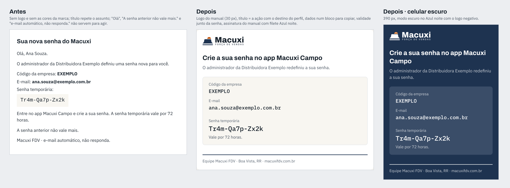
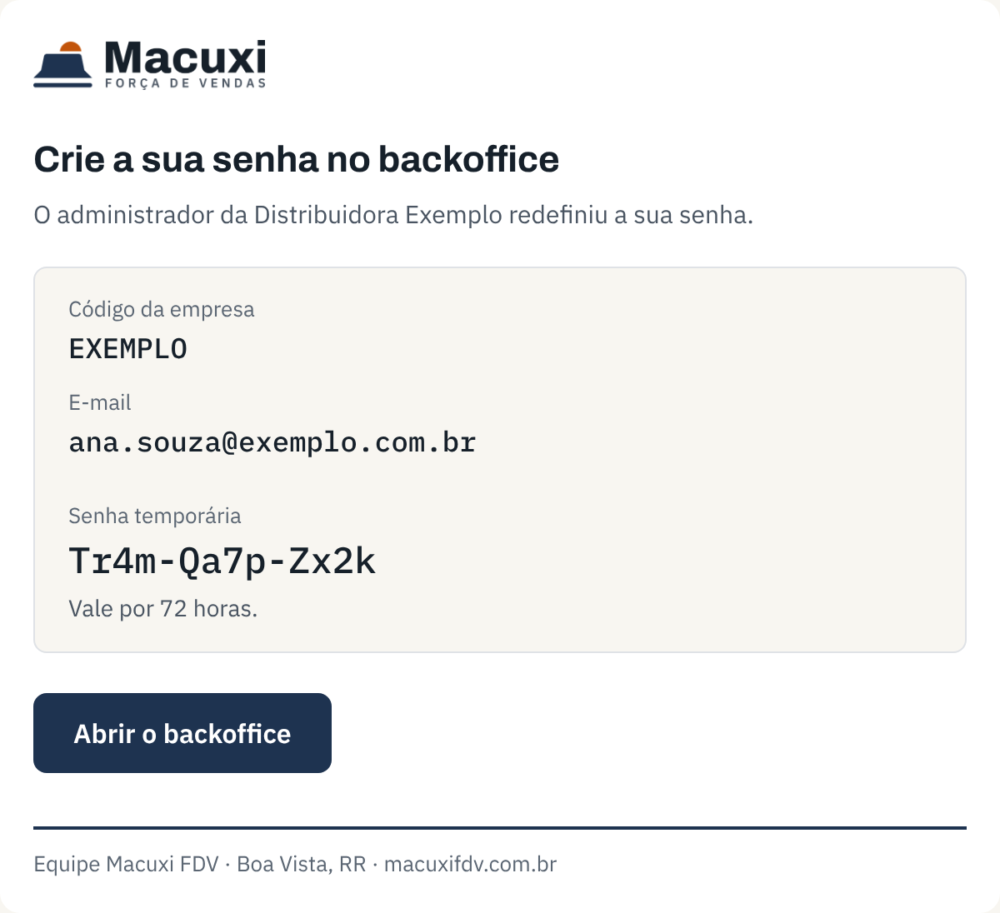

# E-mail "Senha temporária" (redefinir senha) e layout-base dos e-mails transacionais

> Pedido do Alexandre, R-20261114-200500-alexandre (chat de 14/11/2026, ~20h05, Manaus): "Avalie e ajuste o layout do email de
> reset de senha. Quero ele no padrao da marca sem redundancia e passado pelo ux design".
> Designer-ux, 14/11/2026. Base: `docs/marca/manual.md` §2, §3, §5 e §7; R-20261110-192153 (só o que o usuário usa para agir);
> R-20261110-093124 (uma informação, um lugar). Substitui o texto e o HTML de `docs/design/ciclo-de-senha.md` §8.
> Simulações: [`redefinir-senha/`](redefinir-senha/). Dados fictícios.



## 1. Avaliação do e-mail atual (`nova_senha`, motivo `redefinida`)

| Trecho atual | Decisão | Por quê |
|---|---|---|
| Sem logo, sem cor da marca, `#1f2933` no texto | **muda** | O manual §7 pede corpo branco, logo positivo com 30 px e filete Azul noite acima da assinatura. `#1f2933` não é da paleta: o texto passa a grafite `#16202A`. |
| Título "Sua nova senha do Macuxi" | **muda** | Repete o assunto, que o cliente de e-mail já mostra logo acima do corpo (uma informação, um lugar). Além disso, a senha não é a "nova": é a temporária. O título passa a dizer a ação e o destino. |
| "Olá, {NOME}." | **sai** | Não serve para agir. A conta já aparece no bloco de dados, no campo E-mail. O nome continua no `To:`. |
| "O administrador da {EMPRESA} definiu uma senha nova para você." | **fica, mais curta** | É o que mostra se o e-mail é legítimo e a quem perguntar (a empresa). Vira "O administrador da {empresa} redefiniu a sua senha." |
| "Código da empresa / E-mail / Senha temporária" | **fica, em destaque** | São os três campos do login. Cada valor fica numa linha só dele, em fonte mono, fácil de copiar. |
| "Entre no app Macuxi Campo e crie a sua senha." | **vira o título** | É a ação. Não aparece duas vezes. |
| "A senha temporária vale por 72 horas." | **fica, junto da senha** | É o prazo da ação. Vira "Vale por 72 horas.", dentro do bloco, logo abaixo da senha. |
| "A senha anterior não vale mais." | **sai** | Quem recebeu age igual com ou sem a frase: entra com a senha temporária. Se tentar a antiga, o login já recusa. "Redefiniu a sua senha" já diz isso. |
| "Macuxi FDV · e-mail automático, não responda." | **sai** | É o funcionamento do sistema, não uma ação, e o cabeçalho `Auto-Submitted: auto-generated` já marca o e-mail. Entra a assinatura do manual §7. |
| "Se não foi você, ignore este e-mail: a sua senha atual continua valendo." (motivo `esqueci`) | **fica só a primeira parte** | "Ignore" é a ação. "A sua senha atual continua valendo" é texto de garantia (R-20261110-192153). |
| "Se ela vencer, use "Esqueci a senha" na tela de entrada." (`acesso_inicial`) | **sai** | Não é para agir agora. O login já diz isso quando a senha vence (410 `SENHA_TEMPORARIA_VENCIDA`, `ciclo-de-senha.md` §1). |

## 2. Estrutura (de cima para baixo)

1. **Cabeçalho:** logo positivo (`macuxi-logo-positivo`) com 30 × 139 px, alinhado à esquerda, com 28 px de ar embaixo (área de proteção §2.3). Texto alternativo: **"Macuxi Força de Vendas"** (o `aria-label` do SVG), em Archivo 16/700 Azul noite, para aparecer bem quando a imagem vier bloqueada.
2. **Título** (Archivo 24/30, 700, grafite; no celular, 22/28): a ação com o destino do perfil (§4).
3. **Contexto** (IBM Plex Sans 15/22, `#4A5562`): uma linha que diz por que o e-mail chegou (§3).
4. **Bloco de dados** (fundo Pérola `#F8F6F1`, borda `#DFE2E6`, raio 8, 20 px de recuo). Em cada item, o rótulo vem em 13/18 `#5B6673` e o valor em IBM Plex Mono 17/24 500 grafite, numa linha só dele:
   - Código da empresa;
   - E-mail;
   - Senha temporária, em mono 22/30 700, a maior coisa do bloco;
   - "Vale por {n} horas." (14/20 `#4A5562`). Sai quando `validade_horas = null`.

   Os valores levam `user-select: all`: um toque seleciona o valor inteiro, onde o cliente aceita. Não há espaço antes nem depois do valor.
5. **Botão** (só quando o destino tem o backoffice e o endereço dele estiver configurado, §4): "Abrir o backoffice", feito com tabela e sem imagem, fundo Azul noite e texto branco 16/600, recuo 14 × 24 (48 px de altura), raio 8. É o único botão do e-mail. Nos apps não há link, porque o login é no app.
6. **Rodapé:** filete Azul noite de 2 px e, embaixo, **"Equipe Macuxi FDV · Boa Vista, RR · macuxifdv.com.br"** (13/18 `#5B6673`), como pede o manual §7.

Fundo externo Pérola, folha branca de até 600 px com raio 12 e recuo de 32 × 40 (no celular, 24 × 20, colada nas bordas).

**Contraste** (todos ≥ 4,5:1): no claro, grafite no branco 16,48; `#4A5562` no branco 7,59; `#5B6673` no Pérola 5,41; branco no Azul noite (botão) 12,77. No escuro, branco no Azul noite 12,77; `#C9CED5` no Azul noite 8,07; branco no `#3A4D68` 8,60; `#C9CED5` no `#3A4D68` 5,44.

## 3. Textos finais

**Assunto**
- `nova_senha`: **"Sua senha temporária do Macuxi"** (antes, "Sua nova senha do Macuxi").
- `acesso_inicial`: **"Seu acesso ao Macuxi"** (não muda).

**Título:** **"Crie a sua senha {destino}"** (§4), igual nos três casos.

**Contexto** (uma linha):

| Modelo / motivo | Texto |
|---|---|
| `nova_senha` · `redefinida` (BKO) | "O administrador da {empresa_nome} redefiniu a sua senha." |
| `nova_senha` · `redefinida` · `redefinida_por = 'macuxi'` (portal) | "O suporte da Macuxi redefiniu a sua senha na {empresa_nome}." |
| `nova_senha` · `esqueci` | "Foi pedida uma senha nova para o seu acesso na {empresa_nome}. Se não foi você, ignore este e-mail." |
| `acesso_inicial` (convite) | "A {empresa_nome} criou o seu acesso." + só com `campo` ou `gestao` no destino: " Ainda não tem o app? Peça ao administrador da sua empresa." |

**Bloco:** "Código da empresa", "E-mail", "Senha temporária" e "Vale por {validade_horas} horas.".
**Botão:** "Abrir o backoffice".
**Rodapé:** "Equipe Macuxi FDV · Boa Vista, RR · macuxifdv.com.br".

**Versão só texto** (`text/plain`, com o mesmo conteúdo; cada valor fica numa linha só dele, para copiar com um toque longo):
```
Crie a sua senha no app Macuxi Campo

O administrador da Distribuidora Exemplo redefiniu a sua senha.

Código da empresa
EXEMPLO

E-mail
ana.souza@exemplo.com.br

Senha temporária
Tr4m-Qa7p-Zx2k
Vale por 72 horas.

[Abrir o backoffice: https://<endereço do backoffice>]   ← só com o botão

--
Equipe Macuxi FDV · Boa Vista, RR · macuxifdv.com.br
```

## 4. Destino conforme o perfil

O texto **já** varia com `dados.apps`, que é `appsDosPerfis` de todos os perfis do usuário (`modules/core/api/email.ts`). O e-mail que o Alexandre recebeu dizia "app Macuxi Campo" porque a conta de teste tem perfil de Campo. O que muda aqui é só a forma (o título), e "backoffice" fica sem o "do Macuxi, pelo navegador".

| Perfis (`PERFIS_DO_APP`) | `apps` | Título | Botão |
|---|---|---|---|
| vendedor, promotor | `campo` | Crie a sua senha **no app Macuxi Campo** | — |
| supervisor | `gestao` | Crie a sua senha **no app Macuxi Gestão** | — |
| gerente | `gestao`, `web` | Crie a sua senha **no app Macuxi Gestão ou no backoffice** | Abrir o backoffice* |
| admin, analista, assistente | `web` | Crie a sua senha **no backoffice** | Abrir o backoffice* |
| admin + vendedor (mais de um perfil) | `campo`, `web` | Crie a sua senha **no app Macuxi Campo ou no backoffice** | Abrir o backoffice* |
| admin redefinido pelo portal sem acesso ao portal (`apps = []`) | — | Crie a sua senha **no Macuxi** | — |

\* Só quando o endereço do backoffice estiver configurado. Sem ele, não há botão e o título basta.
Ordem fixa: campo, gestão, web. Os destinos são unidos por " ou ".



## 5. Regras de e-mail (layout-base: vale para `nova_senha`, nos motivos `redefinida` e `esqueci`, e para `acesso_inicial`)

Um só layout para os três: muda só o assunto, o contexto e o título. Não há segundo padrão.

- **HTML com tabelas** (`role="presentation"`, `cellpadding/cellspacing/border = 0`) e **estilos inline** em tudo. O `<style>` do `<head>` serve só para melhorar onde o cliente aceita (celular e modo escuro). Sem `div` de layout, sem flex/grid, sem CSS externo, sem fonte remota (a pilha é `Archivo, Arial` / `'IBM Plex Sans', Arial` / `'IBM Plex Mono', Consolas, 'Courier New'`).
- **Largura:** tabela de 600 px com `width:100%; max-width:600px`. Abaixo de 620 px, o `@media` reduz o recuo e o título.
- **Modo escuro:** `<meta name="color-scheme" content="light dark">` e `supported-color-schemes`. No `@media (prefers-color-scheme: dark)`:
  - fundo e folha em Azul noite `#1E3350` (a folha não fica sobre grafite, porque o manual proíbe Azul noite sobre grafite);
  - títulos e valores em branco; textos e rótulos em `#C9CED5`;
  - bloco `#3A4D68` (o trilho do manual §4);
  - filete `#C9CED5`;
  - botão branco com texto Azul noite;
  - o logo troca para `macuxi-logo-negativo-azul-noite`: duas ``, `.mx-claro`/`.mx-escuro`, e a escura com `display:none` e `mso-hide:all`.

  Nos clientes que invertem as cores sozinhos (Gmail app, Outlook), o PNG positivo vai com fundo branco opaco, para o logo continuar legível.
- **Imagem:** só o logo, em PNG 2× (60 px de altura, mostrado com 30), servido por HTTPS com `width`/`height` no atributo e texto alternativo com estilo. Nada depende da imagem: sem ela, o e-mail continua completo. Nenhuma imagem com texto, nenhum rastreador.
- **Escapar** todo valor de `dados` (`escaparHtml`). Os valores ficam sem `<a>`. O `format-detection` e o `a[x-apple-data-detectors]` evitam que o iOS transforme o código em link. O Gmail ainda pode sublinhar o e-mail: isso é aceito.
- **Versão só texto** sempre (`multipart/alternative`), com o mesmo conteúdo, na ordem do §3.
- Sem pré-cabeçalho escondido: a prévia da caixa de entrada mostra o título, e assim nada se repete.
- Remetente: "Macuxi FDV" (não muda). A senha aparece uma vez só, no corpo. Nunca vai para link, assunto ou log (`renderizarEmailParaLog` continua com os marcadores).

## 6. Simulações (`redefinir-senha/`, Playwright, `deviceScaleFactor` 2, dados fictícios)

| Arquivo | O que é |
|---|---|
| `depois-desktop-claro.png` / `depois-desktop-escuro.png` | 600 px, vendedor, `redefinida` |
| `depois-celular-claro.png` / `depois-celular-escuro.png` | 390 px, vendedor, `redefinida` |
| `depois-backoffice-desktop-claro.png` | 600 px, admin, com o botão |
| `antes-desktop.png` / `antes-celular.png` | réplica do `montar()` atual |
| `comparativo-antes-depois.png` | antes × depois × celular escuro |
| `depois-campo.html`, `depois-backoffice.html`, `antes.html`, `comparativo.html` | HTML-fonte. Os `depois-*.html` são a referência do HTML de produção. |

As fontes da marca foram carregadas só no momento da captura. No Gmail e no Outlook, entra o Arial da pilha.

## 7. Quem implementa

`node scripts/coord.mjs dono apps/api/src/email/despachante.ts` → **engenheiro-software** (também é dono de `packages/platform-sdk/src/email/**` e de `apps/api/src/email/config.ts`).

| Dono | Arquivo | Função / item | O que muda |
|---|---|---|---|
| engenheiro-software | `packages/platform-sdk/src/email/modelos.ts` | `ASSUNTOS_EMAIL` | `nova_senha` → "Sua senha temporária do Macuxi" |
| engenheiro-software | idem | `ONDE_ENTRAR` / `ondeEntrar` | `web` → "no backoffice"; sem destino → "no Macuxi"; usado no título |
| engenheiro-software | idem | `RODAPE` | → "Equipe Macuxi FDV · Boa Vista, RR · macuxifdv.com.br" |
| engenheiro-software | idem | `montar` | troca a lista de `Linha` por um modelo estruturado (`{ titulo, contexto, dados[], validade?, botao? }`) que gera o HTML do §2 e §5 (base: `redefinir-senha/depois-campo.html`) e o texto do §3 |
| engenheiro-software | idem | `renderizarValidado` | sem "Olá"; contexto do §3 por modelo e motivo; sem "A senha anterior não vale mais." e sem "Se ela vencer…"; o fecho do `esqueci` sobe para o contexto |
| engenheiro-software | idem | `renderizarEmail`, `renderizarEmailParaLog`, `renderizarEmailSemSenha` | recebem opções de apresentação `{ urlLogo?, urlLogoEscuro?, urlBackoffice? }`. Sem `urlLogo`, entra o texto alternativo como texto, no mesmo lugar. Sem `urlBackoffice`, não há botão. |
| engenheiro-software | `packages/platform-sdk/src/email/modelos.test.ts` | testes dos modelos | assunto novo, título por destino (tabela do §4), ausência das frases que saem, valores escapados, versão só texto igual ao HTML |
| engenheiro-software | `apps/api/src/email/config.ts` | `lerConfigEmail` / `ConfigEmail` | variáveis opcionais `MACUXI_EMAIL_URL_ATIVOS` (base HTTPS dos PNG do logo) e `MACUXI_EMAIL_URL_BKO` (endereço do backoffice) |
| engenheiro-software | `apps/api/src/email/despachante.ts` | `criarDespachanteEmail` → `umEmail` | passa as opções de apresentação às três chamadas de renderização |
| engenheiro-software | `apps/api/src/email/despachante.test.ts`, `servico.test.ts` | — | ajuste aos textos novos |
| engenheiro-apps | `apps/web/public/email/` | ativos | publica `macuxi-logo-positivo-email.png` e `macuxi-logo-negativo-email.png` (servidos pelo BKO por HTTPS) |
| design-de-marca | `docs/marca/ativos/2026-11-12-v1/` | ativos | exporta os dois PNG 2× (60 px de altura): o positivo com fundo branco opaco e o negativo com fundo Azul noite |
| modulo-core | `modules/core/api/email.ts`, `usuarios.ts`, `autenticacao.ts`, `equipe-csv.ts` | — | nada muda: `dados.apps` já sai dos perfis |

`apps/api/src/email/mime.ts` não muda: o logo é servido por HTTPS e não vai como anexo (CID).

## 8. Pendências antes do lote
- **design-de-marca:** validar cores e layout (fundo Pérola externo, folha branca, modo escuro em Azul noite com bloco `#3A4D68`, logo no cabeçalho). Pergunta para o Alexandre: a assinatura do manual repete "Macuxi FDV", que o logo já mostra. Proposta: "Boa Vista, RR · macuxifdv.com.br". Fica a do manual até ele decidir.
- **corretor-redundancias:** parecer sobre os textos do §3 e o print `comparativo-antes-depois.png`.
