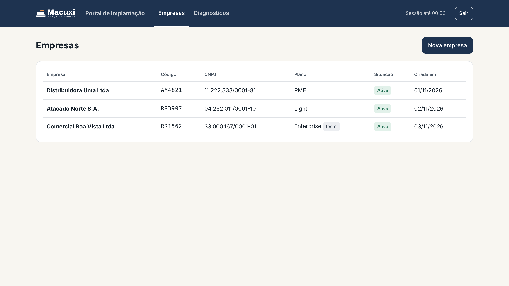
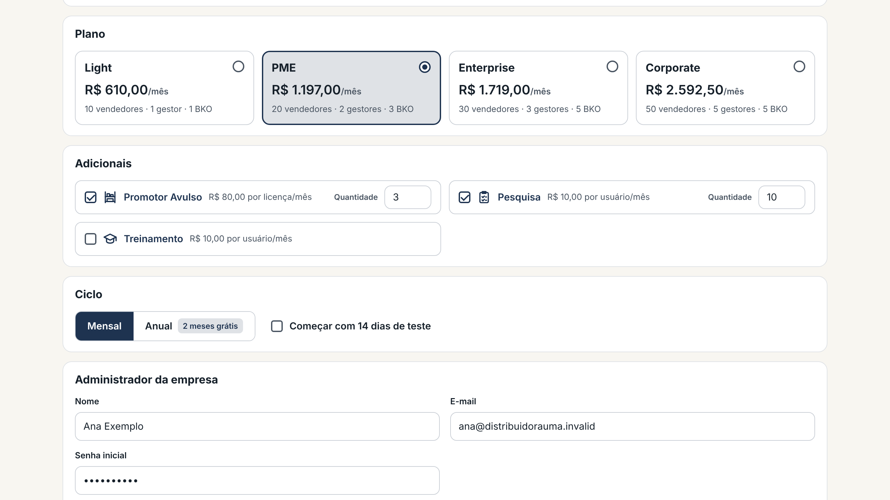
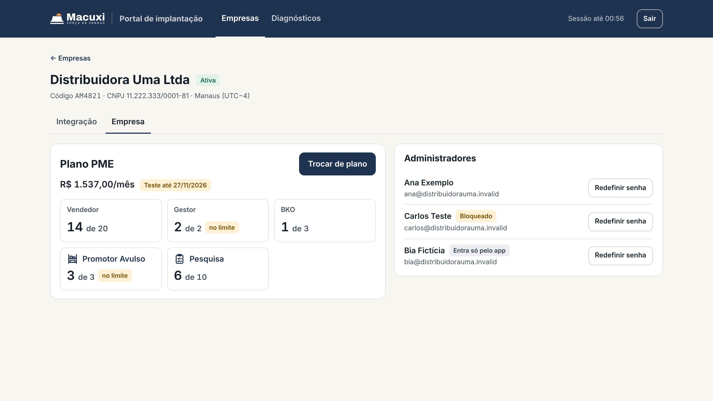
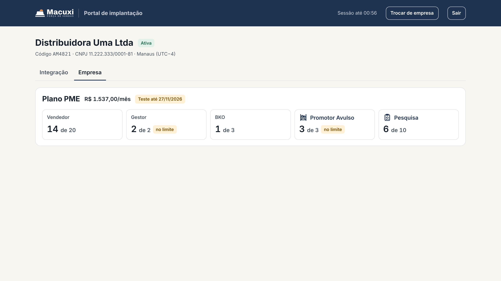
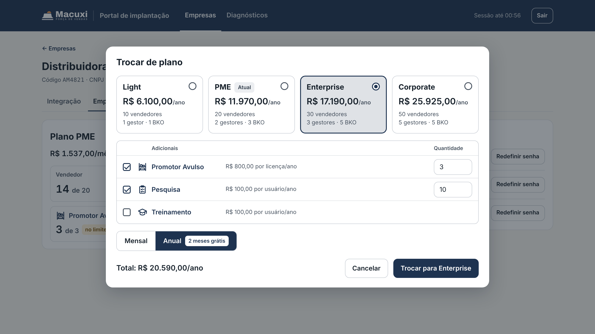
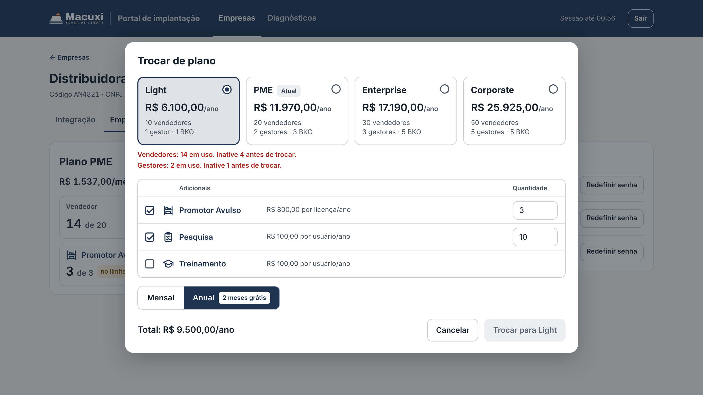

# Planos e assinatura no portal `config.`: inventário e simulação em 1366 × 768 (designer-ux)

**Situação:** Aprovada em 15/11/2026 (R-20261115-123000, delegação ao gerente).

> 2026-11-15 · designer-ux · lacuna achada na revisão: as migrações 0070 e 0071 (PR #334) estão no `main`, mas o portal não tem nenhuma tela de planos. Os **textos, regras e estados** destas telas são os do `docs/design/telas/portal-config-enxuto.md` §11, aprovados em 14/11 (R-20261114-170600 e R-20261114-181000). Esta spec não os repete: traz o inventário, as simulações em 1366 × 768 e o que falta para o código.

## 1. Inventário

| Camada | Tem | Falta |
|---|---|---|
| Banco, 0070 | `plataforma.plano` (catálogo), `plataforma.assinatura` (uma por empresa) e `sa_gravar_assinatura` (idempotente, só super-admin) | `sa_listar_planos`, `sa_assinatura_da_empresa`, `sa_trocar_plano`, `plataforma.assinatura_historico` e `plataforma.licencas_do_tenant()` (ADR 0047; desenho `docs/desenho/planos-e-licencas.md`) |
| Banco, 0071 | `sa_listar_tenants` devolve `plano`, `teste_ate` e `paga` | — |
| Seed | só os planos de teste da fixture (`db/seeds/fixtures/dois-tenants.ts`) | os 4 planos (Light, PME, Enterprise e Corporate). Sem eles, o catálogo fica vazio e nenhuma empresa nasce com plano |
| SDK (`packages/platform-sdk/src/planos.ts`) | contratos e regras puras (`valorDaAssinatura`, `fimDoTeste`, `conferirTrocaDePlano`, `conferirNovoUsuario`) | — |
| API (`apps/api/src/planos-portal.ts`) | as 4 rotas, atrás de `MACUXI_PLANOS` (desligado) | 3 das 4 rotas chamam funções que o banco ainda não tem; só o `POST` da empresa com plano acha a sua (`sa_gravar_assinatura`), e ele depende do catálogo |
| Portal (`apps/web/app/config/**`) | nada de planos: a Nova empresa ainda marca módulo por módulo | as telas da §2 |

## 2. Simulações

1366 × 768, escala 2, na fonte do sistema (manual da marca §5; o `portal.css` já sem `@font-face`). Estilo: o `portal.css` aprovado; o `planos.css` só ajusta a largura (conteúdo de 1174 px) e o erro da troca. Dados fictícios (Distribuidora Uma Ltda, `AM4821`).

| # | Tela (§ do `portal-config-enxuto.md`) | Depende de | Arquivo |
|---|---|---|---|
| 1 | Empresas, coluna Plano (§11.5) | 0071, já no `main` | `01-empresas.png` |
| 2 | Nova empresa: Plano, Adicionais e Ciclo (§11.3) | `sa_listar_planos` + seed | `02-nova-empresa.png` |
| 3 | Aba Empresa, super-admin (§11.4) | `sa_assinatura_da_empresa` | `03-aba-empresa.png` |
| 4 | Aba Empresa, admin do cliente (§11.4) | `sa_assinatura_da_empresa` | `04-aba-empresa-cliente.png` |
| 5 | Diálogo "Trocar de plano" (§11.4) | `sa_trocar_plano` | `05-trocar-plano.png` |
| 6 | Troca abaixo do uso, 422 `PLANO_ABAIXO_DO_USO` (§11.4) | `sa_trocar_plano` | `06-trocar-abaixo-do-uso.png` |

| Empresas | Nova empresa | Aba Empresa |
|---|---|---|
|  |  |  |

| Admin do cliente | Trocar de plano | Abaixo do uso |
|---|---|---|
|  |  |  |

O que muda em relação às simulações de 14/11:
- **Largura:** 1366 px em todas. A aba Empresa e o diálogo cabem sem rolagem. Na Nova empresa, a tela 2 mostra a página rolada até o cartão Plano; o "Criar empresa" fica no fim da página, abaixo da dobra (§11.1).
- **Tela 6 (nova):** Light escolhido para a empresa da ficha (14 vendedores e 2 gestores em uso); o principal desabilitado usa o `.btn.off` do portal (MC-0041).

Aprovadas: estas substituem `depois-03b`, `depois-06b`, `depois-06c` e `depois-06d` do `portal-config-enxuto.md`, e as §11.4, §11.5 e §13 apontam para cá.

## 3. Ordem para o código
1. **banco-dados:** as 3 funções, o histórico, a `licencas_do_tenant()` e o seed dos 4 planos.
2. **engenheiro-software:** ligar `MACUXI_PLANOS` no stack isolado e conferir as 4 rotas contra o banco.
3. **engenheiro-apps:** as telas 1 a 6 no portal. A tela 1 pode sair antes, porque só depende da 0071.
4. **modulo-core:** a trava RN-PLA-04 no cadastro de usuários do BKO.
5. **gerente-projetos:** as RN-PLA-01..06 no doc 03.

## 4. Perguntas ao Alexandre (respondidas em 15/11, R-20261115-123000)
1. **Simulações:** aprova as 6 telas em 1366 × 768?
2. **Edição do catálogo:** a ADR 0047 deixa preço e licenças só no seed, sem tela. Fica assim, ou quer uma página "Planos" no portal para o super-admin editar o catálogo? Se quiser, ela vira tarefa nova, com simulação própria.
3. **Ordem:** o engenheiro-apps pode publicar a coluna Plano (tela 1) antes das funções do banco?
4. **Texto do erro da troca (tela 6):** troca o texto aprovado em 14/11 ("O plano Light tem 10 licenças de vendedor e a empresa usa 14.") por "Vendedores: 14 em uso. Inative 4 antes de trocar." e "Gestores: 2 em uso. Inative 1 antes de trocar."? Se aprovar, a mensagem de `conferirTrocaDePlano` (`packages/platform-sdk/src/planos.ts`, do engenheiro-software) e o §11.4 mudam junto.

**Respostas:**
1. Sim: as 6 telas estão aprovadas.
2. O catálogo fica só no banco (seed), sem página "Planos" no portal e sem item no backlog.
3. Sim: a coluna Plano (tela 1) sai na v1.0.13.
4. Sim: o texto novo vale, uma linha por item. O SDK já foi ajustado (branch `nuvem/planos-v1013-engenheiro-software`) e o §11.4 do `portal-config-enxuto.md` está atualizado.

## 5. Premissas
- **Recados:** o repositório `aloirr/macuxifdv-recados` respondeu HTTP 403 nesta sessão; a caixa do designer-ux não foi lida. Valem as decisões do §11 do `portal-config-enxuto.md` e da ADR 0047.
