# ERP no portal `config.` — assistente da busca na API e painel dos 30 dias (designer-ux)

**Situação:** proposta para o corretor-redundancias e o design-de-marca; não codificar antes do parecer dos dois.

> 2026-11-22 · designer-ux · fatias F5 (assistente) e F6b (painel) de `docs/desenho/integracao-modelos-erp.md` (§4, §5 e §8,
> D1–D9 aprovadas em R-20261122-005500-alexandre), ADR 0066 e RN-INT-17 a 21 (doc 03). Pedido do dono do produto de 22/11/2026
> ("3 A": ERPs da F3 em diante, **sem ligar a busca**). Implementação: engenheiro-apps (F5b e F6c), depois da F3 do
> modulo-integracao (branch `nuvem/v1027-erp-modulo-integracao`, em paralelo; esta spec não depende dela).
> Simulações em `erp-assistente/` (HTML + PNG em 1280 e 390 px, escala 1; estilo de `portal-config-enxuto/portal.css` mais
> `erp-assistente/erp.css`; dados fictícios: Distribuidora Uma Ltda, `AM4821`, IP `203.0.113.10`, que é faixa de documentação).
> Onde conflitar, esta spec vale sobre `portal-config-enxuto.md` §10.2 só no lado "Integração via API".

## Regras aplicadas
1. Cartão = título + ação; nada do que o sistema faz por trás (cifra, recifra, carga semanal, tentativas 1-2-4-8-16 min).
2. Uma informação, um lugar: a data da credencial só na linha "Credencial salva…"; o "Trocar credencial" num lugar por estado.
3. Aviso só na área **"Alertas"** (topo do lado API e do painel), com a ação ao lado; resultado de teste e erro de campo ficam
   junto do botão ou do campo, como os estados do CNPJ (`portal-config-enxuto.md` §11.2).
4. Um só principal por tela: continua o "Gerar credencial" do Conector (§10.2). Tudo aqui é neutro (secundário).
5. Cor sempre com texto ou rótulo de acessibilidade.

## A. Assistente — aba Integração, lado "Integração via API"

O lado esquerdo (Conector) fica como está. O lado direito passa a começar pelo ERP; o que vem embaixo depende dele.
Abaixo de 768 px, empilhado como hoje: Conector primeiro, API depois.

### A.0 Alertas (só quando há)
Primeiro bloco do lado API, título **"Alertas"**. Hoje um alerta só:

| Quando | Texto | Ação |
|---|---|---|
| O ERP respondeu 401 ou 403 numa busca (RN-INT-20) | **"O ERP recusou a credencial em {dd/mm} às {hh:mm}. As buscas estão paradas."** | **"Trocar credencial"** (secundário pequeno; abre a troca no cartão 2) |

Tom `danger` (Notice do kit, com ícone). Enquanto ele aparece, o "Trocar credencial" da linha "Credencial salva…" sai
(uma ação, um lugar) e o "Testar conexão" também (a troca já leva ao teste). Some quando a credencial nova passa no teste.

### A.1 Cartão "1 Seu ERP"
Escolha única em cartões de 52 px (`GrupoOpcoesCartao` + `OpcaoCartao`), duas colunas (uma abaixo de 768 px):

| Opção | Linha de apoio | Embaixo aparece |
|---|---|---|
| **SAP Business One** | "Pela API" + selo **beta** | cartões 2 e 3 (busca) |
| **Sankhya** | "Pela API" + selo **beta** | cartões 2 e 3 (busca) |
| **TOTVS Protheus** | "Pelo Conector" + selo **beta** | cartão "2 Views do Protheus" |
| **TOTVS WinThor** | "Pelo Conector" + selo **beta** | cartão "2 Views do WinThor" |
| **Senior** | "Pelo Conector" + selo **beta** | cartão "2 Views do Senior" |
| **Outro ERP** | "O ERP envia ao Macuxi" | os cartões de hoje: "Gerar a credencial", "Guia" e "Credenciais" (§10.2) |

- **Selo "beta"** (`Badge tone="neutral"`, texto "beta"): vem do modelo (`ModeloErp`, campo de "confirmado"), não fixo na
  tela. Pela D9, todo modelo fica beta até o primeiro cliente daquele ERP confirmar; hoje os cinco.
- Vazio (nada escolhido): só o cartão 1. O escolhido fica gravado por empresa (`integracao.implantacao`); ao voltar, a tela
  abre no mesmo ponto.
- Decisão: "Outro ERP" é o caminho "O ERP envia ao Macuxi" da D4 (a), sem um segundo seletor. A tabela "Credenciais" (chaves
  do Hub) só aparece em "Outro ERP"; na busca ela confundiria com a credencial do ERP.
- Trocar de ERP com credencial salva: diálogo **"Trocar para {ERP}?"** / **"A credencial do {ERP atual} sai."** /
  "Cancelar" · **"Trocar"** (perigo).

### A.2 Cartão "2 Views do {ERP}" (Protheus, WinThor, Senior)
Link **"Baixar as views do {ERP} (.sql)"** (`db/conector/modelos/<erp>.sql`, F4b) e, embaixo, **"Siga a Integração via
Conector."** Nada mais. Sem o arquivo no servidor (404): **"Ainda não disponível neste servidor."** (constante única, §0).

### A.3 Cartão "2 Credencial do ERP" (SAP B1, Sankhya)
Campos (`CampoFormulario` + `CLASSE_CAMPO`; segredo em `CampoSenha` com `finalidade="criacao"` para o navegador não preencher
a senha do portal):

| ERP | Campos visíveis (gravados em claro) | Segredo (só escrita, RN-INT-18) |
|---|---|---|
| SAP Business One | **Endereço do Service Layer** (placeholder `https://servidor:50000/b1s/v1`) · **Banco da empresa** (placeholder "ex.: SBO_EMPRESA") · **Usuário** | **Senha** |
| Sankhya | **Endereço da API** (vem `https://api.sankhya.com.br`) · **Usuário** | **Senha** · **Appkey** |

Embaixo dos campos: **"Libere este IP no ERP: {ip}"** + **"Copiar"** (vira "Copiado"). O IP vem do servidor (D7).
Depois: **"Testar conexão"** (secundário) e, ao lado, o resultado.

**Credencial salva:** os campos de segredo somem e no lugar fica a linha **"Credencial salva em {dd/mm/aaaa} às {hh:mm}"** +
**"Trocar credencial"** (secundário pequeno). Nunca volta valor, máscara, tamanho nem final do segredo. "Trocar credencial"
reabre os campos de segredo vazios com **"Cancelar"**; a credencial antiga vale até a nova passar no teste.

**Estados**

| Estado | Tela | Texto |
|---|---|---|
| Vazio | cartão 1 só | — |
| Preenchendo | campos, IP, "Testar conexão" habilitado | — |
| Erro de validação (no toque em "Testar conexão") | borda `danger` + erro embaixo do campo, nada é enviado | **"Use um endereço https da internet."** (sem https, IP privado, `localhost`, usuário na URL) · **"Informe o banco da empresa."** · **"Informe o usuário."** · **"Informe a senha."** · **"Informe a appkey."** |
| Testando | botão "Testando…" desabilitado com indicador | — |
| Teste OK | ✓ verde + texto; o segredo vira a linha "Credencial salva…"; aparece o cartão 3 | **"Conexão OK."** |
| Teste falhou | ícone + texto `danger` ao lado do botão; nada é gravado | ver tabela abaixo |
| 401/403 parado | área "Alertas" (A.0) | — |

Motivos do teste que falhou (uma frase, com a ação):

| Causa | Texto |
|---|---|
| 401/403 no login | **"O ERP recusou o usuário ou a senha. Confira e teste de novo."** |
| Tempo esgotado, rede, 5xx | **"O ERP não respondeu. Confira o endereço e se o IP está liberado."** |
| 404 no endereço | **"Endereço não encontrado no ERP. Confira o endereço."** |
| 429 | **"O ERP pediu para esperar. Teste de novo em {n} min."** |
| Endereço recusado pela API (SSRF) | o mesmo erro de campo "Use um endereço https da internet." |
| Base sem um campo do modelo | uma linha por base: **"{Base}: falta o campo {campo} no ERP."** |
| Campo do UUID do pedido ausente (D8) | não é falha: o teste passa e a caixa de pedidos do cartão 3 fica desabilitada (A.4) |

O teste nunca mostra dado lido do ERP (§4 do desenho).

### A.4 Cartão "3 Bases e frequência" (aparece com a credencial salva)
Tabela **[caixa] · Base · Frequência**, na ordem de carga, com os nomes de `NOME_DA_BASE` (`apps/web/lib/portal-bases.ts`).
- Frequência: `select` com **15 min · 30 min · 45 min · 1 h · 2 h · 3 h · 4 h · 6 h · 8 h · 12 h · 1 vez por dia**
  (todas múltiplas de 15, de 15 min a 1 dia, RN-INT-17; a API revalida com `problemaFrequenciaColeta`). Padrão do §2.3 do
  desenho: preço, estoque e notas 15 min; cliente, endereço, produto, unidade e título 1 h; o resto 1 vez por dia.
- Base desmarcada: a frequência fica desabilitada com "—".
- Base que já vem de outro Conector (RN-INT-13): caixa desabilitada e, embaixo do nome, **"No Conector {id}"**.
- **"Envia os pedidos aprovados ao ERP"** (marcada). Sem o campo do UUID no ERP (D8): desabilitada, com **"Falta o campo
  {campo} no ERP."** embaixo (`U_MXUUID` no SAP B1, `AD_MXUUID` na Sankhya).
- **"Gravar"** (secundário) → "Gravando…" → ao lado, **"Gravado."** em `success`, que some na próxima mudança. Sem nenhuma
  base marcada, "Gravar" desabilitado.
- Sai da tela (fica na spec e na API): a carga completa semanal, a janela de sobreposição e os limites de coleta.

### A.5 Prints
| Estado | 1280 px | 390 px |
|---|---|---|
| Vazio | 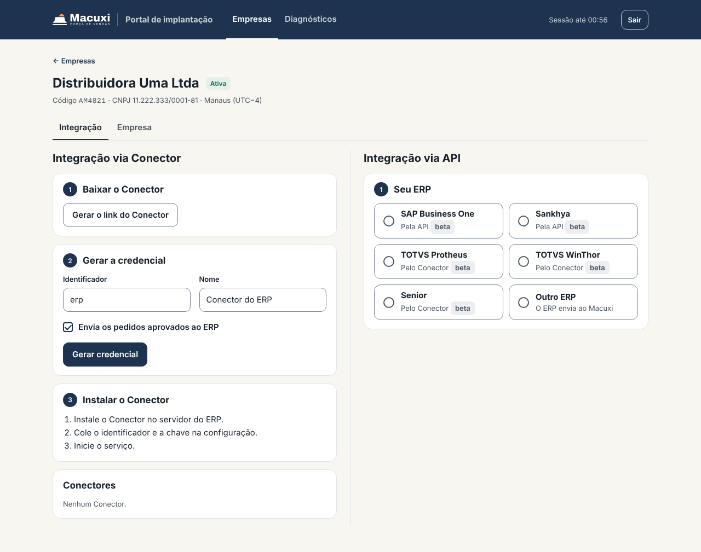 | 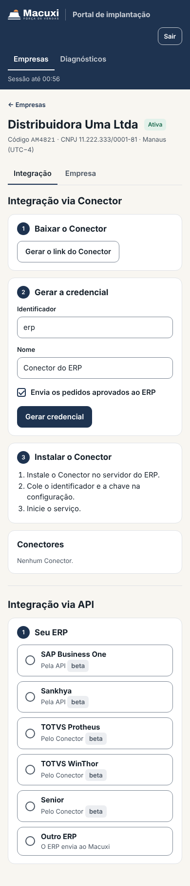 |
| Preenchendo (SAP B1) | 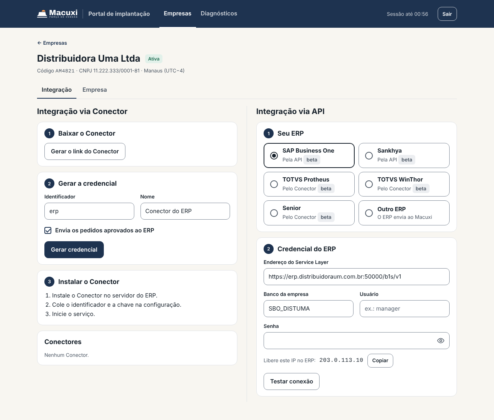 | |
| Preenchendo (Sankhya) | 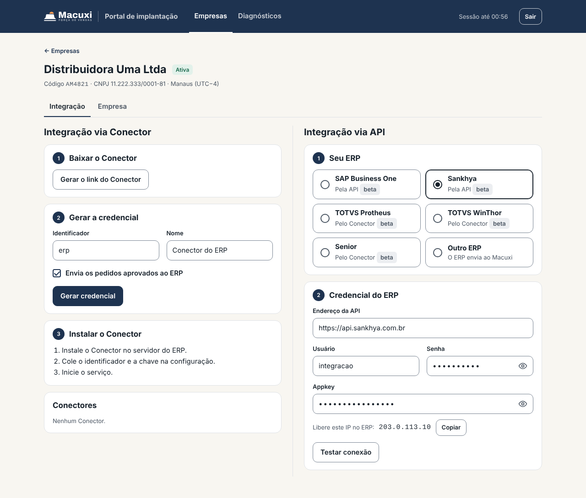 | |
| Erro de validação | 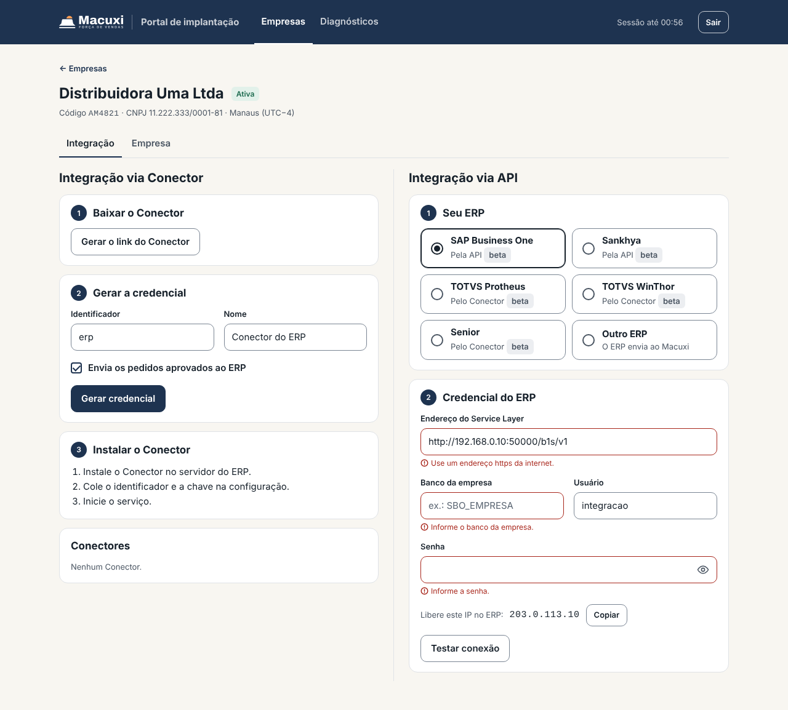 | 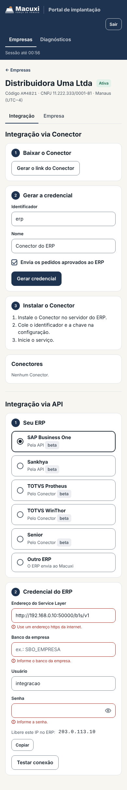 |
| Testando | 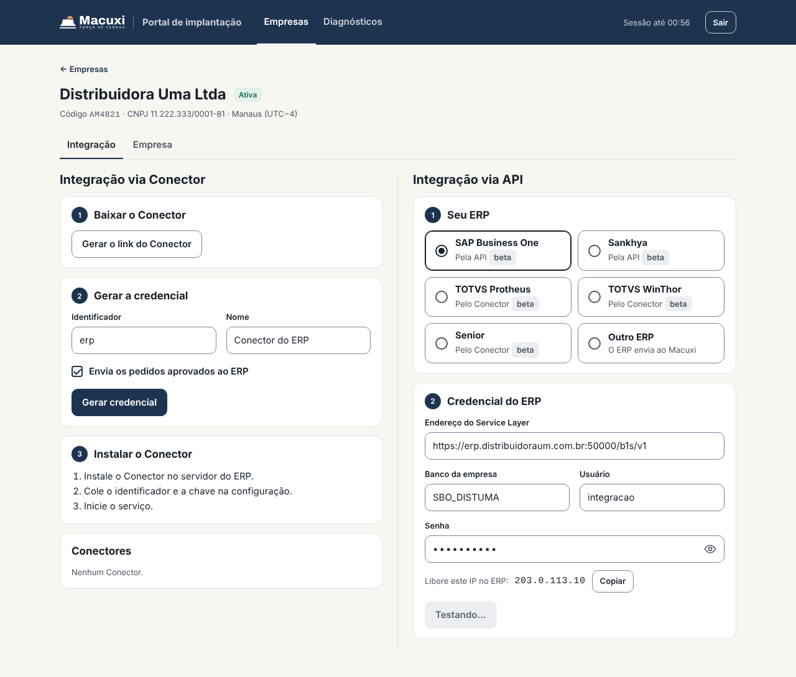 | |
| Teste OK | 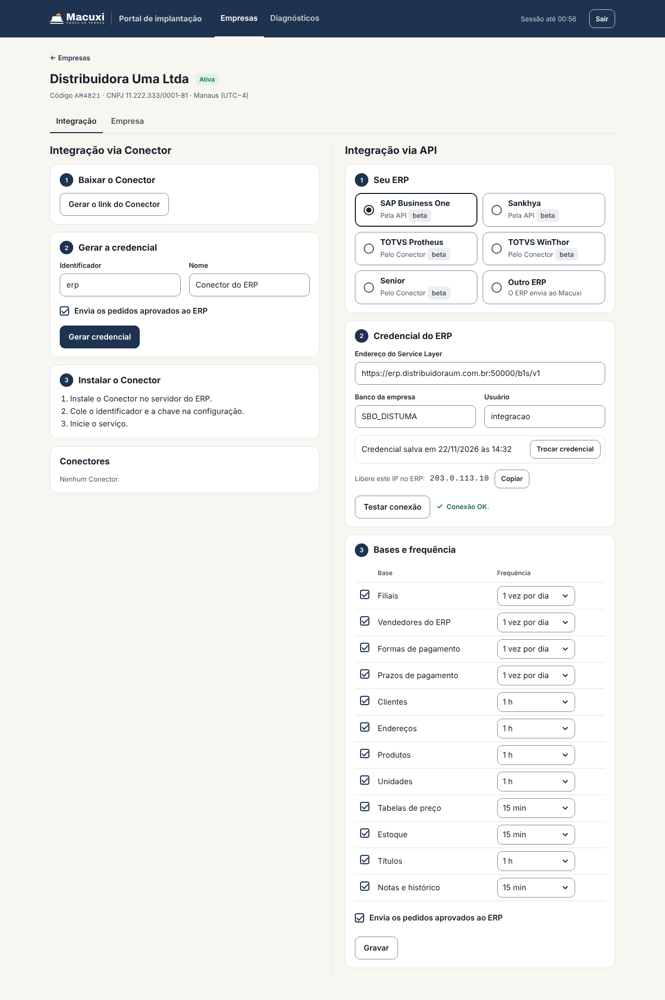 | 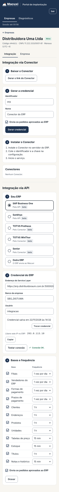 |
| Teste falhou | 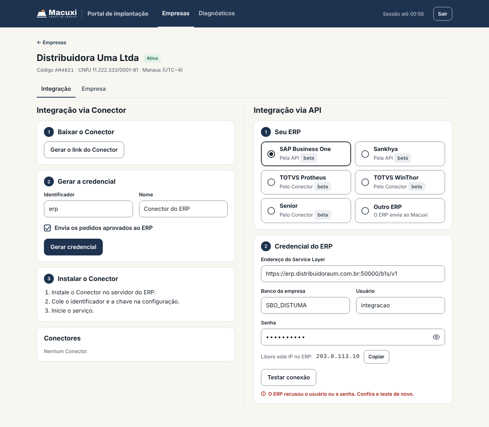 | |
| 401/403 parado | 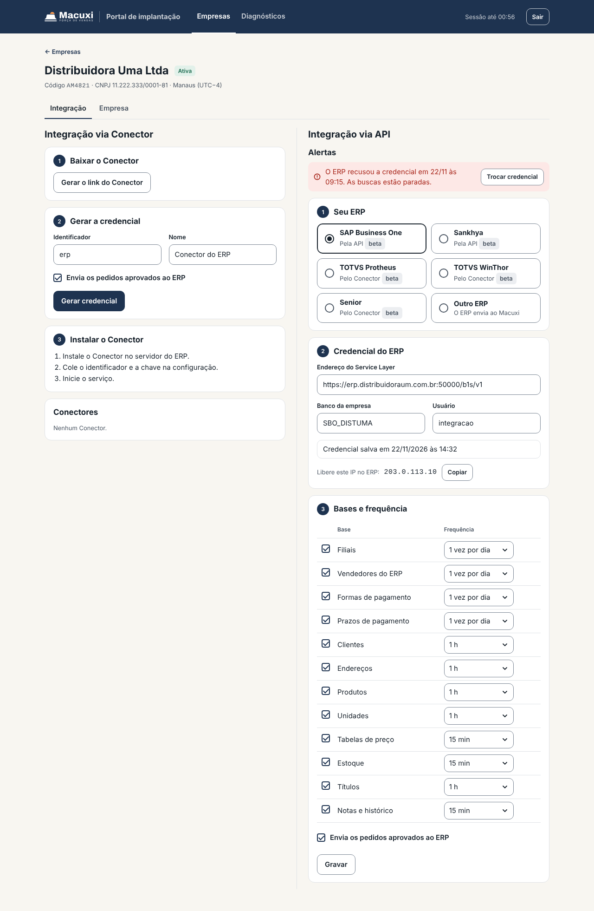 | 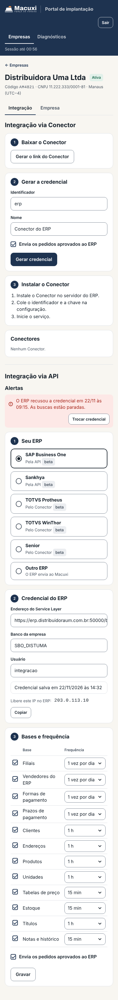 |
| ERP pelo Conector (Protheus) | 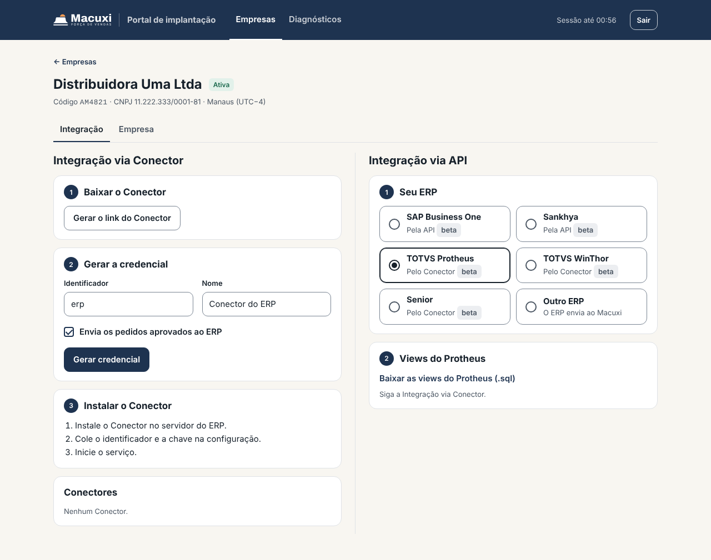 | |

Fora desta spec (próximas fatias do §4 do desenho): "Iniciar carga completa" com o andamento por base, "Buscar agora" e os
de-para mínimos (forma e prazo, depósito → filial, tabela padrão).

## B. Painel dos 30 dias — aba "Implantação"

Aba nova na página da empresa, entre "Integração" e "Empresa": **"Integração · Implantação · Empresa"**. Aparece da primeira
carga completa (D+0) em diante; antes disso não existe. "Integração" continua abrindo por padrão. Super-admin e admin do
cliente veem **a mesma tela** (D6); não há botão de editar nela, então o admin do cliente só lê (RN-INT-21).

1. **Cartão do dia:** **"D+{n}"** grande + **"de 30"**, barra de progresso (n/30) e, embaixo, **"Começou em {dd/mm/aaaa} ·
   termina até {dd/mm/aaaa}"**. Concluída: **"Concluída"** + selo **"D+{n}"** e **"{início} a {fim}"**, sem barra.
2. **"Marcos"** (esquerda, 1,25 : 1): cinco linhas, na ordem: **Primeira carga completa · Primeiro pedido integrado ·
   Primeiro faturamento devolvido · 3 reconciliações seguidas sem divergência · 7 dias seguidos sem alerta**. Cumprido: ✓
   verde (`role="img" aria-label="Cumprido"`) e a data **"dd/mm"** em `success`. Pendente: círculo vazio
   (`aria-label="Pendente"`) e o andamento quando houver contagem (**"2 de 3"**, **"0 de 7"**); sem contagem, "—".
3. **"Alertas"** (direita; só com alerta aberto; sem alerta o bloco some e os Marcos ocupam a largura): uma linha por
   alerta, tom `warning` (atraso) ou `danger` (recusa, erro), com **"Abrir no Monitor"** (link para o Monitor do BKO, já
   filtrado). Textos: **"{Base} sem carga há {tempo}."** · **"{n} pedidos recusados pelo ERP."** · **"{n} linhas com erro
   em {Base}."** · **"{n} divergências na reconciliação de {Base}."** · **"O ERP recusou a credencial. As buscas estão
   paradas."** (este com o link **"Abrir a Integração"** no lugar do Monitor: o painel não edita nada).
   - Decisão: os blocos Saúde, Cargas, Erros, Reconciliação e Pedidos do §5 do desenho entram como alerta quando pedem ação,
     e o detalhe fica no Monitor ("o painel não repete o Monitor"). Gráfico por dia fica para depois do primeiro cliente.
4. Abaixo de 768 px: dia, Marcos e Alertas empilhados.

| Estado | 1280 px | 390 px |
|---|---|---|
| Em andamento (super-admin) | 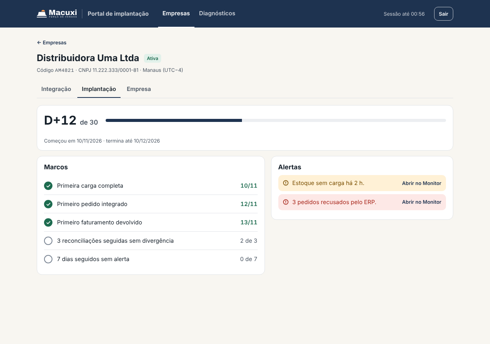 | 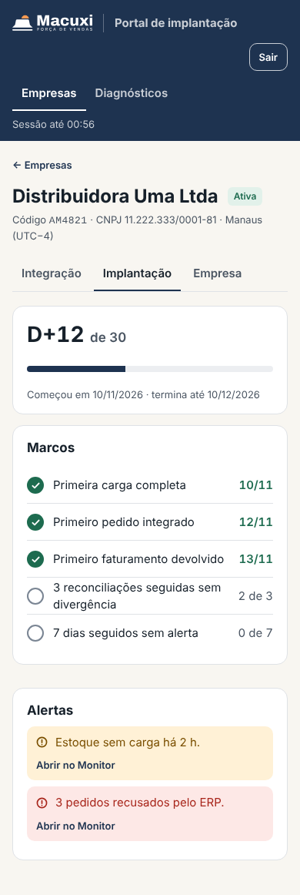 |
| Admin do cliente (só leitura) | 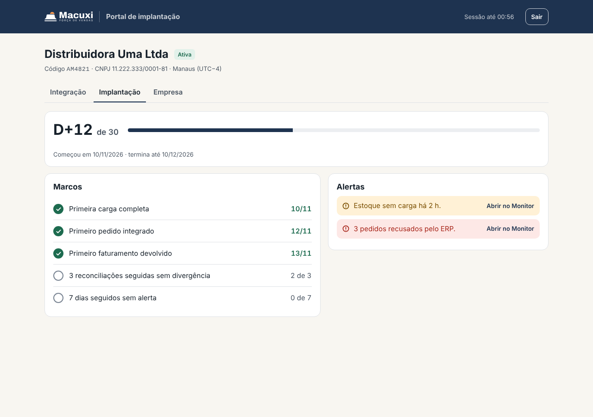 | |
| Concluída | 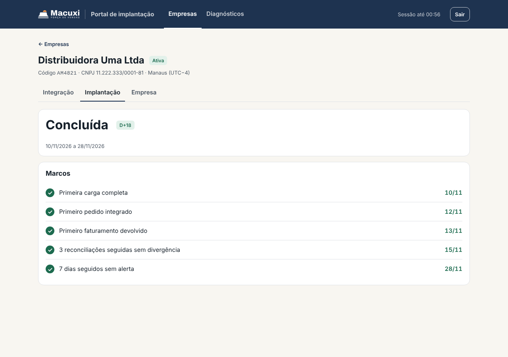 | |

## C. Para o engenheiro-apps

**Interruptor da busca:** a busca entra **desligada** (pedido de 22/11: sem ligar). Proposta: variável do servidor
`MACUXI_BUSCA_ERP`, no mesmo padrão do `MACUXI_PLANOS` (desligado = as rotas novas respondem 404). Desligado: o lado API
fica exatamente como hoje (§10.2) e a aba "Implantação" não aparece. O portal decide pelo 404 da leitura da configuração e da
implantação, sem sondar a cada toque. Nome final da variável com o engenheiro-software/modulo-integracao.

**Componentes e tokens (todos já existem em `packages/ui/src/web`; nada novo no kit):**
- `GrupoOpcoesCartao`, `OpcaoCartao` (cartão 1) · `Badge tone="neutral"` (beta) · `CampoFormulario` + `CLASSE_CAMPO` (campos)
  · `CampoSenha` `finalidade="criacao"` com olho (segredos) · `Button` `secondary`/`sm`/`danger` · `Notice` (Alertas) ·
  `Progresso` (barra do dia; `rotulo="Dia da implantação"`, `textoValor="D+12 de 30"`) · `IconCheck`, `IconAlert` ·
  `th`/`td` (tabela de bases) · diálogo do `overlay`.
- Tokens: borda de campo e de secundário `field` `#7A8593`; linha `line` `#DFE2E6`; `success` `#1D6B4F`/`success-soft`;
  `warning` `#7A4F00`/`warning-soft`; `danger` `#A8261B`/`danger-soft`; `neutral-soft` `#ECEEF1` (selo beta, desabilitado);
  `accent` `#1E3350` (número do passo, barra).

**Rotas** (nomes de trabalho, conforme o desenho §2.2–§2.5 e §5 e a ADR 0066; confirmar com o modulo-integracao na F3):
| Uso | Rota | Ação |
|---|---|---|
| Ler modelos (ERP, meio, beta, campos pedidos, bases e frequência padrão) | `GET /integracao/erp-api/modelos` | — |
| Ler a configuração (ERP, URL, usuário, parâmetros não secretos, `credencial_salva_em`, frequências, alerta 401/403) | `GET /integracao/erp-api` | `integracao.erp_api.editar` |
| Testar e, se OK, gravar a credencial | `POST /integracao/erp-api/testar` | `integracao.erp_api.testar` |
| Gravar ERP, bases, frequências e pedidos | `PUT /integracao/erp-api` | `integracao.erp_api.editar` |
| IP de saída | no `GET /integracao/erp-api` (`ip_saida`) | — |
| Views do ERP | `GET /integracao/conector/modelos/:erp` (presign, como o download do Conector) | — |
| Painel | `GET /v1/plataforma/empresas/:tenant_id/implantacao` (desenho §5) | leitura (ADR 0047) |

Nenhuma resposta traz o segredo (RN-INT-18); o portal nunca guarda o segredo fora do campo, nem em `localStorage`, log ou
diagnóstico. Simular no `apps/web/lib/portal-falso.ts` (resposta 404 com o interruptor desligado).

**data-testid sugeridos**
- Assistente: `erp.alertas`, `erp.alerta-credencial`, `erp.alerta-trocar` · `erp.modelo` (grupo) e `erp.modelo-<sap|sankhya|protheus|winthor|senior|outro>` ·
  `erp.views-baixar` · `erp.campo-url`, `erp.campo-banco`, `erp.campo-usuario`, `erp.campo-senha`, `erp.campo-appkey` ·
  `erp.credencial-salva`, `erp.trocar-credencial`, `erp.trocar-cancelar` · `erp.ip`, `erp.ip-copiar` · `erp.testar`,
  `erp.teste-resultado` (com `data-estado="testando|ok|falha"`) · `erp.bases`, `erp.base-<entidade>`,
  `erp.frequencia-<entidade>`, `erp.pedidos`, `erp.gravar`, `erp.gravado` · `erp.trocar-erp-confirmar`.
- Painel: `empresa-aba-implantacao` · `implantacao.dia`, `implantacao.marcos`, `implantacao.marco-<carga|pedido|faturamento|reconciliacao|sem-alerta>`
  (com `data-cumprido`), `implantacao.alertas`, `implantacao.alerta-<n>`, `implantacao.monitor-<n>`.

## Premissas
1. O selo "beta" vale para todo modelo ainda não confirmado (D9), não só para os do Conector; vem do contrato.
2. "Outro ERP" leva ao caminho "O ERP envia ao Macuxi" (D4 a) e mantém as chaves do Hub como hoje.
3. O segredo só é gravado com o teste OK (RN-INT-18): por isso não há botão "Salvar credencial"; o "Testar conexão" grava.
4. Os nomes das rotas, do interruptor e do campo "confirmado" do modelo são propostas até a F3.
5. "Abrir no Monitor" abre o BKO da empresa; para o super-admin, o acesso segue a regra de suporte de hoje.
