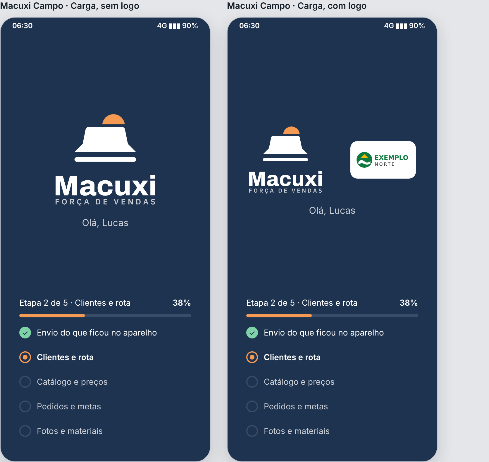
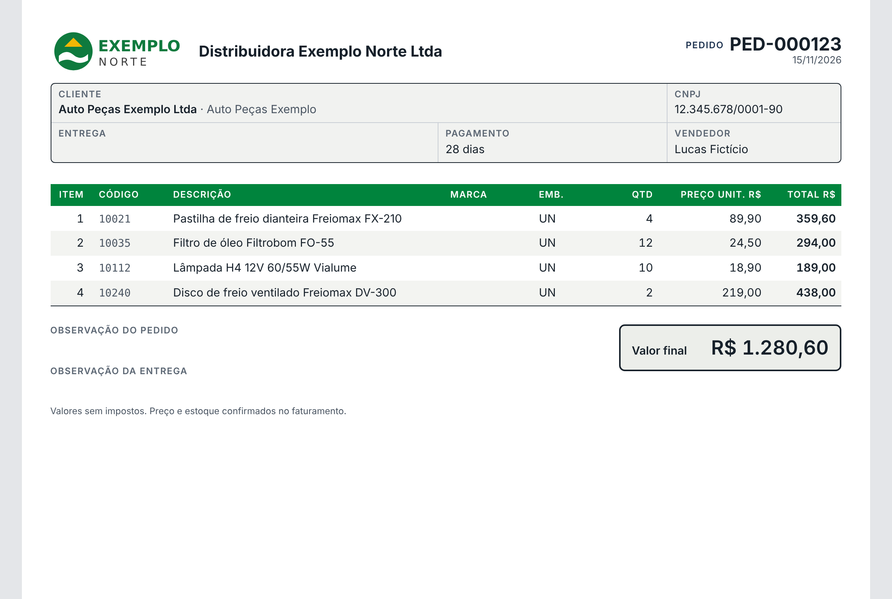
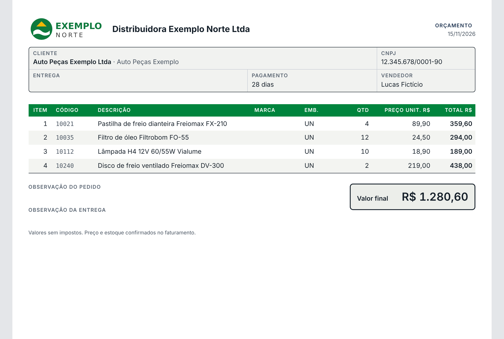

# Logo do cliente: cadastro no portal `config.` e onde aparece (simulação)

> 2026-11-15 · designer-ux · pedido do dono do produto R-20261114-223000-alexandre (pelo gerente-projetos): mostrar a
> logo do cliente (a distribuidora). **Agora é só a simulação.** A implementação fica para depois do build da v1.0.9.
> Simulações em `docs/design/telas/logo-cliente/`: HTML + PNG (Playwright, deviceScaleFactor 2). Celular a 360 dp;
> portal a 1366 px; PDF em A4 paisagem.
>
> **Dados fictícios:**
> - empresa: razão social "Distribuidora Exemplo Norte Ltda", nome fantasia "Exemplo Norte", código `AM4821`,
>   CNPJ 11.222.333/0001-81;
> - logo: `logo-ficticia-exemplo-norte.svg`;
> - pedido: cliente "Auto Peças Exemplo".
>
> Nada disso vai para código, seed nem teste como dado real.
>
> **Decisões** (R-20261114-223500 e R-20261114-234500-alexandre; MC-0066 e MC-0067, parecer do design-de-marca
> `docs/marca/pareceres/2026-11-15-lote-noite.md`, parte 2, lote 13): carga com a logo ao lado (§3), login e telas de
> senha sem logo (§4), placa 52/36 e nome fantasia no Mais (§5). O portal e os PDFs ficam como nesta simulação.

## 0. O que existe hoje no `main` (busca em `db/`, `modules/` e `apps/`)

**Não existe cadastro de logo do cliente.**
- **Banco:** nenhuma coluna nem tabela de logo (`db/migrations`, `plataforma.tenant` desde a 0001).
- **API:** nenhuma rota recebe ou serve a logo (`apps/api`).
- **Portal e BKO:** nenhuma tela de logo (`apps/web/app/config/**`, `apps/web/components/portal/**`).
- **App:** nenhuma tela com logo do cliente (`apps/mobile`).
- **O único ponto pronto** é o PDF: `OrderPdfContext.logo_src` (`modules/vendedor/domain/pdf-pedido.ts:124`) usa
  `LOGO_PADRAO_DATA_URI` quando vem vazio (linha 332). O comentário do campo diz: *"Hoje o tenant não tem o campo: vale
  sempre a padrão."* Há teste da troca (`pdf-pedido.test.ts:421`).

## 1. Regras de todas as superfícies

- **Uma logo por empresa** (tenant). Sem logo, cada lugar volta a ser como é hoje (§3, §5 e §6); nenhum lugar mostra espaço
  vazio nem "sem logo".
- **Placa branca no app:** a logo do cliente fica sempre numa placa branca (`#FFFFFF`, raio 12, borda `#DFE2E6` 1 px sobre o
  Pérola; sem borda sobre o Azul noite). Logo de cliente costuma ter fundo branco ou cores escuras, e some no Azul noite.
  Com a placa, uma regra serve para os dois fundos e para PNG transparente ou JPG com fundo.
- **Nunca recortar nem esticar:** a logo cabe na caixa (`contain`), com a proporção dela.
- **Nunca alterar a logo do cliente:** sem recolorir, sem sombra, sem filtro.
- **Sem texto de explicação** junto da logo ("sua marca aqui", "a logo aparece em…"); R-20261110-192153.
- **Offline:** o app guarda a logo no aparelho na carga, junto do resto da empresa, e usa a cópia guardada sem rede.
- **Acessibilidade:** a logo tem o rótulo "Logo da <nome fantasia>". No fim do Mais ela é decorativa (a frase acima já diz
  o nome), então fica sem rótulo, para o leitor não ler o nome duas vezes.

## 2. Portal `config.`: cadastro da logo

Fica **só no portal `config.`**: na página da empresa, aba **Empresa**, um cartão **"Logo"**, o primeiro da aba. O BKO
não tem esse cadastro.

**Quem grava e quem vê** (RN-CORE-33; decisão do gerente-projetos, T-0182, sobre o pedido "cadastrado só no portal
config. (super-admin)"):
- **Super-admin (time da Macuxi):** grava a logo e o nome fantasia; vê o cartão com todos os estados da tabela abaixo.
- **Administrador do cliente:** vê a aba Empresa **só para leitura**: a caixa com a logo salva (ou a caixa vazia do
  estado 1) e o nome fantasia como texto, **sem nenhum botão** (Enviar logo, Salvar, Cancelar, Trocar, Remover) e **sem a
  linha dos limites**. Não há aviso de "só leitura" nem de "fale com a Macuxi" (R-20261110-192153).

| Simulação | Arquivo |
|---|---|
| Página com a logo salva |  `portal-tela.png` |
| Os estados do cartão |  `portal-estados.png` |

**Cartão "Logo":** título; à esquerda, a caixa da pré-visualização (240 × 96 px, branca, borda `#DFE2E6`, raio 12,
12 px de folga, logo em `contain`); à direita, os botões; embaixo, a linha dos limites.

| # | Estado | Caixa | Botões | Linha de baixo |
|---|---|---|---|---|
| 1 | Sem logo | tracejada `#C9CED5`, fundo Pérola, vazia | **Enviar logo** (secundário) | limites |
| 2 | Arquivo escolhido | a logo nova | **Salvar** (principal) · **Cancelar** | limites |
| 3 | Salvando | a logo nova | **Salvando…** e Cancelar desabilitados | limites |
| 4 | Logo salva | a logo salva | **Trocar** (secundário) · **Remover** (secundário, texto `#A8261B`) | limites |
| 5 | Arquivo recusado | volta ao estado anterior (vazia ou com a logo salva) | os do estado anterior | o erro, no lugar dos limites |
| 6 | Remover | — | diálogo **"Remover a logo?"** com **Cancelar** e **Remover** (perigo) | — |

- **Envio:** "Enviar logo" e "Trocar" abrem o seletor de arquivo do sistema, filtrado em PNG e JPG. Nada de "Choose
  File / No file chosen" na tela (portal-config-enxuto, regra 3).
- **Pré-visualização:** o arquivo escolhido aparece na caixa **antes de salvar** (estado 2). Só "Salvar" grava. "Cancelar"
  volta ao que estava.
- **Troca:** "Trocar" → escolhe o arquivo → estado 2 com a logo nova → "Salvar". A antiga sai quando a nova é salva. Não
  há diálogo de confirmação: a pré-visualização já é a conferência.
- **Remoção:** "Remover" → diálogo sem texto de corpo → "Remover" volta ao estado 1. Os lugares das §3, §5 e §6 voltam a ser
  como são hoje.
- **Limites** (linha de baixo, `#4A5562` 13 px): **"PNG ou JPG · até 1 MB · pelo menos 200 px de altura"**.
  - **PNG ou JPG:** o `Image` do app e o PDF mostram os dois sem biblioteca nova. SVG fica fora, porque pode levar
    script e o app precisaria do `SvgXml` para cada logo.
  - **1 MB:** a logo vai para cada aparelho na carga.
  - **200 px de altura:** a altura mínima para a logo sair nítida no PDF (16 mm ≈ 190 px a 300 dpi).
- **Erros** (só para o super-admin; uma frase com a ação, `#A8261B` 13 px semibold, com o ícone de alerta; erro do arquivo, nunca do servidor
  em inglês):
  - formato: **"Use um arquivo PNG ou JPG."**;
  - tamanho: **"O arquivo passa de 1 MB. Envie um menor."**;
  - altura: **"A imagem tem menos de 200 px de altura. Envie uma maior."**;
  - lado máximo (4096 px de largura ou de altura, `LOGO_LADO_MAXIMO`): **"A imagem passa de 4096 px de largura ou
    altura. Envie uma menor."**;
  - falha ao salvar: **"Não foi possível salvar. Tente de novo."**;
  - rota ausente no servidor: **"Ainda não disponível neste servidor."** (a constante única do portal, RD-0288).
- **Teclado e leitor:** os botões são `button` com foco visível (`outline` Azul noite); o erro é região viva
  (`aria-live="polite"`); a pré-visualização tem `alt` "Logo da <nome fantasia>".

## 3. Carga do app (entrada com sincronização)

Cada imagem mostra a tela sem logo e a tela com logo:

| Campo | Gestão |
|---|---|
|  `carga-campo.png` |  `carga-gestao.png` |

- **As duas telas de cada imagem mostram o mesmo momento** (depois do login, etapa 2 de 5): a única diferença entre
  elas é a logo do cliente.
- **Sem logo:** igual a hoje (`docs/design/entrada-sync.md`): o logo empilhado da Macuxi a 170 dp de largura, no centro,
  com "Olá, Lucas", a barra e as etapas.
- **Com logo:** a logo do cliente fica **ao lado** do logo Macuxi, na mesma linha, centralizada:
  - logo Macuxi (empilhado) com 124 dp de largura (~115 dp de altura);
  - filete de 1 × 64 dp com 24 dp de cada lado (a altura do "M", fora da área de proteção): `#3A4D68` no Campo e
    `#DFE2E6` no Gestão;
  - placa branca (§1) de 64 dp de altura e até 112 dp de largura, com a logo de 48 × até 96 dp em `contain`; no Gestão,
    com a borda `#DFE2E6`;
  - largura total: 124 + 24 + 1 + 24 + 112 = 285 dp, dentro dos 312 úteis.

  O resto da tela não muda: "Olá, Lucas", a barra, as etapas e o erro.
- **A placa da carga (64 dp) é maior que a do Mais (52 dp, §5):** a carga é a tela da marca, e o logo Macuxi ali tem
  ~115 dp de altura, então a placa continua bem menor que ele.
- **Quando aparece:** só quando o aparelho já tem a logo guardada da empresa do último login. Na primeira abertura, antes
  de qualquer login, não há empresa: vale a tela sem logo.
- **Passagem da splash:** a splash do sistema é uma imagem fixa do build (`app.config.ts`) e não pode ter a logo de cada
  cliente. Na entrada, o logo Macuxi reduz de 170 para 124 dp e desliza para a esquerda; o filete e a placa entram com
  esmaecer; 240 ms. Com "reduzir movimento", a troca é direta, sem animação.

## 4. Login e telas de senha do app

Não mostram a logo do cliente (decisão R-20261114-234500-alexandre) e ficam como hoje.

## 5. Fim do menu Mais

`mais.png`:

- **O bloco:** é o último da tela "Mais" (`apps/mobile/src/app/(tabs)/mais.tsx`), depois da lista "Outras telas":
  1. **"Licenciado para <nome fantasia>"**: `type.small`, `#4A5562` (7,03:1 no Pérola), centralizado;
  2. 10 dp abaixo, a **placa** (MC-0067), com borda `#DFE2E6`: 52 dp de altura, até 176 dp de largura (8 dp de folga
     em cima e embaixo e 12 dp dos lados); logo com 36 dp de altura e até 152 dp de largura.
- **Posição:** com espaço sobrando, o bloco vai para o pé da área de rolagem, logo acima da barra de abas (`marginTop:
  auto`, 24 dp mínimos acima). Com lista comprida, fica depois do último item e rola junto.
- **Sem logo:** só a frase, no mesmo lugar.
- **Nome:** o **nome fantasia** da empresa (R-20261114-223500-alexandre). Se o nome fantasia estiver vazio no cadastro,
  vale a razão social, para a frase nunca sair com o nome vazio.
- **Campo e Gestão:** o mesmo bloco nos dois apps. A simulação mostra o Campo.
- **Lista vazia** ("Todas as suas telas já estão na barra de baixo."): o bloco continua no pé.

## 6. PDF de pedido e de orçamento

Simulações geradas do próprio `buildOrderPdfHtml` (versão do cliente):

| Simulação | Arquivo |
|---|---|
| Pedido com logo |  `pdf-pedido-com-logo.png` |
| Orçamento com logo |  `pdf-orcamento-com-logo.png` |
| Pedido sem logo (hoje) |  `pdf-pedido-sem-logo.png` |

- **Fonte da logo:** `ctx.logo_src` recebe a logo cadastrada. Vazio, continua a `logo-padrao-pdf-256.png`, como manda
  o manual §7. O resto do cabeçalho não muda: nome da distribuidora, "PEDIDO"/"ORÇAMENTO" em Azul noite e o
  cabeçalho verde da tabela.
- **Caixa da logo** (a única mudança de CSS): hoje é um quadrado de 16 × 16 mm com raio de 2 mm, que deixa minúscula uma
  logo larga. Passa a ter altura de 16 mm e largura até 48 mm, alinhada à esquerda e sem raio:
  `.logo { width: auto; max-width: 48mm; height: 16mm; object-fit: contain; object-position: left center; border-radius: 0 }`.
  Uma logo quadrada continua com 16 × 16 mm.
- **Os dois PDFs** (cliente e escritório) e os dois tipos (pedido e orçamento) usam o mesmo cabeçalho.
- **PDF gerado offline no aparelho:** usa a cópia guardada (§1).

## 7. Quem faz (depois do build da v1.0.9)

| Dono | O quê |
|---|---|
| engenheiro-software | desenho e contrato: onde a logo fica (arquivo no armazenamento, URL ou bytes no tenant), rota do portal de envio e remoção, campo na carga do app |
| banco-dados | campo/tabela da logo do tenant (com os campos comuns e RLS) |
| engenheiro-apps | cartão "Logo" do portal (`apps/web/components/portal/tela-empresa.tsx`); entrada e Mais no shell (`apps/mobile`); cópia no aparelho |
| modulo-core | a logo e o nome fantasia na carga do app (contrato da empresa) |
| modulo-vendedor | `logo_src` com a logo cadastrada e a caixa nova da `.logo` em `pdf-pedido.ts` |
| designer-ux | placa da logo como componente em `packages/ui` (mobile): a de 52/36 do Mais e a de 64/48 da carga; revisão de UX |
| design-de-marca | validação nos prints (Campo, Gestão, portal e PDF) |

## 8. Premissas e pontos para o dono do produto e o design-de-marca

1. **Manual:** a regra da placa branca (sempre menor que o logo Macuxi da tela e fora da área de proteção) só entra no
   manual com o "aprovo" do dono do produto.
2. **Limites** (PNG/JPG, 1 MB, 200 px de altura): são uma proposta minha. O engenheiro-software pode ajustá-los no
   desenho.
3. **Sem cadastro no BKO:** só o portal `config.`, como foi pedido.
4. **Gestão:** a carga dele continua no Pérola (`entrada-sync.md` §7). A placa ganha borda para não sumir no fundo claro.
