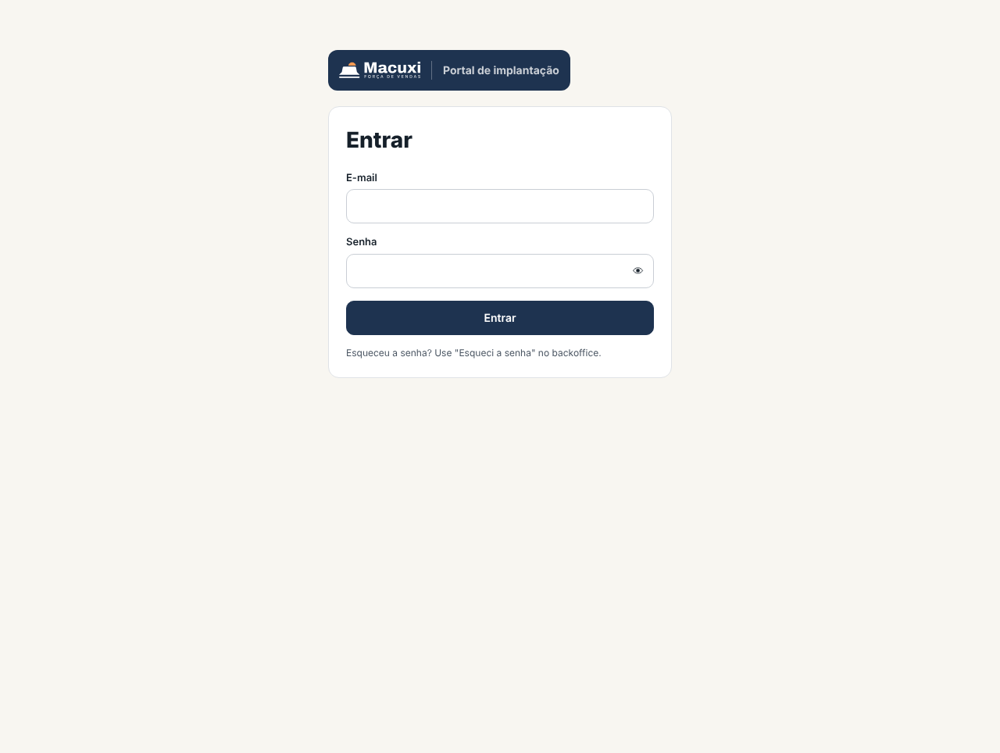
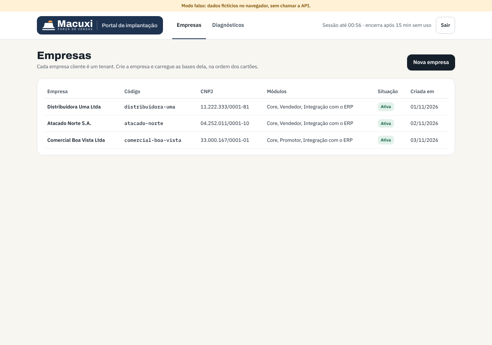
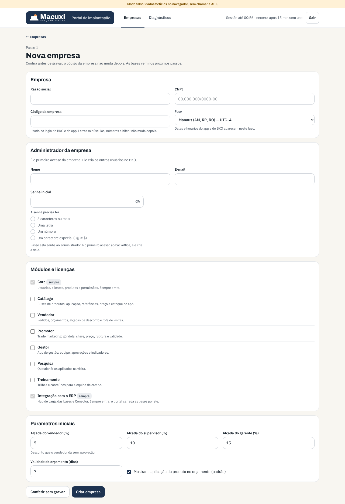
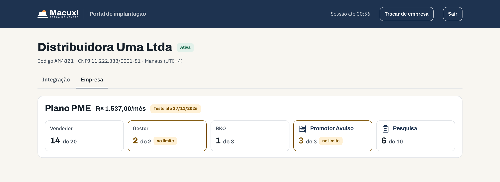
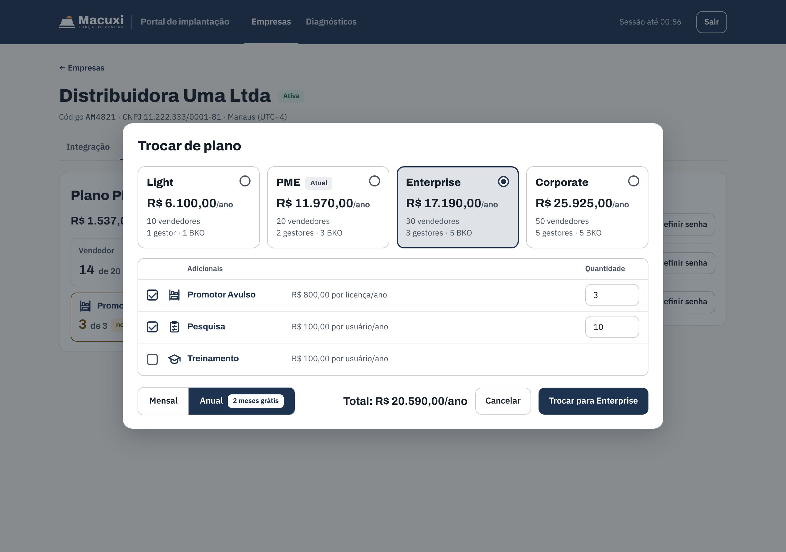
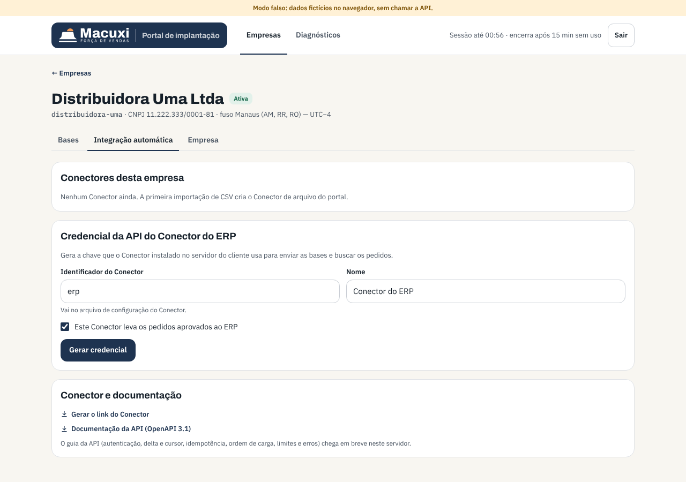

# Portal `config.` enxuto — textos finais, tela por tela (designer-ux)

**Situação:** Fechada em 14/11/2026: achados RD e MC respondidos (§13); perguntas do §11.7 decididas pelo dono do produto em 14/11; segunda passada do corretor (P1–P6) e da marca (MC-0035 a MC-0042) respondida no §13.5. Aba Empresa refeita (§8, §11.4) e divisória da Integração (§10.2) pelo R-20261114-170200. Simulações re-renderizadas com as fontes do BKO, aguardando a nova conferência do corretor e da marca antes de irem ao dono do produto.

> 2026-11-14 · designer-ux · pedido do dono do produto R-20261114-130000-alexandre; R-20261114-122200 (sai o "Parâmetros iniciais"); R-20261114-130500-alexandre e R-20261114-131200-alexandre (código da empresa = número da licença, **UF + 4 dígitos aleatórios, ex.: `AM4821`**, gerado pelo servidor; os dois últimos chegaram pela ponte e não foram lidos no repositório de recados nesta sessão — confirmar). Implementação: engenheiro-apps, branch `nuvem/portal-parametros-engenheiro-apps`. Telas: `apps/web/app/config/**`, `apps/web/components/portal/**` e textos em `apps/web/lib/{portal-carga,portal-admins,conector-download,equipe-csv,portal-diagnosticos}.ts`. Simulações em `docs/design/telas/portal-config-enxuto/` (`antes-*` = print do BKO no modo falso; `depois-*` = simulação, HTML + PNG em 1280 px e escala 2, estilo e fontes do BKO em `portal.css`; dados fictícios: Distribuidora Uma Ltda, `AM4821`, 11.222.333/0001-81). Onde conflitar, esta spec substitui `docs/design/portal-entrar.md` §1, §2 e §6.

## Regras aplicadas
1. Cartão = título + ação. Sai frase que explica o funcionamento ou o que o sistema faz por trás (R-20261110-192153).
2. Uma informação, um lugar (R-20261110-093124).
3. Sem rótulo repetido e sem texto do navegador em inglês ("Choose File / No file chosen").
4. Passos na ordem em que a pessoa age.
5. Erro e aviso: uma frase, dizendo o que fazer.

## 0. Moldura (todas as páginas internas)
| Onde | Antes | Depois |
|---|---|---|
| Cabeçalho | "Sessão até 00:56 · encerra após 15 min sem uso" | **"Sessão até 00:56"** |
| Diálogo "Sua sessão terminou" | "Os links dos convites aparecem só nesta tela. Baixe agora, antes de entrar de novo: depois eles somem e cada pessoa vai precisar de um link novo pelo Renovar." | **sai inteiro** (ajustado pelo RD-0262) |
| Diálogo "Sua sessão termina em N min" | "Os links dos convites aparecem só nesta tela. Baixe agora: quando a sessão terminar, eles somem." + "A sessão de 8 horas não se renova; depois dela, é preciso entrar de novo." | **sai inteiro** (ajustado pelo RD-0262) |
| Diálogo "Baixar os convites antes de sair?" | "Os links dos convites aparecem só nesta tela. Se sair agora, eles somem e cada pessoa vai precisar de um link novo pelo Renovar." | **sai inteiro** (ajustado pelo RD-0262) |
| Nome da empresa no cabeçalho (admin do cliente) | "Distribuidora Uma Ltda" no cabeçalho e no título da página | **sai do cabeçalho**; fica só no título da página (ajustado pelo RD-0261) |
| Rota ausente no servidor (11 textos: "… chega em breve neste servidor.", "… ainda não está disponível neste servidor.") | um texto por controle | **"Ainda não disponível neste servidor."**, ao lado do controle, constante única (ajustado pelo RD-0288) |

~~Botões sem mudança. Sai: 7 frases. Pergunta ao corretor: os convites saíram na T-0094; se nada mais gera link de convite, `lib/portal-saida` e os três diálogos são código morto e saem inteiros.~~ **Respondida pelo corretor (RD-0262):** código morto; os três diálogos saem inteiros, com `TEXTO_UMA_VEZ`, `rotuloDeBaixar`, `useSaidaSegurada`, `pedirSaida`, `avisoDeFimDaSessao` e o que sobrar sem uso em `lib/portal-saida.ts`.

**Cabeçalho na faixa (ajustado pelo MC-0022 e pelo MC-0023):** a barra inteira é a faixa Azul noite `#1E3350` (largura total); dentro dela, o logo negativo a **104 px** (22 px de altura) com **14 px de folga**, sem fundo nem arredondado próprios, o filete e **"Portal de implantação"** em `#C9CED5`; aba ativa branca com filete branco, inativa `#C9CED5` (branca no hover); "Sessão até 00:56" em `#C9CED5`; "Sair" e "Trocar de empresa" com borda `#C9CED5`, fundo transparente e texto branco; foco `outline-white`. Na tela Entrar e na Escolha a empresa (sem cabeçalho), a mesma marca fica numa faixa solta, arredondada, com 14 px de folga. Especificação do componente: `docs/design/componentes.md` §5.3.
**Botão-link principal (ajustado pelo MC-0021):** "Nova empresa" e "Ir para a sua empresa" em Azul noite (`bg-accent`, hover `bg-accent/90`), como o `Button` principal; sai o grafite `bg-ink`/`#0b1218`.

O cabeçalho "depois" aparece no topo de todas as simulações internas (ex.: `depois-02-empresas.png`, re-renderizada com a faixa).

## 1. Entrar
Título **"Entrar"** · **"E-mail"** · **"Senha"** (olho) · **"Entrar"**/"Entrando…" · **"Esqueceu a senha? Use "Esqueci a senha" no backoffice."**
Estados: **"Informe o e-mail e a senha."** · **"E-mail ou senha incorretos."** · **"Muitas tentativas erradas. Espere 15 minutos e tente de novo."** · **"Muitas tentativas deste endereço. Espere alguns minutos e tente de novo."** · **"Sua sessão terminou. Entre de novo."**
Muda: senha a trocar → **"Crie a sua senha no backoffice antes de entrar aqui."** (sai "Use o código da empresa, o e-mail e a senha que você recebeu."). Sai: 1.

| Antes | Depois |
|---|---|
|  |  |

## 2. Escolha a empresa
Título **"Escolha a empresa"** · lista (nome; embaixo o código, ex. **AM4821**; selo **"Atual"**) · **"Sair"**. Sai "Seu acesso vale para estas empresas.". Sai: 1.

| Antes | Depois |
|---|---|
|  |  |

## 3. Empresas
Título **"Empresas"** + **"Nova empresa"**. Sai o subtítulo "Cada empresa cliente é um tenant. Crie a empresa e carregue as bases dela, na ordem dos cartões." Tabela **Empresa · Código · CNPJ · Módulos · Situação · Criada em** (Código em maiúsculas, ex. AM4821). Vazio: só **"Nenhuma empresa ainda."** (sai "Comece pela empresa cliente: razão social, CNPJ, fuso, módulos e os parâmetros iniciais." e o botão "Cadastrar a primeira empresa", que repete o "Nova empresa"). Sai: 3 frases + 1 botão.
> Ver §11: a coluna "Módulos" vira **"Plano"**.

| Antes | Depois (lista e, abaixo, o estado vazio) |
|---|---|
|  |  |

## 4. Nova empresa
> Ver §11: CNPJ no topo preenche o cartão "Empresa" pela Receita; o cartão "Módulos e licenças" (item 2) dá lugar a Plano, Adicionais e Ciclo. Simulação nova: `depois-03b-nova-empresa.png`.

"← Empresas" · **"Nova empresa"**. Saem "Passo 1" e "Confira antes de gravar: o código da empresa não muda depois. As bases vêm nos próximos passos."
1. **"Empresa"**: **Razão social** · **CNPJ** · **UF** (obrigatório, lista das 27, sem pré-seleção; erro **"Escolha a UF."**) · **Fuso**. Sai o campo "Código da empresa" e a ajuda dele; sai a ajuda do fuso "Datas e horários do app e do BKO aparecem neste fuso."
2. **"Módulos e licenças"**: só o nome de cada módulo, selo **"sempre"** em Core e Integração com o ERP (fica; pergunta ao dono do produto no §10), campo **"Licenças"** (placeholder "sem limite"). Saem as 8 descrições (`ROTULO_MODULO[*].ajuda`, 10 frases).
3. **"Administrador da empresa"**: Nome · E-mail · Senha inicial com "A senha precisa ter" ao vivo; embaixo só **"Passe esta senha ao administrador."** Saem "É o primeiro acesso da empresa. Ele cria os outros usuários no BKO." e "No primeiro acesso ao backoffice, ele cria a dele." Senha vazia ao criar: só **"Informe a senha inicial."**, com as regras neutras; o vermelho das regras volta quando há senha digitada (ajustado pelo RD-0272).
4. **Sai o cartão "Parâmetros iniciais" inteiro** (alçadas, validade, aplicação e "Desconto que o vendedor dá sem aprovação."); o corpo vai sem `parametros`.

Botão só **"Criar empresa"**/"Criando…" (sai "Conferir sem gravar": sem código digitado não há o que conferir; os erros por campo aparecem no Criar e nada é gravado com erro). Erro **"Confira os campos marcados."** Sucesso: página da empresa com aviso success fechável, uma vez: **"Empresa criada. Código da empresa: AM4821."**
Sai: 18 frases, "Passo 1", 1 campo, 1 cartão (5 campos), 1 botão. Entra: campo UF.

| Antes | Depois (com os planos do §11) |
|---|---|
|  |  |

## 5. Página da empresa — cabeçalho
"← Empresas" (só time Macuxi) · razão social + selo da situação · **"Código AM4821 · CNPJ 11.222.333/0001-81 · Manaus (UTC−4)"**. Empresa que não existe: só **"Empresa não encontrada."** (ou **"Empresa não encontrada ou inativa."**); sai "Volte à lista de empresas.", que repete o "← Empresas" (ajustado pelo RD-0293). Abas **"Bases" · "Integração" · "Empresa"** (sai "automática").
> Abas revogadas pelo §10: **"Integração" · "Empresa"**, Integração abre por padrão. O resto do cabeçalho fica.

O cabeçalho "depois" aparece no topo de `depois-05b-integracao.png` e `depois-06b-aba-empresa.png`. As antigas §6 (aba Bases) e §7 (aba Integração em uma coluna) foram revogadas pelo §10 e saíram (Histórico, §14).

## 8. Aba Empresa
> 2026-11-14 17h02 · designer-ux · refeita do zero pelo pedido do dono do produto R-20261114-170200 ("Não gostei da tela 7, muito complexa e com redundâncias. Simplifique e aproveite melhor o espaço."). O cartão Plano e o diálogo de troca estão no §11.4.

**Layout (≥ 768 px):** duas colunas lado a lado, sem rolagem em 1280 × 800: **esquerda "Plano"** (§11.4) · **direita "Administradores"**, com larguras 1,25 : 1. Abaixo de 768 px, empilhados (Plano primeiro). Admin do cliente: só o Plano, na largura toda (licenças em uma linha só).

**"Administradores"** (só time Macuxi): uma linha por pessoa: **nome** com o selo ao lado (**"Bloqueado"**/**"Entra só pelo app"**), o e-mail embaixo e **"Redefinir senha"** (secundário) à direita. Diálogo **"Uma senha temporária vai para {e-mail}. {Nome} sai do Macuxi em todos os aparelhos."**; sucesso **"Senha temporária enviada para {e-mail}."** (a validade fica só no selo da linha, RD-0291); e-mail não configurado: **"O envio de e-mail não está configurado neste servidor: nada foi gravado. Confira a configuração de e-mail."** (RD-0292).

**Antes × depois** (o "antes" é a 06b da manhã de 14/11, no git até `9b4dd17`):

| # | Antes | Depois | Por quê |
|---|---|---|---|
| 1 | Título "Plano" e, embaixo, a linha "PME" | título **"Plano PME"** | uma linha a menos; o título só dizia o nome do cartão |
| 2 | Tabela de 3 colunas (Licenças · Em uso · Contratadas), 5 linhas na largura toda, número longe do nome | **blocos** "Vendedor **14** de 20" (3 por linha) | sai o cabeçalho de coluna; nome e número juntos; metade da altura |
| 3 | "**2** · no limite" em Em uso e "**2**" de novo em Contratadas | "**2** de 2" + selo **"no limite"** e borda de alerta | o número contratado aparecia duas vezes na mesma linha |
| 4 | Seletor "Trocar de plano" sempre aberto embaixo (4 planos, 3 adicionais, ciclo, total, 2 botões) | **diálogo** aberto pelo botão (`depois-06d-trocar-plano`) | ~60 % da altura da página; o plano atual aparecia duas vezes (cartão e seletor com "Atual") |
| 5 | Legenda "Estado ao tocar em 'Trocar de plano': o cartão Plano dá lugar a este seletor…" | sai | explica o funcionamento; o estado tem simulação própria |
| 6 | Legenda "Dados fictícios. Seletor no Anual: Enterprise … = R$ 20.590,00/ano. As linhas … só aparecem quando contratadas." | sai | conta e regra de exibição ficam na spec (§11.4), não na tela |
| 7 | Rótulo "Quantidade" em cada adicional (2×) | um cabeçalho **"Quantidade"** na lista de adicionais do diálogo | rótulo repetido |
| 8 | Adicionais em grade 2 × 2, com a terceira caixa sozinha e vazio ao lado | lista de uma linha por adicional (caixa · ícone · nome · preço · quantidade) | sem vazio; preço e quantidade alinhados |
| 9 | Cartões em uma coluna, com vazio no meio das linhas (Plano 1.537 px de altura de página) | **duas colunas** (Plano · Administradores), página com 636 px | usa a largura; sem rolagem |
| 10 | Selos dos administradores numa coluna solta no meio da linha | selo ao lado do nome | a coluna ficava vazia na maioria das linhas |
| 11 | Valor e selo do teste na linha do nome, botão no meio da altura do cartão | valor + selo do teste numa linha só, logo abaixo do título; botão ao lado do título | leitura em uma passada: nome → valor → prazo |

Fica: um só principal na aba ("Trocar de plano"); ícones e nomes dos adicionais (§11.10); "Atual" no plano de hoje, dentro do diálogo; admin do cliente só vê (§11.4).

| Antes | Depois (super-admin) | Depois (admin do cliente) | "Trocar de plano" aberto |
|---|---|---|---|
|  |  |  |  |

## 9. Diagnósticos
Sai o subtítulo "Enviados pelos aparelhos. Ficam 90 dias." inteiro (o RD-0295 propõe manter "Ficam 90 dias."; fica a saída inteira: o prazo é o que o sistema faz por trás e o time não age por ele). A contagem ("12 diagnósticos") só aparece com 1 ou mais; no vazio fica só **"Nenhum diagnóstico com estes filtros."**/**"Nenhum diagnóstico recebido."** (ajustado pelo RD-0294). Resto igual. Sai: 2 + a contagem "0 diagnósticos".

| Antes | Depois |
|---|---|
|  |  |

## 10. Adendo — Integração via Conector e via API; CSV fora do portal
> 2026-11-14 · designer-ux · pedido do dono do produto R-20261114-132000-alexandre (chegou pela ponte; não lido no repositório de recados nesta sessão — confirmar). Onde conflitar, o §10 vale sobre o §5 (abas); as antigas §6 e §7 saíram (§14).

**Regra:** ou é Conector, ou é API. O CSV sai do portal: a aba Bases (com a Equipe por CSV), o Conector de arquivo e todo texto sobre CSV. (Confirmado pelo §12: nenhum CSV fica no `config.`.)

### 10.1 Abas
Abas da página da empresa: **"Integração" · "Empresa"**; **Integração abre por padrão**. O resto do cabeçalho do §5 fica igual. A aba Bases sai inteira.

### 10.2 Aba Integração em dois lados
Dois lados lado a lado, com a mesma largura (≥ 768 px), separados por uma **divisória vertical no meio**: filete de 1 px na cor de linha do kit (`line`, `#DFE2E6`), da altura do lado mais alto, com 24 px de folga para cada lado (pedido do dono do produto R-20261114-170200). Abaixo de ~768 px, empilhados: **Conector primeiro**, API depois, e a divisória vira **horizontal** entre os dois (mesmo filete, 24 px antes do título "Integração via API"). Cada lado tem título de seção e, embaixo, só a lista do que já existe.

**Esquerda — "Integração via Conector"** (passos numerados na ordem em que a pessoa age; o círculo do número em Azul noite `bg-accent`, texto branco, ajustado pelo MC-0024):
1. **"Baixar o Conector"**: botão "Gerar o link do Conector"/"Gerando o link…" (texto atual de `TEXTOS_DOWNLOAD_CONECTOR`) → link **"Baixar {arquivo}"**, embaixo só **"38 MB"** (saem o nome do arquivo e a versão: os dois já estão no link; ajustado pelo P6 do corretor), **"O link vale até 01:30. Depois disso, gere outro."** e **"SHA-256 {hash}"**. Estados de erro do download sem mudança.
2. **"Gerar a credencial"**: **Identificador** · **Nome** · caixa **"Envia os pedidos aprovados ao ERP"** · **"Gerar credencial"** (principal). Chave gerada: **"Copie a chave agora: ela não aparece de novo."** + chave + **"Copiar"**. Saem o título interno "Credencial do Conector "erp"" e o rodapé "Identificador: erp · escopo integracao.v1 · prefixo mx_…" (ajustado pelo RD-0286; o "cole na configuração" já está no passo 3).
3. **"Instalar e colar a credencial"**: lista numerada, três linhas:
   1. **"Instale o Conector no servidor do ERP."**
   2. **"Cole o identificador e a chave na configuração."**
   3. **"Inicie o serviço."**

Embaixo: **"Conectores"** — tabela **Identificador · Pedidos · Situação**; vazio **"Nenhum Conector."**

**Direita — "Integração via API":**
1. **"Gerar a credencial da API"**: os mesmos campos e textos do passo 2 da esquerda — **Identificador** · **Nome** · **"Envia os pedidos aprovados ao ERP"** · **"Gerar credencial"** (neutro) · chave gerada com o mesmo aviso e "Copiar".
   - Decisão (caixa de pedidos fica): pela API o ERP também busca os pedidos aprovados; a caixa diz se esta credencial pode buscá-los, igual ao Conector.
   - Decisão (botão neutro): um só principal por tela; o principal fica no Conector, que é o primeiro caminho.
2. **"Guia da API"**: botão **"Baixar o guia (PDF)"** + link **"Documentação da API (OpenAPI 3.1)"** (o link sai do lado do Conector: uma informação, um lugar).
   - Decisão: enquanto o PDF não existir, o botão **não aparece** e o cartão fica só com o link do OpenAPI. Sem "O guia chega em breve.": a pessoa não age com esse texto.

Embaixo: **"Credenciais da API"** — tabela **Identificador · Pedidos · Situação** (a coluna Pedidos fica, porque a caixa ficou); vazio **"Nenhuma credencial."**

**Sai:** o diálogo "Passar as bases ao Conector do ERP?" inteiro (título, 3 frases, botões "Gerar só para as bases livres" e "Desativar o de arquivo e passar todas"), o tipo "Carga por arquivo" (`ROTULO_TIPO.arquivo`), "Nenhum Conector ainda. A primeira importação de CSV cria o Conector de arquivo do portal.", "O guia da API (…) chega em breve neste servidor.", "Gera a chave que o Conector…" e "Vai no arquivo de configuração do Conector."

No celular (abaixo de 768 px), o **"Sair"** fica na linha do logo, à direita; abas e "Sessão até" vão para a linha de baixo.

| Antes | Depois, 1280 px (com o link gerado e a chave recém-gerada) | Depois, celular 390 px |
|---|---|---|
|  |  |  |

### 10.3 Nova empresa (§4)
Fica como está: selo **"sempre"** em Core e em Integração com o ERP. **Pergunta ao dono do produto:** sem CSV, toda empresa precisa de Conector ou API; a Integração com o ERP continua "sempre"?

> Ver §11: com os planos, a Nova empresa não lista mais módulos; a pergunta acima passa a ser se todo plano inclui a Integração com o ERP.

### 10.5 Para o engenheiro-apps
- **Saem do portal:** `components/portal/cartao-base.tsx`, `components/portal/cartao-equipe.tsx`, `lib/portal-carga.ts`, `lib/portal-carga-rede.ts` (e `portal-carga.test.ts`), `lib/equipe-csv.ts` (e o teste), o Conector de arquivo em `lib/portal-rotas.ts` ("Carga por arquivo (implantação)"), a Equipe por CSV de `lib/portal-falso.ts` e os testIDs `base-*`, `equipe-*` e `integracao.confirmar-*`. Confirmar com o corretor-redundancias se algum deles é usado fora do portal antes de apagar.
- `tela-empresa.tsx`: abas Integração e Empresa; Integração abre por padrão.
- `aba-integracao.tsx`: dois lados (grid de 2 colunas ≥ 768 px; 1 coluna abaixo, Conector primeiro); o botão do Conector passa para dentro do passo 1; `textoDoPacote` sem o nome do arquivo quando o link já o mostra; o link do OpenAPI vai para o cartão "Guia da API"; `integracao.guia` vira o botão do PDF, só quando ele existir.
- **A Equipe passa a vir só pelo ERP (Conector/API) ou pelo BKO.** ~~Pendência — pergunta ao dono do produto: a Equipe por CSV sai mesmo do portal?~~ **Respondida: sim** (§12).
- **Pendência para engenheiro-software / modulo-integracao:** credencial de API separada da do Conector (tipo próprio, ex. o `nuvem` que já existe em `ROTULO_TIPO`, rota que lista só as de API) e o guia da API em PDF (modulo-integracao faz e manda ao designer-ux para revisão de layout). Se a rota não existir, o lado direito mostra só o guia e o link do OpenAPI.

## 11. Adendo — Planos (Light, PME, Enterprise, Corporate) e CNPJ pela Receita
> 2026-11-14 · designer-ux · pedido do dono do produto R-20261114-132600-alexandre (chegou pela ponte; não lido no repositório de recados nesta sessão — confirmar). Onde conflitar, o §11 vale sobre §3 (coluna Módulos), §4 (cartões Empresa e Módulos e licenças), §8 (cartão Módulos e licenças) e §10.3. Contratos novos (planos e CNPJ) vêm do engenheiro-software.
>
> ~~**A tabela dos planos (preço e licenças) não chegou a esta sessão.** Nenhum preço nem limite foi inventado: a spec e as simulações usam os marcadores `{preço}` e `{licenças}`, **a confirmar pela tabela do recado**.~~
> **Fechamento (14/11):** a tabela chegou pela ponte (recado do dono do produto R-20261114-132600, a tabela que faltava) e foi conferida contra o contrato `packages/platform-sdk/src/planos.ts` e a ADR 0046 (branch `nuvem/planos-engenheiro-software`). Os valores batem com o contrato (preço mensal e anual = 10 × o mensal); as diferenças de forma e o que a spec segue estão no §11.9. A tela mostra reais; o contrato guarda centavos (`preco_mensal_centavos`, `preco_unitario_centavos`, `valor.*_centavos`).

**Premissa:** os módulos da empresa passam a vir do **plano + adicionais**. O cartão "Módulos e licenças" sai do Criar empresa e da aba Empresa; o portal não marca mais módulo por módulo.

### 11.1 Ordem do Criar empresa
**CNPJ → dados preenchidos → Plano → Adicionais → Ciclo e teste → Administrador → "Criar empresa" com o "Total" ao lado.** Um só botão principal (52 px), no fim.

### 11.2 Cartão "Empresa" com o CNPJ pela Receita
- **CNPJ** no topo, sozinho na primeira linha (máscara `00.000.000/0000-00`, placeholder igual). A busca dispara **ao sair do campo** com 14 dígitos válidos.
- Embaixo, sempre visíveis (vazios até a busca, para quem preenche à mão): **Razão social · Nome fantasia** / **Endereço** (linha inteira) / **Município · UF · Fuso** / **Telefone · E-mail** / **CNAE** (linha inteira).
- A busca preenche **razão social, nome fantasia, endereço, município, UF, situação, CNAE, telefone e e-mail**. A UF gera o código UF+4 (§4, §5), como antes. O **Fuso** vem pré-escolhido pela UF/município e continua editável (ex.: AM → Manaus (UTC−4)).
- **Decisão (edição):** todos os campos preenchidos continuam **editáveis**, exceto o **CNAE**, **só leitura** (fundo cinza, sem borda), porque vem da Receita e não muda no portal.
- **Sai o campo "Situação"** (ajustado pelo P2 do corretor): com o bloqueio decidido em 14/11, a empresa só é criada com CNPJ ativo; "Ativa" num campo repetiria o que o ✓ do CNPJ e o selo da página da empresa já dizem. A situação vai no corpo (`situacao` da consulta) e a API revalida.
- Editar o CNPJ de novo limpa o estado e busca outra vez ao sair; os campos que a pessoa editou à mão **não são sobrescritos** sem ela apagar (decisão: não perder digitação).
- Nenhum texto explicando a consulta (sem "Os dados vêm da Receita Federal").

**Estados do campo CNPJ** (uma frase, embaixo do campo, `aria-live="polite"`; somem quando a pessoa edita o CNPJ):

| Estado | Campo | Texto final |
|---|---|---|
| Vazio | placeholder `00.000.000/0000-00` | — |
| Buscando | indicador girando à direita, campo travado | **"Buscando na Receita…"** |
| Encontrado (situação ativa) | ✓ à direita | — (decisão: sem texto; os campos preenchidos já mostram o resultado) |
| CNPJ inválido (dígito verificador ou menos de 14 dígitos) | borda de erro | **"CNPJ inválido. Confira os 14 dígitos."** |
| Não encontrado | borda de erro | **"CNPJ não encontrado na Receita."** |
| Receita fora (tempo esgotado, 5xx, limite de consultas; a API do #243 responde 503 com `Retry-After`) | borda de alerta + link **"Tentar de novo"** à direita; "Criar empresa" desabilitado | **"A Receita não respondeu."** |
| Situação não ativa (baixada, suspensa, inapta, nula) | **borda de erro**; os campos se preenchem; "Criar empresa" desabilitado | **"CNPJ {situação} na Receita. Use um CNPJ ativo."** — "CNPJ baixado na Receita. Use um CNPJ ativo.", "CNPJ suspenso na Receita. Use um CNPJ ativo.", "CNPJ inapto na Receita. Use um CNPJ ativo.", "CNPJ nulo na Receita. Use um CNPJ ativo." (`{situação}` no masculino, minúsculo) |

- **Decidido em 14/11 (dono do produto):** CNPJ inválido, não encontrado ou não ativo **não cria empresa**: o "Criar empresa" fica desabilitado (Névoa `#ECEEF1`, texto `#5B6673`) até o CNPJ voltar ao estado Encontrado. Com a **Receita fora** também não cria (a API responde 503 com `Retry-After` e não grava); sem "Preencha os campos": a pessoa só tenta de novo. A API revalida tudo.
- CNPJ que já tem empresa no Macuxi: segue o erro da API que já existe ao criar (sem mudança).

### 11.3 Cartões "Plano", "Adicionais" e "Ciclo"
1. **"Plano"**: 4 cartões de **escolha única** (rádio), em uma linha (2 × 2 abaixo de 768 px), só os planos `ativo`, na `ordem` do catálogo (`GET ROTA_PORTAL_PLANOS`, `ListaPlanosSchema`). Cada cartão tem 3 linhas e nada mais: **nome** · **preço** · **licenças**. Sem descrição e sem o desconto por licença (já está no preço). Sem pré-seleção; sem plano, erro no cartão **"Escolha o plano."** Selecionado: borda Azul noite de 2 px, fundo Azul suave `#DFE2E6` (`accent-soft`, MC-0037) e rádio cheio.

   | Plano (`codigo`) | Mensal | Anual | Licenças |
   |---|---|---|---|
   | **Light** (`light`) | **R$ 610,00/mês** | **R$ 6.100,00/ano** | **10 vendedores · 1 gestor · 1 BKO** |
   | **PME** (`pme`) | **R$ 1.197,00/mês** | **R$ 11.970,00/ano** | **20 vendedores · 2 gestores · 3 BKO** |
   | **Enterprise** (`enterprise`) | **R$ 1.719,00/mês** | **R$ 17.190,00/ano** | **30 vendedores · 3 gestores · 5 BKO** |
   | **Corporate** (`corporate`) | **R$ 2.592,50/mês** | **R$ 25.925,00/ano** | **50 vendedores · 5 gestores · 5 BKO** |

   - Preço: `preco_mensal_centavos` formatado em reais; no Anual, `valorDaAssinatura(plano, [], 'anual').por_ciclo_centavos` (= mensal × (12 − `meses_gratis_anual`)). Os números vêm do catálogo, nunca de constante na tela.
   - Licenças: de `licencas` (vendedor, gestor, bko), singular com 1 ("1 gestor"), "BKO" invariável; tipo com 0 não aparece (o `promotor` é 0 em todos os planos); `null` = "{tipo} sem limite".
   - **Decisão (selo "2 meses grátis"):** fica **só no alternador "Anual"** do cartão Ciclo, visível nos dois ciclos; no Anual, o cartão do plano mostra só **"R$ 6.100,00/ano"**. O pedido previa o selo também no cartão; com o do alternador seriam 5 selos iguais na mesma tela (uma informação, um lugar).
2. **"Adicionais"**: três caixas, cada uma com caixa de marcar + **ícone do módulo** + **nome** (Archivo 700, Azul noite) + preço, **o mesmo em todos os planos** (ícone e nome pelo mapa único do §11.10):
   - **"Promotor Avulso · R$ 80,00 por licença/mês"**;
   - **"Pesquisa · R$ 10,00 por usuário/mês"**;
   - **"Treinamento · R$ 10,00 por usuário/mês"**.
   - **O preço segue o ciclo** (ajustado pelo P5 do corretor): no Anual, **"R$ 800,00 por licença/ano"** e **"R$ 100,00 por usuário/ano"** (`valorDaAssinatura(plano, [{ adicional, quantidade: 1 }], ciclo)`, a parcela do adicional; nunca constante na tela).
   - Marcada, a caixa mostra o campo **"Quantidade"** (inteiro, mínimo 1, padrão 1, máximo 100.000): no Promotor Avulso são as licenças; na Pesquisa e no Treinamento, os usuários com o módulo liberado (o contrato pede `quantidade` nos três: `AdicionalContratadoSchema`, RN-PLA-03; ver §11.9). Vazio ou 0: **"Informe a quantidade."** `aria-label` **"Quantidade de {adicional}"**.
   - Preço: `plano.adicionais[].preco_unitario_centavos`. Nenhum plano inclui adicional (`incluidos` = 0), então os três aparecem em todos; adicional que o plano não vende (fora de `plano.adicionais`) não aparece.
3. **"Ciclo"**: alternador **Mensal / Anual** (padrão **Mensal**); no Anual, selo curto **"2 meses grátis"** (de `meses_gratis_anual`). Ao lado, a caixa **"Começar com 14 dias de teste"** (de `dias_teste`; vai em `com_teste`), **desmarcada por padrão**.
   - **Decidido em 14/11 (dono do produto):** a caixa começa **desmarcada**; quem vai começar em teste marca com um toque.
   - Selo **"2 meses grátis"**: com o Anual escolhido, branco com texto Azul noite; com o Anual não escolhido, Azul suave `#DFE2E6` com texto Azul noite (MC-0038; nunca verde).
   - Caixa marcada (aqui, nos Adicionais e no "Envia os pedidos aprovados ao ERP"): branca, com borda e ✓ em Azul noite (como a MC-0028).
4. **Total do pedido (decisão: aparece)**: uma linha ao lado do "Criar empresa": **"Total: R$ 1.537,00/mês"** (Mensal) ou **"Total: R$ 15.370,00/ano"** (Anual). A tela calcula com `valorDaAssinatura(plano, adicionais, ciclo).por_ciclo_centavos` e confere com `valor.por_ciclo_centavos` da resposta (`CriarEmpresaComPlanoRespostaSchema.valor`). Some sem plano escolhido. Motivo: cada parcela já está no seu cartão, a soma não está em lugar nenhum, e é o número que o time confere com o cliente antes de criar. Sem texto sobre cobrança ou teste.
   - Exemplo da simulação: PME R$ 1.197,00 + 3 × R$ 80,00 + 10 × R$ 10,00 = **R$ 1.537,00/mês** (153.700 centavos).

Envio: `POST ROTA_PORTAL_EMPRESA_COM_PLANO` (`CriarEmpresaComPlanoSchema`) com `assinatura: { plano: codigo, ciclo, adicionais: [{ adicional, quantidade }], com_teste, pedido_id }` (`pedido_id` gerado no portal).

Sucesso, como no §4: **"Empresa criada. Código da empresa: AM4821."** Erro geral: **"Confira os campos marcados."**

| Depois — Nova empresa (CNPJ preenchido, PME, Promotor Avulso 3 e Pesquisa 10, total) | Depois — estados do campo CNPJ |
|---|---|
|  |  |

### 11.4 Aba Empresa: cartão "Plano" e diálogo "Trocar de plano"
Coluna esquerda da aba (§8). Dados da ficha: `GET rotaPortalAssinatura(tenantId)` (`FichaAssinaturaSchema`).
- **Título "Plano {nome}"** (ex.: **"Plano PME"**) e, à direita, **"Trocar de plano"** (principal: a única ação principal da aba; só super-admin). Embaixo do título, uma linha: valor **"R$ 1.537,00/mês"** (ou **"R$ 15.370,00/ano"**; `valor.por_ciclo_centavos`; o "/mês" ou "/ano" já diz o ciclo, P4) + selo de alerta **"Teste até 27/11/2026"** se `teste_ate` e não `paga` (data no fuso do tenant, `fimDoTeste`).
- **Licenças em blocos** (`licencas[]`): um bloco por item, com o nome em cima e **"{em uso} de {contratadas}"** embaixo (número em Archivo 700). **Vendedor**, **Gestor** e **BKO** sempre; **Promotor Avulso**, **Pesquisa** e **Treinamento** (ícone + nome do §11.10) só quando contratados. `contratadas` = `null`: **"{em uso} · sem limite"**. Em uso = contratadas: borda e número em cor de alerta **com o selo "no limite"** (cor nunca sozinha). Grade: 3 por linha na coluna do super-admin; 5 por linha (até 6) na largura toda do admin do cliente; 2 por linha abaixo de 768 px.
- **Admin do cliente** (decidido em 14/11): só vê; o valor e o selo do teste ficam na linha do título, sem "Trocar de plano" (o `PUT` é só do super-admin); sem o cartão Administradores. Simulação: `depois-06c-aba-empresa-cliente.png`.

**Diálogo "Trocar de plano"** (`depois-06d-trocar-plano.png`; 880 px no desktop, folha de tela cheia abaixo de 768 px, planos 2 × 2):
- **4 planos** em uma linha (o mesmo seletor do Criar empresa, §11.3; licenças em duas linhas, "30 vendedores" / "3 gestores · 5 BKO"); o atual com o selo **"Atual"** (Névoa `#ECEEF1`, texto `#34404D`, MC-0039) e já selecionado.
- **Adicionais** numa lista de uma linha por adicional: caixa · ícone · nome · preço no ciclo · campo de quantidade (só com a caixa marcada); um cabeçalho só, **"Adicionais"** e **"Quantidade"** (`aria-label` "Quantidade de {adicional}" em cada campo). Os atuais já marcados, com as quantidades atuais.
- **Rodapé:** alternador **Mensal / Anual** (selo "2 meses grátis") à esquerda; à direita **"Total: R$ 20.590,00/ano"**, **"Cancelar"** e **"Trocar para {plano}"** (principal). Sem mudança, o principal fica desabilitado como **"Trocar de plano"**. Sem a caixa do teste. "Cancelar" e Esc fecham sem gravar. Envio: `PUT rotaPortalAssinatura(tenantId)` (`TrocarPlanoSchema`, com `pedido_id`).
- Sucesso: o diálogo fecha e aparece o aviso success fechável **"Plano trocado: Enterprise."**
- Plano abaixo do uso (`conferirTrocaDePlano`; 422 `PLANO_ABAIXO_DO_USO`, `detalhes.problemas[].mensagem`): erro embaixo do cartão do plano, dentro do diálogo, uma linha por item, principal desabilitado. Texto do contrato: **"O plano Light tem 10 licenças de vendedor e a empresa usa 14."** Pedido ao engenheiro-software para acrescentar **"Inative 4 antes de trocar."** (recados-pendentes.md); até lá, vale a do contrato.
- Plano atual fora de venda (`PLANO_INATIVO`): **"O plano {nome} não está mais à venda."** (do contrato), no cartão dele.
- A tela não explica cobrança nem quando a troca vale.

### 11.5 Lista de Empresas (§3)
Tabela **Empresa · Código · CNPJ · Plano · Situação · Criada em**. A coluna Plano mostra o nome (ex.: "PME"); em teste, o selo **"teste"** ao lado. Sem simulação nova (só troca o cabeçalho e o conteúdo da coluna).

### 11.7 Perguntas ao dono do produto
1. ~~**Teste de 14 dias:** caixa marcada por padrão?~~ **Decidido em 14/11:** a caixa "Começar com 14 dias de teste" começa **desmarcada** (§11.3).
2. ~~**Admin do cliente:** pode trocar de plano?~~ **Decidido em 14/11:** o admin do cliente **só vê** o plano, sem "Trocar de plano" (§11.4).
3. ~~**CNPJ não ativo:** só alerta?~~ **Decidido em 14/11:** CNPJ inválido ou não ativo **não cria empresa**; o "Criar empresa" fica bloqueado (§11.2).
4. ~~**Integração com o ERP** (§10.3): todo plano inclui?~~ **Respondida: sim.** Todos os planos incluem Core, Catálogo, Vendedor, Gestor e Integração com o ERP (pela ponte, 14/11; no contrato, `core` e `integracao` entram sempre, `modulosDaAssinatura`).
5. ~~**Tabela dos planos** (preço por ciclo, licenças por tipo, preço dos adicionais, se Promotor avulso é por licença): não chegou a esta sessão.~~ **Respondida:** tabela no §11.3; Promotor Avulso é por licença; tipos de licença: vendedor, gestor, BKO e Promotor Avulso.
6. ~~**Equipe por CSV** (§10.5): sai mesmo do portal?~~ **Respondida: sim** (§12).

### 11.8 Para o engenheiro-apps
- **testIDs (alinhados ao `planos.ts`):** `empresa.cnpj` (com `data-estado` = `vazio|buscando|encontrado|invalido|nao-encontrado|receita-fora|nao-ativa`), `empresa.cnpj-tentar`, `empresa.nome-fantasia`, `empresa.endereco`, `empresa.municipio`, `empresa.telefone`, `empresa.email`, `empresa.cnae`, `empresa.plano-<codigo>` (`light|pme|enterprise|corporate`, o `codigo` do catálogo), `empresa.adicional-<adicional>` (`promotor|pesquisa|treinamento`, os valores de `ADICIONAIS`; antes `promotor-avulso`), `empresa.adicional-<adicional>-qtd` (antes só `empresa.adicional-promotor-avulso-qtd`), `empresa.ciclo-<mensal|anual>` (`CICLOS`), `empresa.teste` (`com_teste`), `empresa.total`; na aba Empresa `empresa-plano.cartao`, `empresa-plano.nome`, `empresa-plano.teste-ate`, `empresa-plano.valor`, `empresa-plano.uso-<item>` (`vendedor|gestor|bko|promotor|pesquisa|treinamento`, os valores de `ITENS_CONTADOS`), `empresa-plano.trocar`, `empresa-plano.dialogo`, `empresa-plano.confirmar`, `empresa-plano.cancelar`, `empresa-plano.erro`, `empresa-plano.total`.
- **Rótulos na tela por item:** `vendedor` = "Vendedor", `gestor` = "Gestor", `bko` = "BKO", `promotor` = "Promotor Avulso", `pesquisa` = "Pesquisa", `treinamento` = "Treinamento" — os três adicionais pelo mapa `ADICIONAIS_DO_PLANO` de `@macuxi/ui/web` (§11.10), nunca rótulo solto na tela.
- **Saem:** `empresa.situacao` (o campo Situação) e `empresa-plano.ciclo` (o selo Mensal/Anual).
- **Saem:** os testIDs e o código do cartão "Módulos e licenças" no Criar empresa e na aba Empresa (`empresa.modulo-*`, `empresa.licencas-*`, `empresa.acrescentar-modulos` ou equivalentes) e `ROTULO_MODULO` no portal, se não for usado em outro lugar (confirmar com o corretor-redundancias).
- O seletor de planos é **um componente só**, usado no Criar empresa e no "Trocar de plano" (prop `atual`).
- **Contratos:** planos entregues pelo engenheiro-software em `packages/platform-sdk/src/planos.ts` (ADR 0046): `ListaPlanosSchema`, `CriarEmpresaComPlanoSchema`/`CriarEmpresaComPlanoRespostaSchema`, `FichaAssinaturaSchema`, `TrocarPlanoSchema`, `valorDaAssinatura`, `conferirTrocaDePlano`, `fimDoTeste`; rotas atrás de `MACUXI_PLANOS` (404 com a flag desligada = passo Empresa atual). Falta o contrato de **CNPJ** (consulta → campos e códigos `invalido`, `nao_encontrado`, `indisponivel`; situação). Dinheiro formatado de centavos (`R$ 1.234,00`). O modo falso (`lib/portal-falso.ts`) usa os valores do §11.3.

### 11.9 Tabela da ponte × contrato (`planos.ts`, ADR 0046)
Os números batem: Light 10 × 50 + 1 × 70 + 1 × 40 = R$ 610,00; PME (1.000 + 140 + 120) × 0,95 = R$ 1.197,00; Enterprise (1.500 + 210 + 200) × 0,90 = R$ 1.719,00; Corporate (2.500 + 350 + 200) × 0,85 = R$ 2.592,50; anual = 10 × mensal nos quatro. A spec segue o contrato nas diferenças de forma:

| Ponto | Tabela da ponte | Contrato | A spec segue |
|---|---|---|---|
| Quantidade dos adicionais | só o Promotor avulso tem "Quantidade" | `AdicionalContratadoSchema.quantidade` (≥ 1) nos três; Pesquisa e Treinamento contam usuários liberados (RN-PLA-03) e a trava usa esse número | campo **Quantidade** nos três (§11.3, 2) |
| Desconto por licença (−5%, −10%, −15%) | coluna própria | não existe campo: só `preco_mensal_centavos`, já com o desconto | a tela não mostra o desconto |
| Preço anual | coluna própria | calculado: mensal × (12 − `meses_gratis_anual`), `valorDaAssinatura` | a tela calcula; não há campo |
| Código do adicional | "Promotor avulso" | `promotor` | rótulo "Promotor Avulso", id `promotor` |
| Código dos planos | só o nome | `codigo` do catálogo (seed do banco-dados) | `light`, `pme`, `enterprise`, `corporate` (premissa; confirmar no seed) |
| Ficha | vendedor, gestor, BKO, promotor avulso | 6 itens (`ITENS_CONTADOS`), com Pesquisa e Treinamento | 3 linhas sempre + as dos adicionais contratados (§11.4) |
| Teste | — | `dias_teste` (14) e `com_teste`; fim = hoje + 14 − 1 | "Teste até 27/11/2026" (antes 28/11 na simulação) |
| Licença de promotor no plano / adicional incluso | "nenhum plano inclui" | `licencas.promotor` e `adicionais[].incluidos` existem | seed com 0 nos dois (banco-dados) |

### 11.10 Nome e ícone dos módulos adicionais (MC-0042)
Pedido do dono do produto (14/11): "Deixe mais bonito os nomes do módulo com a letra maiúscula, talvez um ícone, tanto no config quanto no BKO. VALORIZE-OS."
- **Mapa único** em `packages/ui/src/web/adicionais.tsx` (exportado por `@macuxi/ui/web`): `ADICIONAIS_DO_PLANO` (id do contrato → nome → ícone), `nomeDoAdicional(id)` e `iconeDoAdicional(id)`. Ids = `ADICIONAIS` de `planos.ts`: `promotor` → **"Promotor Avulso"** (`IconPromotor`, gôndola com produtos), `pesquisa` → **"Pesquisa"** (`IconPesquisa`, prancheta com respostas), `treinamento` → **"Treinamento"** (`IconTreinamento`, capelo).
- Ícones em `icons.tsx`: traço único de 2 px, grade 24 × 24, sem preenchimento, cor herdada (Azul noite `#1E3350`); sem laranja, sem cor de situação, sem grafismo. Tamanho na tela: **22 px** (legível de 20 a 24 px).
- **Onde aparecem:** na caixa do adicional (Criar empresa) e na linha do adicional (diálogo "Trocar de plano"), entre a caixa de marcar e o nome; no bloco de licenças da aba Empresa, antes do nome. O nome vai em Archivo 700, Azul noite. No BKO, onde o módulo adicional aparecer pelo nome (licenças, perfis, menus), usar o mesmo mapa.
- Prancha para a marca conferir: `portal-config-enxuto/prancha-icones-adicionais.png` (48, 24 e 20 px, na caixa e na linha da tabela).

## 12. Adendo — o `config.` cadastra só o admin da conta do cliente
> 2026-11-14 · designer-ux · pedido do dono do produto R-20261114-133000-alexandre (chegou pela ponte; não lido no repositório de recados nesta sessão — confirmar). Responde a pergunta do §10.5 e do §11.7 item 6 ("a Equipe por CSV sai mesmo do portal?"): **sim**.

- O `config.` cadastra **só o administrador da conta do cliente** (cartão "Administrador da empresa" do Criar empresa, §4 item 3, e cartão "Administradores" da aba Empresa, §8 e §11.4).
- **Sai o cartão Equipe inteiro**: modelo, CSV e importação (já fora com a aba Bases no §10). Os demais usuários o admin cadastra **no BKO**.
- Dos cartões de usuários, **fica só "Administradores"**. **Nenhum CSV fica no `config.`**: todo trecho anterior que cite CSV (a aba Bases, o diálogo "Passar as bases ao Conector do ERP?" e a linha "Aba Bases" dos placares antigos, hoje no §14) está **revogado pelo §12** (e já pelo §10).
- **Simulações:** nenhuma nova. As do §10 e do §11 (`depois-03b-*`, `depois-03c-*`, `depois-05b-*`, `depois-06b-*`, `depois-06c-*`, `depois-06d-*`) não mostram a Equipe nem CSV.
- **Placar:** não muda; a aba Bases, com a Equipe dentro, já sai inteira (§13.3).
- **Para o engenheiro-apps:** nada além do §10.5 (saem `cartao-equipe.tsx`, `lib/equipe-csv.ts`, a Equipe de `lib/portal-falso.ts` e os testIDs `equipe-*`).

## 13. Achados RD (corretor) e MC (marca) — respostas
> 2026-11-14 · designer-ux. Fontes: parecer do corretor-redundancias `docs/qualidade/redundancias/2026-11-14-portal-config.md` (branch `nuvem/config-auditoria-corretor`; RD-0260 a RD-0295, RD-0089/RD-0090 fechados e os 3 desvios do §12 dele) e parecer do design-de-marca `docs/marca/pareceres/2026-11-14-portal-config.md` (branch `nuvem/config-auditoria-marca`; MC-0021 a MC-0024 e 3 itens fora do escopo da marca). Os dois pareceres olharam o portal **de hoje** (`main` `bb20d06`); muitos achados já estavam resolvidos por esta spec, que tira mais do que eles pediam (aba Bases, Equipe e CSV saem inteiros, §10 e §12).
>
> **Resposta:** **aceito** = a spec mudou agora (nota "ajustado pelo …" na seção); **coberto** = a spec já resolvia antes do parecer; **recusado** = não entra, com o motivo. **Nenhum recusado.** Referências a §6 e §7 nesta tabela apontam para as seções retiradas (Histórico, §14).

### 13.1 Corretor-redundancias (RD)
| Id | Tela | Achado (curto) | Resposta | Onde ficou |
|---|---|---|---|---|
| RD-0260 | Moldura | "encerra após 15 min sem uso" explica a sessão | coberto | §0: "Sessão até 00:56" |
| RD-0261 | Moldura (admin do cliente) | nome da empresa no cabeçalho e no título | **aceito**: sai do cabeçalho, fica no título (a regra "uma informação, um lugar", de 10/11, vale sobre a escolha de 07/11 em `portal-entrar.md` §3) | §0; nota em `portal-entrar.md` §3 |
| RD-0262 | Moldura | 3 diálogos dos convites são código morto | **aceito**: saem inteiros (a spec só os encurtava e perguntava se eram mortos) | §0 |
| RD-0263 | Moldura (código) | `hora`, tom da situação, strings de leitura e `ListaErros` copiados | **aceito** (só código, sem texto novo): `hora` e `tomDaSituacao` num lugar só; as strings de leitura e a `ListaErros` saem junto com `cartao-base`/`cartao-equipe` (§10.5) | §13.4 |
| RD-0264 | Entrar | 2ª frase da senha a trocar repete a tela do BKO | coberto | §1; nota em `portal-entrar.md` §1 e `ciclo-de-senha.md` §7 |
| RD-0265 | Escolha a empresa | subtítulo explica a lista | coberto | §2; nota em `portal-entrar.md` §2 |
| RD-0266 | Empresas | subtítulo "Cada empresa cliente é um tenant…" | coberto | §3 |
| RD-0267 | Empresas | coluna Módulos repete Core e Integração | coberto: a coluna sai e vira **Plano** | §11.5; `depois-02-empresas.png` |
| RD-0268 | Empresas | vazio com frase e 2º botão | coberto | §3 |
| RD-0269 | Nova empresa | "Passo 1" e subtítulo | coberto | §4 |
| RD-0270 | Nova empresa | ajudas do fuso, do administrador e da alçada | coberto (a alçada sai com o cartão Parâmetros) | §4, itens 1, 3 e 4 |
| RD-0271 | Nova empresa | 8 ajudas dos módulos e "Sempre entra" | coberto: as ajudas saíram e depois o cartão inteiro (planos) | §4 item 2; §11 |
| RD-0272 | Nova empresa | senha vazia: erro + 4 regras em vermelho | **aceito**: só "Informe a senha inicial.", regras neutras | §4 item 3 |
| RD-0273 | Nova empresa | 4 linhas do "Conferido" | coberto: o "Conferir sem gravar" sai; com planos, o resultado é o aviso de sucesso | §4; §11.3 |
| RD-0274 | Bases | "Carregue na ordem…" | coberto: a aba Bases sai | §6; §10.1 |
| RD-0275 (alta) | Bases · Equipe | 3 frases do cartão Equipe | coberto: as 3 frases saíram (§6) e depois o cartão inteiro | §6; §10; §12 |
| RD-0276 | Bases · Equipe | rodapé "Se alguma linha tiver erro…" | coberto | §6; §12 |
| RD-0277 | Bases | nome do arquivo 2× e "(até 5.000 linhas…)" | coberto | §6; §10 |
| RD-0278 | Bases · Equipe | resultados com unidade repetida, zeros e "acessos enviados" | coberto: a Equipe sai | §10; §12; nota em `ciclo-de-senha.md` §6 |
| RD-0279 | Bases | descrições das 16 bases | coberto: nenhuma fica (os cartões saem; pedido de decisão do corretor respondido) | §6; §10 |
| RD-0280 | Bases | regra do Completo 3× e `title` | coberto | §6; §10 |
| RD-0281 | Bases | conferência com "nada gravado" e unidade repetida | coberto | §6; §10 |
| RD-0282 | Bases | "o Hub", "com a mesma chave", zeros | coberto | §6; §10 |
| RD-0283 | Bases · Equipe (modo falso) | "Linha 3 · email: Linha 3: …" | coberto: a Equipe sai do `portal-falso.ts` | §12 |
| RD-0284 | Integração | "A primeira importação de CSV cria o Conector…" | coberto | §10.2: "Nenhum Conector." |
| RD-0285 | Integração | "Gera a chave…" e "Vai no arquivo de configuração…" | coberto | §7; §10.2 |
| RD-0286 | Integração | título interno, rodapé e aviso da chave repetidos | **aceito**: saem o título interno e o rodapé; o aviso fica o da spec, "Copie a chave agora: ela não aparece de novo." (o "cole na configuração" está no passo 3) | §10.2, passo 2 |
| RD-0287 | Integração | diálogo "Passar as bases ao Conector do ERP?" | coberto: sai inteiro | §10.2 |
| RD-0288 | Integração e várias | guia "chega em breve" + 11 textos de rota ausente | **aceito**: o guia já saía (§10.2); os textos de rota ausente viram **"Ainda não disponível neste servidor."** | §0; §10.2 |
| RD-0289 | Aba Empresa | "Módulos licenciados" repete o formulário | coberto: os dois saem; fica o cartão Plano | §8; §11.4 |
| RD-0290 | Aba Empresa | painéis Empresa e Administrador repetidos | coberto | §8 |
| RD-0291 | Aba Empresa · Admins | ajuda, diálogo e validade 2× | **aceito**: ajuda e diálogo já estavam (§8); o sucesso fica "Senha temporária enviada para {e-mail}." | §8 |
| RD-0292 | Aba Empresa · Admins | e-mail não configurado com 2 textos | **aceito**: um texto só, o do time (a Equipe saiu e o cartão é só do time) | §8 |
| RD-0293 | Página da empresa | "Volte à lista de empresas." repete o link | **aceito** | §5 |
| RD-0294 | Diagnósticos | "0 diagnósticos" + frase de vazio | **aceito**: contagem só com 1 ou mais | §9 |
| RD-0295 | Diagnósticos | "Enviados pelos aparelhos." | coberto, e a spec tira mais: o subtítulo sai inteiro, com "Ficam 90 dias." (o corretor propõe manter; é funcionamento) | §9 |
| RD-0089 | Diagnósticos | "Sem relato." | coberto: fechado pelo corretor nesta passada | `diagnostico.md` |
| RD-0090 | Diagnósticos | "Ocorrido" só no botão | coberto: fechado pelo corretor nesta passada | `diagnostico.md` |
| §12-1 (sem RD) | Bases | "vendedores do erp" em minúscula | coberto: o diálogo sai com a carga completa | §10 |
| §12-2 (sem RD) | Bases | 403 manda o admin do cliente à aba Empresa | coberto: a aba Bases sai | §10 |
| §12-3 (sem RD) | Bases · Equipe | "Choose File" / "No file chosen" | coberto: o campo de arquivo sai com o CSV | §10; §12 |

**Contagem RD:** 36 achados novos + 2 fechados = 38. **Aceitos 10** (RD-0261, 0262, 0263, 0272, 0286, 0288, 0291, 0292, 0293, 0294); **cobertos 28**; **recusados 0**. Os 3 desvios funcionais sem RD estão cobertos pelo §10/§12.

### 13.2 Design-de-marca (MC)
| Id | Tela | Achado (curto) | Resposta | Onde ficou |
|---|---|---|---|---|
| MC-0021 | Empresas, Diagnósticos | botão-link principal em grafite, hover `#0b1218` | **aceito**: Azul noite (`bg-accent`, hover `bg-accent/90`); "Cadastrar a primeira empresa" já saía (§3). A MC-0019 (`BotaoLink` do kit) fica para o próximo lote do designer-ux em `packages/ui` | §0 |
| MC-0022 | Entrar, Escolha a empresa, cabeçalho | logo sem área de proteção | **aceito**: logo a 104 px, 14 px de folga | §0; `componentes.md` §5.3; `depois-01-entrar.png`, `depois-09-escolher.png` |
| MC-0023 | todas as telas com sessão | cabeçalho branco com o logo numa "pílula" | **aceito**: a barra inteira é a faixa Azul noite; especificação da variante da marca, das abas, do botão sobre a faixa e do foco | §0; `componentes.md` §5.3; todas as simulações vigentes re-renderizadas |
| MC-0024 | Bases (e passos do Conector) | número dos passos em grafite | **aceito**: círculo em Azul noite. As bases saem (§10), mas os passos 1-2-3 do Conector usam o mesmo círculo | §10.2; `depois-05b-integracao*.png` |
| Fora 1 | Bases | "Choose File / No file chosen" | coberto: sai com o CSV | §10; §12 |
| Fora 2 | Diagnósticos (modo falso) | "Empresa não encontrada ou inativa" para o time | fora da spec: defeito do modo falso, do engenheiro-apps e do testes (o corretor já pediu a resposta falsa dos Diagnósticos) | recados-pendentes.md |
| Fora 3 | todas | dois padrões de botão desabilitado | **decidido**: Névoa `#ECEEF1` com texto `#5B6673` (5,03:1), o do app; sai o `#8B96A3` com branco (3,00:1). Vai ao Alexandre pelo design-de-marca | `componentes.md` §5.3 |

**Contagem MC:** **aceitos 4** (MC-0021 a MC-0024); cobertos 0; recusados 0. Itens fora do catálogo: 1 coberto, 1 encaminhado, 1 decidido.

### 13.3 Placar (o único da spec)
| Tela | Sai | Entra |
|---|---|---|
| Moldura | 1 frase da sessão; **3 diálogos inteiros** (títulos, textos e botões); o nome da empresa repetido no cabeçalho (admin do cliente); 11 textos de rota ausente viram 1 | cabeçalho na faixa Azul noite (logo 104 px); "Ainda não disponível neste servidor." |
| Entrar | 1 frase | marca na faixa solta |
| Escolha a empresa | 1 frase | marca na faixa solta |
| Empresas | 3 frases, 1 botão repetido, coluna "Módulos" | coluna "Plano" (+ selo "teste"); "Nova empresa" em Azul noite |
| Nova empresa | 18 frases, campo Código, cartão Parâmetros (5 campos), "Passo 1", "Conferir sem gravar", cartão "Módulos e licenças" (8 linhas, 8 campos, 2 selos); as regras da senha em vermelho com a senha vazia | CNPJ com 5 textos de estado (bloqueiam o "Criar empresa"); 6 campos da Receita; cartões Plano (4), Adicionais (3, com Quantidade), Ciclo (+ teste); "Escolha o plano.", "Informe a quantidade." e a linha "Total" |
| Página da empresa | 2 frases ("Volte à lista de empresas.") | — |
| Aba Bases | **a aba inteira** (17 cartões; até 59 frases) | — |
| Aba Integração | 8 frases; o diálogo inteiro (3 botões); o tipo "Carga por arquivo"; o título interno e o rodapé da credencial | 2 lados com a divisória no meio (horizontal no celular), 3 passos (número em Azul noite), cartões da API |
| Aba Empresa | 17 frases, 3 cartões repetidos, "Conferir sem gravar", cartão "Módulos e licenças", "Acrescentar módulos", 2 resultados, "Vale até …" no sucesso, a linha "Adicionais: …"; na refação de 14/11 17h (§8): o título "Plano" separado do nome, o cabeçalho da tabela, o número contratado repetido no limite, o seletor sempre aberto, 2 legendas, o "Quantidade" repetido, a coluna solta dos selos | duas colunas (Plano · Administradores); cartão "Plano {nome}" (valor com o ciclo, teste, blocos "{em uso} de {contratadas}" com "no limite"/"sem limite", "Trocar de plano"); diálogo de troca; "Plano trocado: {plano}.", as mensagens de troca do contrato |
| Diagnósticos | 2 frases, a contagem "0 diagnósticos" | — |
| **Total** | **66 frases + a aba Bases inteira + 3 diálogos inteiros** | **13 textos de estado/erro, todos de ação** (5 do CNPJ, "Escolha o plano.", "Informe a quantidade.", "Plano trocado: {plano}.", 2 mensagens de troca do contrato, "no limite", "sem limite", "Ainda não disponível neste servidor.") + a linha "Total" e o valor na ficha |

Conta das frases: 59 (placares anteriores, §14) + 3 frases curtas que ficavam nos diálogos + 2 "Volte à lista de empresas." + 1 "Vale até …" + 1 "Adicionais: …" = **66**.

### 13.4 Para o engenheiro-apps (além do §10.5 e do §11.8)
- testIDs ficam; mudam os asserts de texto (`TEXTOS_*`, `CARTAO_DA_ENTIDADE`, `ROTULO_MODO`, `TEXTOS_ADMINS`, `TEXTOS_PORTAL_DIAGNOSTICOS`). Saem `empresa.codigo`, `empresa.alcada-*`, `empresa.validade-orcamento`, `empresa.aplicacao-orcamento`, `empresa.conferir`, `empresa.admin-existente`; entra `empresa.uf`.
- `CARTAO_DA_ENTIDADE[*].descricao` e `ROTULO_MODULO[*].ajuda` saem do código.
- Código UF+4 depende da API (`CriarEmpresaSchema` com `uf` e sem `codigo`; resposta com `codigo`) — dono: engenheiro-software/modulo-core. O modo falso (`lib/portal-falso.ts`) gera `AM4821` igual.
- **RD-0262:** apagar os 3 diálogos de `base.tsx` e o que só eles usam; `lib/portal-saida.ts` fica só com o que a sessão usa, ou sai com o teste.
- **RD-0263:** `hora` e `tomDaSituacao` num lugar só (`base.tsx` ou `lib/portal.ts`).
- **RD-0288:** uma constante `TEXTO_INDISPONIVEL = 'Ainda não disponível neste servidor.'` em `lib/portal-api.ts`.
- **MC-0021 a MC-0024:** como nos §0 e §10.2 e em `componentes.md` §5.3; o reteste da marca pede o print de Entrar, Empresas e Empresa (aba Integração, que substitui a aba Bases).
- Simulações vigentes: lista no §13.5. As de registro (`depois-03`, `-04`, `-05`, `-06`) foram apagadas (MC-0036).

### 13.5 Segunda passada do corretor (P1–P6) e da marca (MC-0035 a MC-0042) — respostas
> 2026-11-14 · designer-ux. Todos **aceitos**; nenhum recusado.

| Id | Achado (curto) | Resposta | Onde ficou |
|---|---|---|---|
| P1 | 03b com a caixa do teste marcada | aceito: caixa vazia (decisão de 14/11) | §11.3; `depois-03b` |
| P2 | campo só leitura "Situação: Ativa" no cartão Empresa | aceito: o campo sai | §11.2; `depois-03b` |
| P3 | estado 7 "não ativa" só alerta | aceito: erro (borda vermelha), "CNPJ baixado na Receita. Use um CNPJ ativo." e equivalentes; "Criar empresa" bloqueado | §11.2; `depois-03c` |
| P3 (estado 6) | Receita fora com "Preencha os campos" | aceito: bloqueia; "A Receita não respondeu." e o link "Tentar de novo" (API: 503 com `Retry-After`) | §11.2; `depois-03c` |
| P4 | selo "Mensal"/"Anual" no cartão Plano | aceito: sai (o "/mês" do valor já diz) | §11.4; `depois-06b`, `depois-06c` |
| P5 | adicionais em "/mês" no Anual | aceito: seguem o ciclo pelo `valorDaAssinatura` | §11.3; `depois-06b` |
| P6 | "Versão 1.4.0 · 38 MB" | aceito: só "38 MB" | §10.2; `depois-05b` |
| Dados | nomes fictícios diferentes entre prints | aceito: Distribuidora Uma Ltda, `AM4821`, 11.222.333/0001-81 em todos | todas as simulações |
| Spec | seções revogadas e 4 placares | aceito: §6, §7 e os placares antigos saíram (§14); fica o §13.3 | §13.3; §14 |
| MC-0035 | PNGs em Inter | aceito: `@font-face` em `portal.css` com os arquivos de `apps/web/app/fonts/` (Archivo 700/800, IBM Plex Sans 400–700, IBM Plex Mono 500); conferido no render | `portal.css`; todas |
| MC-0036 | prints de registro `depois-03/04/05/06` | aceito: apagados; as tabelas Antes/Depois apontam para 03b e 06b | §4; §8 |
| MC-0037 | `.plano.on` `#F2F5F9` | aceito: Azul suave `#DFE2E6` | §11.3; `portal.css` |
| MC-0038 | "2 meses grátis" verde com o Anual desmarcado | aceito: Azul suave com texto Azul noite | §11.3; `depois-03b` |
| MC-0039 | "Atual" em duas cores | aceito: Névoa `#ECEEF1`, texto `#34404D` no 09 e no 06b | §11.4; `depois-09`, `depois-06b` |
| MC-0040 | placeholder `#8A939D` | aceito: `#5B6673` (o kit não tem token de placeholder) | `portal.css`; `depois-05b`, `depois-03c`, `depois-07` |
| MC-0041 | `.btn.off` com opacidade | aceito: fundo e borda `#ECEEF1`, texto `#5B6673` | `portal.css`; `depois-03c`, `depois-05b` |
| MC-0042 | módulos adicionais sem destaque | aceito: mapa id → nome → ícone no kit; ícone na caixa e na linha da tabela; prancha própria | §11.10; `prancha-icones-adicionais.png` |
| Fora | caixa marcada; "Sair" no celular | aceito: caixa branca com borda e ✓ em Azul noite; no celular, "Sair" na linha do logo, à direita | §11.3; §10.2; `depois-05b-integracao-celular` |

**Simulações vigentes** (PNG em escala 2, fontes do BKO): `depois-01-entrar`, `depois-09-escolher`, `depois-02-empresas`, `depois-03b-nova-empresa`, `depois-03c-cnpj-estados`, `depois-05b-integracao` (+ `-celular`, 390 px), `depois-06b-aba-empresa`, `depois-06c-aba-empresa-cliente`, `depois-06d-trocar-plano`, `depois-07-diagnosticos` e `prancha-icones-adicionais`.

## 14. Histórico
- **§6 Aba Bases** (cartões de base em uma linha, Equipe = 1, estados da carga por CSV) e **§7 Aba Integração em uma coluna**: revogados pelo §10 e pelo §12 (o CSV sai do portal) e retirados da spec em 14/11; o texto está no histórico do git (commit `8fa541e`).
- **Placares antigos** (§Placar, §10.4, §11.6): substituídos pelo §13.3, o único.
- **§11.4, linha "Adicionais: Promotor avulso · Pesquisa"** embaixo da tabela: saiu (repetia as linhas da tabela). **Texto antigo da troca abaixo do uso** ("{Plano} tem {n} licenças de {tipo}; {m} em uso. Desative {m−n} antes de trocar."): trocado pelo do contrato.
- **Simulações de registro** `depois-03-nova-empresa`, `depois-04-bases`, `depois-05-integracao`, `depois-06-aba-empresa`: apagadas (MC-0036); no git até o commit `8fa541e`.
- **§8 e §11.4 da manhã de 14/11** (aba Empresa com o título "Plano" + linha do nome, tabela Licenças · Em uso · Contratadas com "2 · no limite", seletor "Trocar de plano" aberto no lugar do cartão, cartões em uma coluna; antes disso, o cartão "Módulos e licenças" + "Acrescentar módulos" com os resultados "Módulos acrescentados: Catálogo."/"Nada mudou."): substituídos pela refação do R-20261114-170200 (§8, tabela antes × depois); no git até `9b4dd17`.
