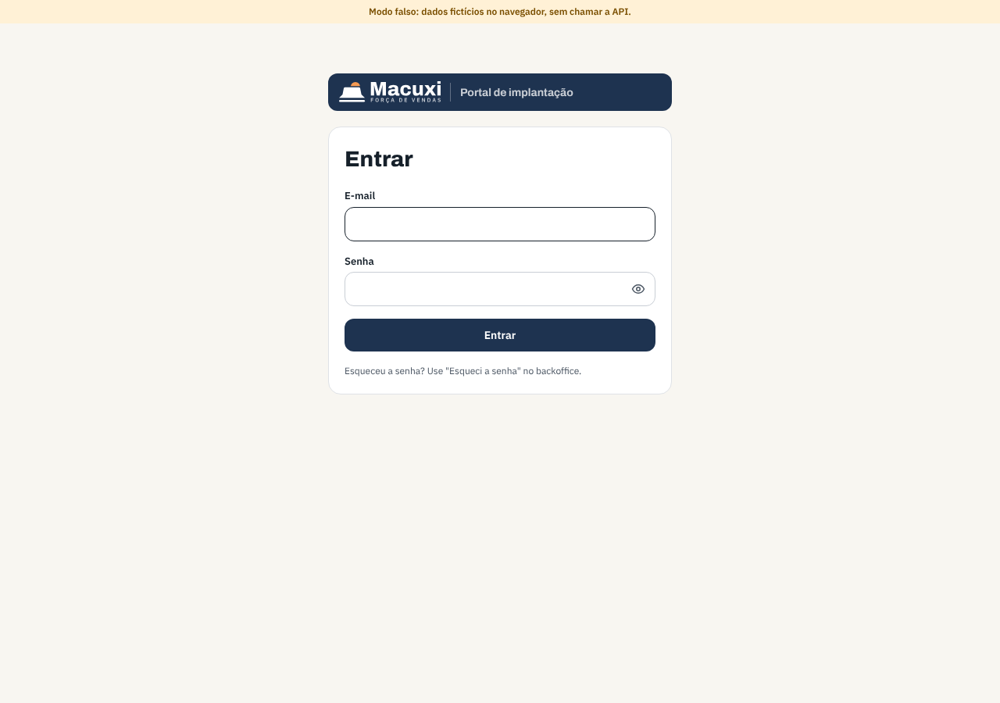
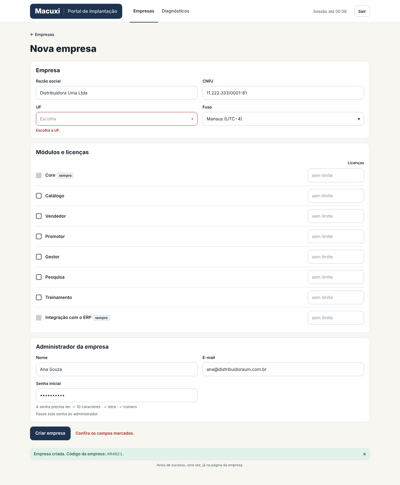
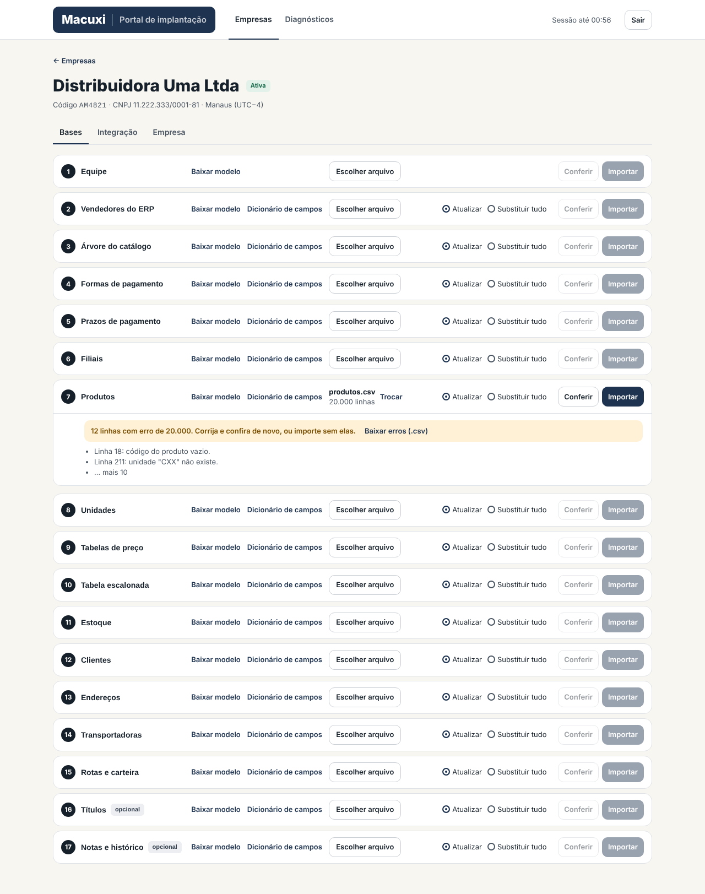
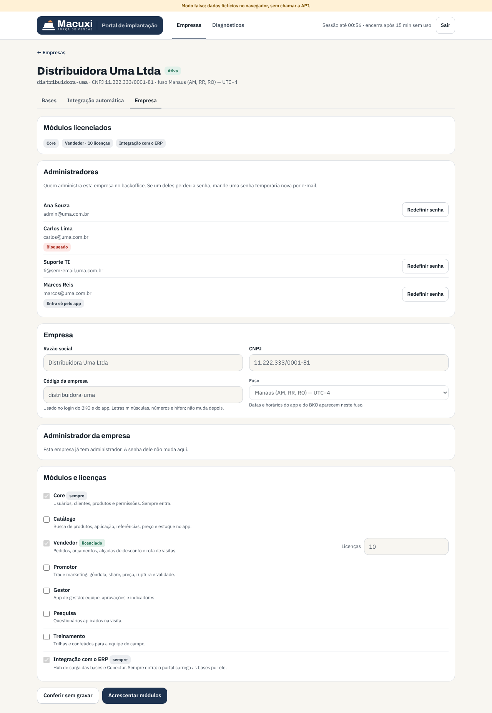
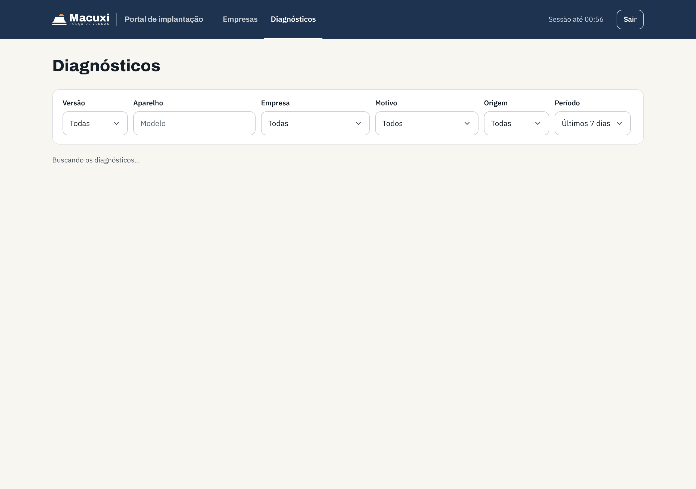
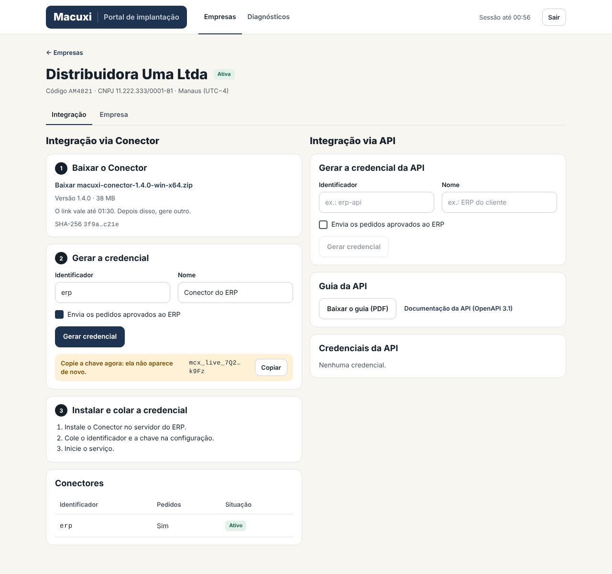

# Portal `config.` enxuto — textos finais, tela por tela (designer-ux)

> 2026-11-14 · designer-ux · pedido do dono do produto R-20261114-130000-alexandre; R-20261114-122200 (sai o "Parâmetros iniciais"); R-20261114-130500-alexandre e R-20261114-131200-alexandre (código da empresa = número da licença, **UF + 4 dígitos aleatórios, ex.: `AM4821`**, gerado pelo servidor; os dois últimos chegaram pela ponte e não foram lidos no repositório de recados nesta sessão — confirmar). Implementação: engenheiro-apps, branch `nuvem/portal-parametros-engenheiro-apps`. Telas: `apps/web/app/config/**`, `apps/web/components/portal/**` e textos em `apps/web/lib/{portal-carga,portal-admins,conector-download,equipe-csv,portal-diagnosticos}.ts`. Simulações em `docs/design/telas/portal-config-enxuto/` (`antes-*` = print do BKO no modo falso; `depois-*` = simulação, HTML + PNG em 1280 px, estilo em `portal.css`). Onde conflitar, esta spec substitui `docs/design/portal-entrar.md` §1, §2 e §6.

## Regras aplicadas
1. Cartão = título + ação. Sai frase que explica o funcionamento ou o que o sistema faz por trás (R-20261110-192153).
2. Uma informação, um lugar (R-20261110-093124).
3. Sem rótulo repetido e sem texto do navegador em inglês ("Choose File / No file chosen").
4. Passos na ordem em que a pessoa age.
5. Erro e aviso: uma frase, dizendo o que fazer.

## 0. Moldura (todas as páginas internas)
| Onde | Antes | Depois |
|---|---|---|
| Cabeçalho | "Sessão até 00:56 · encerra após 15 min sem uso" | **"Sessão até 00:56"** |
| Diálogo "Sua sessão terminou" | "Os links dos convites aparecem só nesta tela. Baixe agora, antes de entrar de novo: depois eles somem e cada pessoa vai precisar de um link novo pelo Renovar." | **"Baixe os links agora: depois eles somem."** |
| Diálogo "Sua sessão termina em N min" | "Os links dos convites aparecem só nesta tela. Baixe agora: quando a sessão terminar, eles somem." + "A sessão de 8 horas não se renova; depois dela, é preciso entrar de novo." | **"Baixe os links agora: depois eles somem."** |
| Diálogo "Baixar os convites antes de sair?" | "Os links dos convites aparecem só nesta tela. Se sair agora, eles somem e cada pessoa vai precisar de um link novo pelo Renovar." | **"Se sair agora, eles somem."** |

Botões sem mudança. Sai: 7 frases. Pergunta ao corretor: os convites saíram na T-0094; se nada mais gera link de convite, `lib/portal-saida` e os três diálogos são código morto e saem inteiros.

O cabeçalho "depois" aparece no topo de todas as simulações internas (ex.: `depois-02-empresas.png`).

## 1. Entrar
Título **"Entrar"** · **"E-mail"** · **"Senha"** (olho) · **"Entrar"**/"Entrando…" · **"Esqueceu a senha? Use "Esqueci a senha" no backoffice."**
Estados: **"Informe o e-mail e a senha."** · **"E-mail ou senha incorretos."** · **"Muitas tentativas erradas. Espere 15 minutos e tente de novo."** · **"Muitas tentativas deste endereço. Espere alguns minutos e tente de novo."** · **"Sua sessão terminou. Entre de novo."**
Muda: senha a trocar → **"Crie a sua senha no backoffice antes de entrar aqui."** (sai "Use o código da empresa, o e-mail e a senha que você recebeu."). Sai: 1.

| Antes | Depois |
|---|---|
|  |  |

## 2. Escolha a empresa
Título **"Escolha a empresa"** · lista (nome; embaixo o código, ex. **AM4821**; selo **"Atual"**) · **"Sair"**. Sai "Seu acesso vale para estas empresas.". Sai: 1.

| Antes | Depois |
|---|---|
|  |  |

## 3. Empresas
Título **"Empresas"** + **"Nova empresa"**. Sai o subtítulo "Cada empresa cliente é um tenant. Crie a empresa e carregue as bases dela, na ordem dos cartões." Tabela **Empresa · Código · CNPJ · Módulos · Situação · Criada em** (Código em maiúsculas, ex. AM4821). Vazio: só **"Nenhuma empresa ainda."** (sai "Comece pela empresa cliente: razão social, CNPJ, fuso, módulos e os parâmetros iniciais." e o botão "Cadastrar a primeira empresa", que repete o "Nova empresa"). Sai: 3 frases + 1 botão.

| Antes | Depois (lista e, abaixo, o estado vazio) |
|---|---|
|  |  |

## 4. Nova empresa
"← Empresas" · **"Nova empresa"**. Saem "Passo 1" e "Confira antes de gravar: o código da empresa não muda depois. As bases vêm nos próximos passos."
1. **"Empresa"**: **Razão social** · **CNPJ** · **UF** (obrigatório, lista das 27, sem pré-seleção; erro **"Escolha a UF."**) · **Fuso**. Sai o campo "Código da empresa" e a ajuda dele; sai a ajuda do fuso "Datas e horários do app e do BKO aparecem neste fuso."
2. **"Módulos e licenças"**: só o nome de cada módulo, selo **"sempre"** em Core e Integração com o ERP (fica; pergunta ao dono do produto no §10), campo **"Licenças"** (placeholder "sem limite"). Saem as 8 descrições (`ROTULO_MODULO[*].ajuda`, 10 frases).
3. **"Administrador da empresa"**: Nome · E-mail · Senha inicial com "A senha precisa ter" ao vivo; embaixo só **"Passe esta senha ao administrador."** Saem "É o primeiro acesso da empresa. Ele cria os outros usuários no BKO." e "No primeiro acesso ao backoffice, ele cria a dele."
4. **Sai o cartão "Parâmetros iniciais" inteiro** (alçadas, validade, aplicação e "Desconto que o vendedor dá sem aprovação."); o corpo vai sem `parametros`.

Botão só **"Criar empresa"**/"Criando…" (sai "Conferir sem gravar": sem código digitado não há o que conferir; os erros por campo aparecem no Criar e nada é gravado com erro). Erro **"Confira os campos marcados."** Sucesso: página da empresa com aviso success fechável, uma vez: **"Empresa criada. Código da empresa: AM4821."**
Sai: 18 frases, "Passo 1", 1 campo, 1 cartão (5 campos), 1 botão. Entra: campo UF.

| Antes | Depois (com o erro da UF e, no fim, o aviso de sucesso que aparece na página da empresa) |
|---|---|
|  |  |

## 5. Página da empresa — cabeçalho
"← Empresas" (só time Macuxi) · razão social + selo da situação · **"Código AM4821 · CNPJ 11.222.333/0001-81 · Manaus (UTC−4)"**. Abas **"Bases" · "Integração" · "Empresa"** (sai "automática").
> Abas revogadas pelo §10: **"Integração" · "Empresa"**, Integração abre por padrão. O resto do cabeçalho fica.

O cabeçalho "depois" aparece no topo de `depois-04-bases.png`, `depois-05-integracao.png` e `depois-06-aba-empresa.png`.

## 6. Aba Bases
> **Revogado pelo §10**: a aba Bases sai inteira (inclusive a Equipe por CSV). O texto abaixo fica só como registro.

Sai "Carregue na ordem: cada base usa as anteriores. Confira sem gravar, corrija pelo "Baixar erros" e importe."
Cartões numerados: **Equipe = 1, bases do Hub = posição + 1** (sai o "0"). Cartão em uma linha: **nº · título [· "opcional"] [· status]** · **"Baixar modelo"** · **"Dicionário de campos"** (Hub) · **"Escolher arquivo"** · rádio **"Atualizar"/"Substituir tudo"** (Hub; padrão Atualizar) · **"Conferir"** · **"Importar"**.
- Sai a descrição de todos os cartões: Equipe (3 frases — o exemplo do dono do produto) e `CARTAO_DA_ENTIDADE[*].descricao` (21 frases; o campo sai do código).
- Sai "Carregue depois de: …".
- Sai o rótulo "Arquivo CSV" e o input nativo em inglês: botão **"Escolher arquivo"**; escolhido, mostra **"produtos.csv · 20.000 linhas"** e **"Trocar"**; `aria-label` **"Arquivo CSV de {título}"**.
- "Delta"/"Completo" → **"Atualizar"/"Substituir tudo"**; saem a legenda "Modo" e a ajuda por cartão.
- "Conferir sem gravar" → **"Conferir"**; "Importar CSV"/"Importar equipe" → **"Importar"**.
- Sai o rodapé da Equipe "Se alguma linha tiver erro, nada é gravado: corrija o arquivo e importe de novo. Quem já existe (mesmo e-mail) é atualizado, não duplicado."
- Sai "em N partes (até 5.000 linhas cada, na mesma sessão)".

Estados (abaixo da linha, só depois de agir):

| Estado | Texto final |
|---|---|
| Lendo | "Lendo o arquivo…" |
| Não leu | "Não deu para ler o arquivo. Salve como CSV (UTF-8) e escolha de novo." |
| Conferido ok (Hub) | **"20.000 linhas sem erro. Pode importar."** |
| Conferido com erro (Hub) | **"12 linhas com erro de 20.000. Corrija e confira de novo, ou importe sem elas."** + "Baixar erros (.csv)" + lista |
| Conferido ok (Equipe) | **"3 novas · 1 atualizada · 0 sem mudança · 0 com erro. Pode importar."** |
| Erro (Equipe) | **"Nada foi gravado: 2 pessoas com erro de 40. Corrija e importe de novo."** + "Baixar erros (.csv)" + lista |
| Avisos (Equipe) | título **"Avisos"** |
| Plano (Equipe) | "Ver o que muda (4 pessoas)" |
| Enviando/gravando | barra + % e **"Enviando…"**/**"Gravando…"** |
| Ainda gravando | **"Ainda gravando. Volte daqui a pouco para ver o resultado."** |
| Repetido | **"Este arquivo já foi importado."** |
| Inativação segurada | **"Muitos registros seriam inativados. Confirme no monitor da Integração, no backoffice."** |
| Resultado | "1.200 novas · 300 atualizadas · 18.500 sem mudança · 0 com erro" |
| Equipe gravada | **"Equipe gravada: 3 novas · 1 atualizada · 36 sem mudança · 0 com erro."** (sai "N acessos enviados por e-mail.", repete as novas) |
| Sem e-mail (Equipe) | "O envio de e-mail não está configurado, e nada foi gravado. Fale com o suporte da Macuxi." |
| Sem Integração (403) | **"A Integração não está licenciada. Acrescente o módulo na aba Empresa."** |

Diálogo: **"Substituir tudo?"** · **"produtos.csv, 20.000 linhas."** · **"O que não estiver no arquivo será inativado."** · com erro: **"12 linhas com erro ficam de fora."** · **"Cancelar"**/**"Substituir tudo"** (danger). Sai `TEXTO_COMPLETO_COM_ERROS`.
Sai: até 59 frases (2 topo + 3 Equipe + 2 rodapé + 21 descrições + até 16 "Carregue depois de" + 15 ajudas do modo), 16 "Arquivo CSV", 16 "Modo".

A simulação mostra os 17 cartões (Equipe = 1; as 16 bases do Hub = 2 a 17), cada um em uma linha, e o cartão 7 (Produtos) expandido com o estado "Conferido com erro (Hub)".

| Antes | Depois |
|---|---|
|  |  |

## 7. Aba Integração
> **Revogado pelo §10**: a aba passa a ter dois lados, "Integração via Conector" e "Integração via API". O texto abaixo fica só como registro.

Ordem: **Conector → Nova credencial → Conectores.**
1. **"Conector"**: "Gerar link do Conector"/"Gerando…" → link "Baixar {arquivo}", pacote, validade, SHA-256 (sem mudança); "Documentação da API (OpenAPI 3.1)". Sai "O guia da API (autenticação, delta e cursor, idempotência, ordem de carga, limites e erros) chega em breve neste servidor."
2. **"Nova credencial"** (antes "Credencial da API do Conector do ERP"): Identificador · Nome · **"Envia os pedidos aprovados ao ERP"** · "Gerar credencial". Saem "Gera a chave que o Conector instalado no servidor do cliente usa para enviar as bases e buscar os pedidos." e "Vai no arquivo de configuração do Conector." Chave gerada: **"Copie a chave agora: ela não aparece de novo."** + "Copiar".
3. **"Conectores"** (antes "Conectores desta empresa"); vazio **"Nenhum Conector."**

Diálogo "Passar as bases ao Conector do ERP?": **"A carga por CSV para de funcionar nesta empresa."** + com livres **"Sem desativar, o Conector leva só: {bases}."** Sai: 6 frases.

| Antes | Depois (com a chave recém-gerada) |
|---|---|
|  |  |

## 8. Aba Empresa
Dois cartões: 1. **"Módulos e licenças"** (sem descrições; já licenciado = selo "licenciado", travado) + **"Acrescentar módulos"** (sai "Conferir sem gravar"); resultado **"Módulos acrescentados: Catálogo."**/**"Nada mudou."**; admin do cliente vê só leitura (nome + licenças, sem caixas e sem botão). 2. **"Administradores"** (só time Macuxi): lista + selos "Bloqueado"/"Entra só pelo app" + "Redefinir senha"; sai a ajuda "Quem administra esta empresa no backoffice. Se um deles perdeu a senha, mande uma senha temporária nova por e-mail."; diálogo **"Uma senha temporária vai para {e-mail}. {Nome} sai do Macuxi em todos os aparelhos."**
Saem três cartões repetidos: "Módulos licenciados", "Empresa" (campos travados que repetem o cabeçalho) e "Administrador da empresa" ("Esta empresa já tem administrador. A senha dele não muda aqui."). Sai: 17 frases, 3 cartões, 1 botão.

| Antes | Depois |
|---|---|
|  |  |

## 9. Diagnósticos
Sai o subtítulo "Enviados pelos aparelhos. Ficam 90 dias." Resto igual. Sai: 2.

| Antes | Depois |
|---|---|
|  |  |

## Placar
> Linhas "Aba Bases", "Aba Integração" e "Total" revogadas pelo §10 (placar novo lá).

| Tela | Frases que saem | Além disso |
|---|---|---|
| Moldura | 7 | — |
| Entrar | 1 | — |
| Escolha a empresa | 1 | — |
| Empresas | 3 | 1 botão repetido |
| Nova empresa | 18 | campo Código, cartão Parâmetros (5 campos), "Passo 1", "Conferir sem gravar"; entra UF |
| Aba Bases | até 59 | 16 "Arquivo CSV", 16 "Modo", input em inglês |
| Aba Integração | 6 | — |
| Aba Empresa | 17 | 3 cartões repetidos, "Conferir sem gravar" |
| Diagnósticos | 2 | — |
| **Total** | **até 114** | |

## Achados RD (corretor) e MC (marca)
Os recados do corretor-redundancias e do design-de-marca não chegaram a esta sessão (coord.mjs com HTTP 403 no GraphQL; repositório de recados não liberado). Cada achado RD de excesso/repetição nas telas do `config.` deve estar coberto por uma linha acima; achado sem linha correspondente entra aqui como **§10 Adendo** antes do fechamento do PR do engenheiro-apps. Achados MC (cor/layout) idem; o layout novo do cartão de base em uma linha precisa da validação do design-de-marca antes do lote.

| Achado | Tela | Resposta | Onde |
|---|---|---|---|
| (pendente: recados não lidos nesta sessão) | | | |

## Para o engenheiro-apps
- testIDs ficam; mudam os asserts de texto (`TEXTOS_*`, `CARTAO_DA_ENTIDADE`, `ROTULO_MODO`, `TEXTOS_ADMINS`, `TEXTOS_PORTAL_DIAGNOSTICOS`). Saem `empresa.codigo`, `empresa.alcada-*`, `empresa.validade-orcamento`, `empresa.aplicacao-orcamento`, `empresa.conferir`, `empresa.admin-existente`; entra `empresa.uf`.
- `CARTAO_DA_ENTIDADE[*].descricao` e `ROTULO_MODULO[*].ajuda` saem do código.
- Código UF+4 depende da API (`CriarEmpresaSchema` com `uf` e sem `codigo`; resposta com `codigo`) — dono: engenheiro-software/modulo-core. O modo falso (`lib/portal-falso.ts`) gera `AM4821` igual.

## 10. Adendo — Integração via Conector e via API; CSV fora do portal
> 2026-11-14 · designer-ux · pedido do dono do produto R-20261114-132000-alexandre (chegou pela ponte; não lido no repositório de recados nesta sessão — confirmar). Onde conflitar, o §10 vale sobre §5 (abas), §6, §7 e o Placar.

**Regra:** ou é Conector, ou é API. O CSV sai do portal: a aba Bases (com a Equipe por CSV), o Conector de arquivo e todo texto sobre CSV.

### 10.1 Abas
Abas da página da empresa: **"Integração" · "Empresa"**; **Integração abre por padrão**. O resto do cabeçalho do §5 fica igual. O §6 (aba Bases) está revogado inteiro.

### 10.2 Aba Integração em dois lados
Dois lados lado a lado, com a mesma largura (≥ 768 px). Abaixo de ~768 px, empilhados: **Conector primeiro**, API depois. Cada lado tem título de seção e, embaixo, só a lista do que já existe.

**Esquerda — "Integração via Conector"** (passos numerados na ordem em que a pessoa age):
1. **"Baixar o Conector"**: botão "Gerar o link do Conector"/"Gerando o link…" (texto atual de `TEXTOS_DOWNLOAD_CONECTOR`) → link **"Baixar {arquivo}"**, embaixo **"Versão 1.4.0 · 38 MB"** (sai o nome do arquivo dessa linha: já está no link), **"O link vale até 01:30. Depois disso, gere outro."** e **"SHA-256 {hash}"**. Estados de erro do download sem mudança.
2. **"Gerar a credencial"**: **Identificador** · **Nome** · caixa **"Envia os pedidos aprovados ao ERP"** · **"Gerar credencial"** (principal). Chave gerada: **"Copie a chave agora: ela não aparece de novo."** + chave + **"Copiar"**.
3. **"Instalar e colar a credencial"**: lista numerada, três linhas:
   1. **"Instale o Conector no servidor do ERP."**
   2. **"Cole o identificador e a chave na configuração."**
   3. **"Inicie o serviço."**

Embaixo: **"Conectores"** — tabela **Identificador · Pedidos · Situação**; vazio **"Nenhum Conector."**

**Direita — "Integração via API":**
1. **"Gerar a credencial da API"**: os mesmos campos e textos do passo 2 da esquerda — **Identificador** · **Nome** · **"Envia os pedidos aprovados ao ERP"** · **"Gerar credencial"** (neutro) · chave gerada com o mesmo aviso e "Copiar".
   - Decisão (caixa de pedidos fica): pela API o ERP também busca os pedidos aprovados; a caixa diz se esta credencial pode buscá-los, igual ao Conector.
   - Decisão (botão neutro): um só principal por tela; o principal fica no Conector, que é o primeiro caminho.
2. **"Guia da API"**: botão **"Baixar o guia (PDF)"** + link **"Documentação da API (OpenAPI 3.1)"** (o link sai do lado do Conector: uma informação, um lugar).
   - Decisão: enquanto o PDF não existir, o botão **não aparece** e o cartão fica só com o link do OpenAPI. Sem "O guia chega em breve.": a pessoa não age com esse texto.

Embaixo: **"Credenciais da API"** — tabela **Identificador · Pedidos · Situação** (a coluna Pedidos fica, porque a caixa ficou); vazio **"Nenhuma credencial."**

**Sai:** o diálogo "Passar as bases ao Conector do ERP?" inteiro (título, 3 frases, botões "Gerar só para as bases livres" e "Desativar o de arquivo e passar todas"), o tipo "Carga por arquivo" (`ROTULO_TIPO.arquivo`), "Nenhum Conector ainda. A primeira importação de CSV cria o Conector de arquivo do portal.", "O guia da API (…) chega em breve neste servidor.", "Gera a chave que o Conector…" e "Vai no arquivo de configuração do Conector."

| Antes | Depois, 1280 px (com o link gerado e a chave recém-gerada) | Depois, celular 390 px |
|---|---|---|
|  |  |  |

A simulação do §7 (`depois-05-integracao.*`) e a do §6 (`depois-04-bases.*`) ficam só como registro.

### 10.3 Nova empresa (§4)
Fica como está: selo **"sempre"** em Core e em Integração com o ERP. **Pergunta ao dono do produto:** sem CSV, toda empresa precisa de Conector ou API; a Integração com o ERP continua "sempre"?

### 10.4 Placar novo
| Tela | Frases que saem | Além disso |
|---|---|---|
| Moldura | 7 | — |
| Entrar | 1 | — |
| Escolha a empresa | 1 | — |
| Empresas | 3 | 1 botão repetido |
| Nova empresa | 18 | campo Código, cartão Parâmetros (5 campos), "Passo 1", "Conferir sem gravar"; entra UF |
| Aba Bases | **aba inteira, 17 cartões** (antes: até 59 frases enxugadas; agora sai tudo) | a aba some |
| Aba Integração | 8 | diálogo inteiro (3 botões), tipo "Carga por arquivo"; entram 2 títulos de lado, 3 passos com 3 linhas, 3 cartões da API |
| Aba Empresa | 17 | 3 cartões repetidos, "Conferir sem gravar" |
| Diagnósticos | 2 | — |
| **Total** | **57 frases + a aba Bases inteira (17 cartões)** | |

### 10.5 Para o engenheiro-apps
- **Saem do portal:** `components/portal/cartao-base.tsx`, `components/portal/cartao-equipe.tsx`, `lib/portal-carga.ts`, `lib/portal-carga-rede.ts` (e `portal-carga.test.ts`), `lib/equipe-csv.ts` (e o teste), o Conector de arquivo em `lib/portal-rotas.ts` ("Carga por arquivo (implantação)"), a Equipe por CSV de `lib/portal-falso.ts` e os testIDs `base-*`, `equipe-*` e `integracao.confirmar-*`. Confirmar com o corretor-redundancias se algum deles é usado fora do portal antes de apagar.
- `tela-empresa.tsx`: abas Integração e Empresa; Integração abre por padrão.
- `aba-integracao.tsx`: dois lados (grid de 2 colunas ≥ 768 px; 1 coluna abaixo, Conector primeiro); o botão do Conector passa para dentro do passo 1; `textoDoPacote` sem o nome do arquivo quando o link já o mostra; o link do OpenAPI vai para o cartão "Guia da API"; `integracao.guia` vira o botão do PDF, só quando ele existir.
- **A Equipe passa a vir só pelo ERP (Conector/API) ou pelo BKO.** Pendência — pergunta ao dono do produto: a Equipe por CSV sai mesmo do portal?
- **Pendência para engenheiro-software / modulo-integracao:** credencial de API separada da do Conector (tipo próprio, ex. o `nuvem` que já existe em `ROTULO_TIPO`, rota que lista só as de API) e o guia da API em PDF (modulo-integracao faz e manda ao designer-ux para revisão de layout). Se a rota não existir, o lado direito mostra só o guia e o link do OpenAPI.
