# Portal `config.` enxuto — textos finais, tela por tela (designer-ux)

**Situação:** Fechada em 14/11/2026: todos os achados RD e MC respondidos (§13); perguntas 1–3 do §11.7 aguardando o dono do produto.

> 2026-11-14 · designer-ux · pedido do dono do produto R-20261114-130000-alexandre; R-20261114-122200 (sai o "Parâmetros iniciais"); R-20261114-130500-alexandre e R-20261114-131200-alexandre (código da empresa = número da licença, **UF + 4 dígitos aleatórios, ex.: `AM4821`**, gerado pelo servidor; os dois últimos chegaram pela ponte e não foram lidos no repositório de recados nesta sessão — confirmar). Implementação: engenheiro-apps, branch `nuvem/portal-parametros-engenheiro-apps`. Telas: `apps/web/app/config/**`, `apps/web/components/portal/**` e textos em `apps/web/lib/{portal-carga,portal-admins,conector-download,equipe-csv,portal-diagnosticos}.ts`. Simulações em `docs/design/telas/portal-config-enxuto/` (`antes-*` = print do BKO no modo falso; `depois-*` = simulação, HTML + PNG em 1280 px, estilo em `portal.css`). Onde conflitar, esta spec substitui `docs/design/portal-entrar.md` §1, §2 e §6.

## Regras aplicadas
1. Cartão = título + ação. Sai frase que explica o funcionamento ou o que o sistema faz por trás (R-20261110-192153).
2. Uma informação, um lugar (R-20261110-093124).
3. Sem rótulo repetido e sem texto do navegador em inglês ("Choose File / No file chosen").
4. Passos na ordem em que a pessoa age.
5. Erro e aviso: uma frase, dizendo o que fazer.

## 0. Moldura (todas as páginas internas)
| Onde | Antes | Depois |
|---|---|---|
| Cabeçalho | "Sessão até 00:56 · encerra após 15 min sem uso" | **"Sessão até 00:56"** |
| Diálogo "Sua sessão terminou" | "Os links dos convites aparecem só nesta tela. Baixe agora, antes de entrar de novo: depois eles somem e cada pessoa vai precisar de um link novo pelo Renovar." | **sai inteiro** (ajustado pelo RD-0262) |
| Diálogo "Sua sessão termina em N min" | "Os links dos convites aparecem só nesta tela. Baixe agora: quando a sessão terminar, eles somem." + "A sessão de 8 horas não se renova; depois dela, é preciso entrar de novo." | **sai inteiro** (ajustado pelo RD-0262) |
| Diálogo "Baixar os convites antes de sair?" | "Os links dos convites aparecem só nesta tela. Se sair agora, eles somem e cada pessoa vai precisar de um link novo pelo Renovar." | **sai inteiro** (ajustado pelo RD-0262) |
| Nome da empresa no cabeçalho (admin do cliente) | "Distribuidora Uma Ltda" no cabeçalho e no título da página | **sai do cabeçalho**; fica só no título da página (ajustado pelo RD-0261) |
| Rota ausente no servidor (11 textos: "… chega em breve neste servidor.", "… ainda não está disponível neste servidor.") | um texto por controle | **"Ainda não disponível neste servidor."**, ao lado do controle, constante única (ajustado pelo RD-0288) |

~~Botões sem mudança. Sai: 7 frases. Pergunta ao corretor: os convites saíram na T-0094; se nada mais gera link de convite, `lib/portal-saida` e os três diálogos são código morto e saem inteiros.~~ **Respondida pelo corretor (RD-0262):** código morto; os três diálogos saem inteiros, com `TEXTO_UMA_VEZ`, `rotuloDeBaixar`, `useSaidaSegurada`, `pedirSaida`, `avisoDeFimDaSessao` e o que sobrar sem uso em `lib/portal-saida.ts`.

**Cabeçalho na faixa (ajustado pelo MC-0022 e pelo MC-0023):** a barra inteira é a faixa Azul noite `#1E3350` (largura total); dentro dela, o logo negativo a **104 px** (22 px de altura) com **14 px de folga**, sem fundo nem arredondado próprios, o filete e **"Portal de implantação"** em `#C9CED5`; aba ativa branca com filete branco, inativa `#C9CED5` (branca no hover); "Sessão até 00:56" em `#C9CED5`; "Sair" e "Trocar de empresa" com borda `#C9CED5`, fundo transparente e texto branco; foco `outline-white`. Na tela Entrar e na Escolha a empresa (sem cabeçalho), a mesma marca fica numa faixa solta, arredondada, com 14 px de folga. Especificação do componente: `docs/design/componentes.md` §5.3.
**Botão-link principal (ajustado pelo MC-0021):** "Nova empresa" e "Ir para a sua empresa" em Azul noite (`bg-accent`, hover `bg-accent/90`), como o `Button` principal; sai o grafite `bg-ink`/`#0b1218`.

O cabeçalho "depois" aparece no topo de todas as simulações internas (ex.: `depois-02-empresas.png`, re-renderizada com a faixa).

## 1. Entrar
Título **"Entrar"** · **"E-mail"** · **"Senha"** (olho) · **"Entrar"**/"Entrando…" · **"Esqueceu a senha? Use "Esqueci a senha" no backoffice."**
Estados: **"Informe o e-mail e a senha."** · **"E-mail ou senha incorretos."** · **"Muitas tentativas erradas. Espere 15 minutos e tente de novo."** · **"Muitas tentativas deste endereço. Espere alguns minutos e tente de novo."** · **"Sua sessão terminou. Entre de novo."**
Muda: senha a trocar → **"Crie a sua senha no backoffice antes de entrar aqui."** (sai "Use o código da empresa, o e-mail e a senha que você recebeu."). Sai: 1.

| Antes | Depois |
|---|---|
|  |  |

## 2. Escolha a empresa
Título **"Escolha a empresa"** · lista (nome; embaixo o código, ex. **AM4821**; selo **"Atual"**) · **"Sair"**. Sai "Seu acesso vale para estas empresas.". Sai: 1.

| Antes | Depois |
|---|---|
| 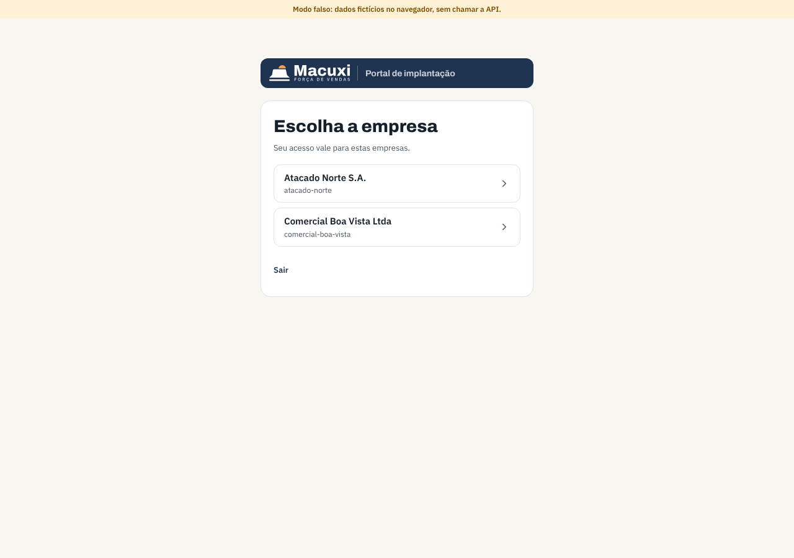 | 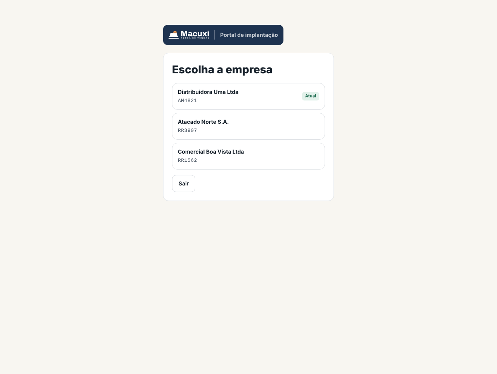 |

## 3. Empresas
Título **"Empresas"** + **"Nova empresa"**. Sai o subtítulo "Cada empresa cliente é um tenant. Crie a empresa e carregue as bases dela, na ordem dos cartões." Tabela **Empresa · Código · CNPJ · Módulos · Situação · Criada em** (Código em maiúsculas, ex. AM4821). Vazio: só **"Nenhuma empresa ainda."** (sai "Comece pela empresa cliente: razão social, CNPJ, fuso, módulos e os parâmetros iniciais." e o botão "Cadastrar a primeira empresa", que repete o "Nova empresa"). Sai: 3 frases + 1 botão.
> Ver §11: a coluna "Módulos" vira **"Plano"**.

| Antes | Depois (lista e, abaixo, o estado vazio) |
|---|---|
|  | 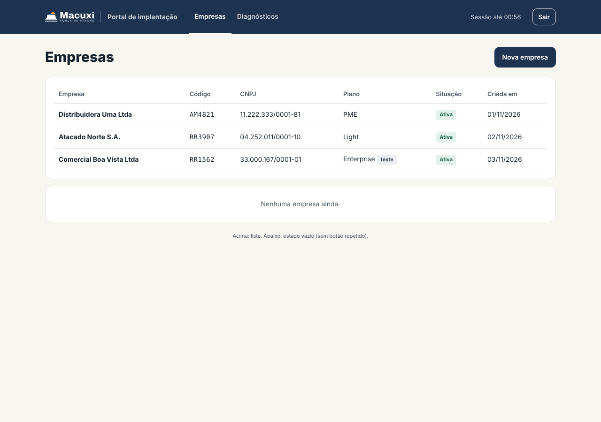 |

## 4. Nova empresa
> Ver §11: CNPJ no topo preenche o cartão "Empresa" pela Receita; o cartão "Módulos e licenças" (item 2) dá lugar a Plano, Adicionais e Ciclo. Simulação nova: `depois-03b-nova-empresa.png`.

"← Empresas" · **"Nova empresa"**. Saem "Passo 1" e "Confira antes de gravar: o código da empresa não muda depois. As bases vêm nos próximos passos."
1. **"Empresa"**: **Razão social** · **CNPJ** · **UF** (obrigatório, lista das 27, sem pré-seleção; erro **"Escolha a UF."**) · **Fuso**. Sai o campo "Código da empresa" e a ajuda dele; sai a ajuda do fuso "Datas e horários do app e do BKO aparecem neste fuso."
2. **"Módulos e licenças"**: só o nome de cada módulo, selo **"sempre"** em Core e Integração com o ERP (fica; pergunta ao dono do produto no §10), campo **"Licenças"** (placeholder "sem limite"). Saem as 8 descrições (`ROTULO_MODULO[*].ajuda`, 10 frases).
3. **"Administrador da empresa"**: Nome · E-mail · Senha inicial com "A senha precisa ter" ao vivo; embaixo só **"Passe esta senha ao administrador."** Saem "É o primeiro acesso da empresa. Ele cria os outros usuários no BKO." e "No primeiro acesso ao backoffice, ele cria a dele." Senha vazia ao criar: só **"Informe a senha inicial."**, com as regras neutras; o vermelho das regras volta quando há senha digitada (ajustado pelo RD-0272).
4. **Sai o cartão "Parâmetros iniciais" inteiro** (alçadas, validade, aplicação e "Desconto que o vendedor dá sem aprovação."); o corpo vai sem `parametros`.

Botão só **"Criar empresa"**/"Criando…" (sai "Conferir sem gravar": sem código digitado não há o que conferir; os erros por campo aparecem no Criar e nada é gravado com erro). Erro **"Confira os campos marcados."** Sucesso: página da empresa com aviso success fechável, uma vez: **"Empresa criada. Código da empresa: AM4821."**
Sai: 18 frases, "Passo 1", 1 campo, 1 cartão (5 campos), 1 botão. Entra: campo UF.

| Antes | Depois (com o erro da UF e, no fim, o aviso de sucesso que aparece na página da empresa) |
|---|---|
|  |  |

## 5. Página da empresa — cabeçalho
"← Empresas" (só time Macuxi) · razão social + selo da situação · **"Código AM4821 · CNPJ 11.222.333/0001-81 · Manaus (UTC−4)"**. Empresa que não existe: só **"Empresa não encontrada."** (ou **"Empresa não encontrada ou inativa."**); sai "Volte à lista de empresas.", que repete o "← Empresas" (ajustado pelo RD-0293). Abas **"Bases" · "Integração" · "Empresa"** (sai "automática").
> Abas revogadas pelo §10: **"Integração" · "Empresa"**, Integração abre por padrão. O resto do cabeçalho fica.

O cabeçalho "depois" aparece no topo de `depois-04-bases.png`, `depois-05-integracao.png` e `depois-06-aba-empresa.png`.

## 6. Aba Bases
> **Revogado pelo §10**: a aba Bases sai inteira (inclusive a Equipe por CSV). O texto abaixo fica só como registro.

Sai "Carregue na ordem: cada base usa as anteriores. Confira sem gravar, corrija pelo "Baixar erros" e importe."
Cartões numerados: **Equipe = 1, bases do Hub = posição + 1** (sai o "0"). Cartão em uma linha: **nº · título [· "opcional"] [· status]** · **"Baixar modelo"** · **"Dicionário de campos"** (Hub) · **"Escolher arquivo"** · rádio **"Atualizar"/"Substituir tudo"** (Hub; padrão Atualizar) · **"Conferir"** · **"Importar"**.
- Sai a descrição de todos os cartões: Equipe (3 frases — o exemplo do dono do produto) e `CARTAO_DA_ENTIDADE[*].descricao` (21 frases; o campo sai do código).
- Sai "Carregue depois de: …".
- Sai o rótulo "Arquivo CSV" e o input nativo em inglês: botão **"Escolher arquivo"**; escolhido, mostra **"produtos.csv · 20.000 linhas"** e **"Trocar"**; `aria-label` **"Arquivo CSV de {título}"**.
- "Delta"/"Completo" → **"Atualizar"/"Substituir tudo"**; saem a legenda "Modo" e a ajuda por cartão.
- "Conferir sem gravar" → **"Conferir"**; "Importar CSV"/"Importar equipe" → **"Importar"**.
- Sai o rodapé da Equipe "Se alguma linha tiver erro, nada é gravado: corrija o arquivo e importe de novo. Quem já existe (mesmo e-mail) é atualizado, não duplicado."
- Sai "em N partes (até 5.000 linhas cada, na mesma sessão)".

Estados (abaixo da linha, só depois de agir):

| Estado | Texto final |
|---|---|
| Lendo | "Lendo o arquivo…" |
| Não leu | "Não deu para ler o arquivo. Salve como CSV (UTF-8) e escolha de novo." |
| Conferido ok (Hub) | **"20.000 linhas sem erro. Pode importar."** |
| Conferido com erro (Hub) | **"12 linhas com erro de 20.000. Corrija e confira de novo, ou importe sem elas."** + "Baixar erros (.csv)" + lista |
| Conferido ok (Equipe) | **"3 novas · 1 atualizada · 0 sem mudança · 0 com erro. Pode importar."** |
| Erro (Equipe) | **"Nada foi gravado: 2 pessoas com erro de 40. Corrija e importe de novo."** + "Baixar erros (.csv)" + lista |
| Avisos (Equipe) | título **"Avisos"** |
| Plano (Equipe) | "Ver o que muda (4 pessoas)" |
| Enviando/gravando | barra + % e **"Enviando…"**/**"Gravando…"** |
| Ainda gravando | **"Ainda gravando. Volte daqui a pouco para ver o resultado."** |
| Repetido | **"Este arquivo já foi importado."** |
| Inativação segurada | **"Muitos registros seriam inativados. Confirme no monitor da Integração, no backoffice."** |
| Resultado | "1.200 novas · 300 atualizadas · 18.500 sem mudança · 0 com erro" |
| Equipe gravada | **"Equipe gravada: 3 novas · 1 atualizada · 36 sem mudança · 0 com erro."** (sai "N acessos enviados por e-mail.", repete as novas) |
| Sem e-mail (Equipe) | "O envio de e-mail não está configurado, e nada foi gravado. Fale com o suporte da Macuxi." |
| Sem Integração (403) | **"A Integração não está licenciada. Acrescente o módulo na aba Empresa."** |

Diálogo: **"Substituir tudo?"** · **"produtos.csv, 20.000 linhas."** · **"O que não estiver no arquivo será inativado."** · com erro: **"12 linhas com erro ficam de fora."** · **"Cancelar"**/**"Substituir tudo"** (danger). Sai `TEXTO_COMPLETO_COM_ERROS`.
Sai: até 59 frases (2 topo + 3 Equipe + 2 rodapé + 21 descrições + até 16 "Carregue depois de" + 15 ajudas do modo), 16 "Arquivo CSV", 16 "Modo".

A simulação mostra os 17 cartões (Equipe = 1; as 16 bases do Hub = 2 a 17), cada um em uma linha, e o cartão 7 (Produtos) expandido com o estado "Conferido com erro (Hub)".

| Antes | Depois |
|---|---|
| 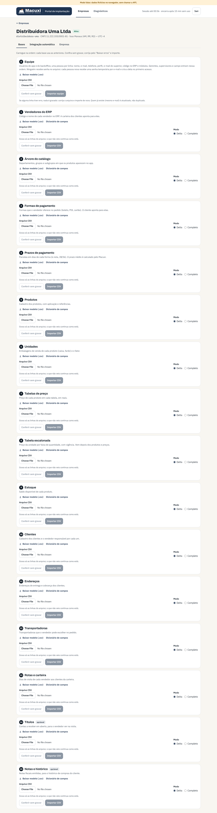 |  |

## 7. Aba Integração
> **Revogado pelo §10**: a aba passa a ter dois lados, "Integração via Conector" e "Integração via API". O texto abaixo fica só como registro.

Ordem: **Conector → Nova credencial → Conectores.**
1. **"Conector"**: "Gerar link do Conector"/"Gerando…" → link "Baixar {arquivo}", pacote, validade, SHA-256 (sem mudança); "Documentação da API (OpenAPI 3.1)". Sai "O guia da API (autenticação, delta e cursor, idempotência, ordem de carga, limites e erros) chega em breve neste servidor."
2. **"Nova credencial"** (antes "Credencial da API do Conector do ERP"): Identificador · Nome · **"Envia os pedidos aprovados ao ERP"** · "Gerar credencial". Saem "Gera a chave que o Conector instalado no servidor do cliente usa para enviar as bases e buscar os pedidos." e "Vai no arquivo de configuração do Conector." Chave gerada: **"Copie a chave agora: ela não aparece de novo."** + "Copiar".
3. **"Conectores"** (antes "Conectores desta empresa"); vazio **"Nenhum Conector."**

Diálogo "Passar as bases ao Conector do ERP?": **"A carga por CSV para de funcionar nesta empresa."** + com livres **"Sem desativar, o Conector leva só: {bases}."** Sai: 6 frases.

| Antes | Depois (com a chave recém-gerada) |
|---|---|
|  | 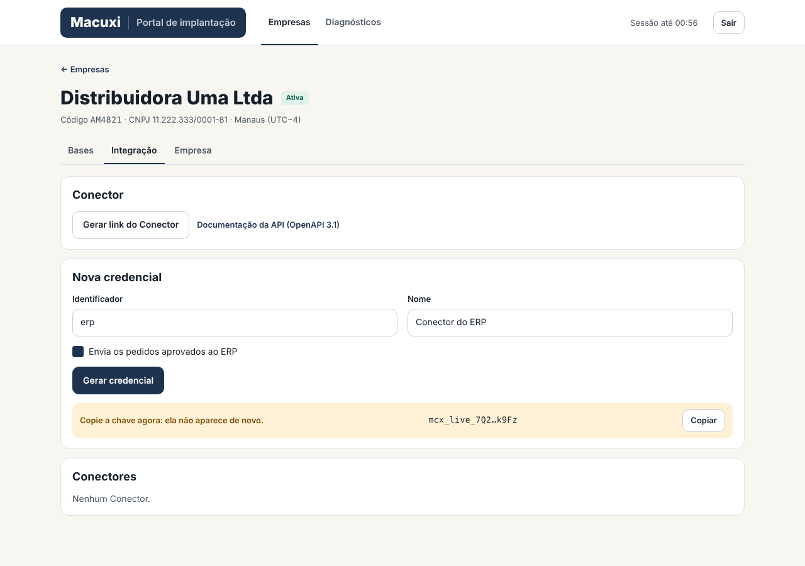 |

## 8. Aba Empresa
> Ver §11: o cartão 1 ("Módulos e licenças" + "Acrescentar módulos") dá lugar ao cartão **"Plano"**. O cartão "Administradores" fica. Simulação nova: `depois-06b-aba-empresa.png`.

Dois cartões: 1. **"Módulos e licenças"** (sem descrições; já licenciado = selo "licenciado", travado) + **"Acrescentar módulos"** (sai "Conferir sem gravar"); resultado **"Módulos acrescentados: Catálogo."**/**"Nada mudou."**; admin do cliente vê só leitura (nome + licenças, sem caixas e sem botão). 2. **"Administradores"** (só time Macuxi): lista + selos "Bloqueado"/"Entra só pelo app" + "Redefinir senha"; sai a ajuda "Quem administra esta empresa no backoffice. Se um deles perdeu a senha, mande uma senha temporária nova por e-mail."; diálogo **"Uma senha temporária vai para {e-mail}. {Nome} sai do Macuxi em todos os aparelhos."**; sucesso **"Senha temporária enviada para {e-mail}."** (sai "Vale até 17/11 às 12:59.": a validade fica só no selo da linha, ajustado pelo RD-0291); e-mail não configurado: **"O envio de e-mail não está configurado neste servidor: nada foi gravado. Confira a configuração de e-mail."** (um texto só: o cartão é só do time da Macuxi e a Equipe saiu no §12; ajustado pelo RD-0292)
Saem três cartões repetidos: "Módulos licenciados", "Empresa" (campos travados que repetem o cabeçalho) e "Administrador da empresa" ("Esta empresa já tem administrador. A senha dele não muda aqui."). Sai: 17 frases, 3 cartões, 1 botão.

| Antes | Depois |
|---|---|
|  | 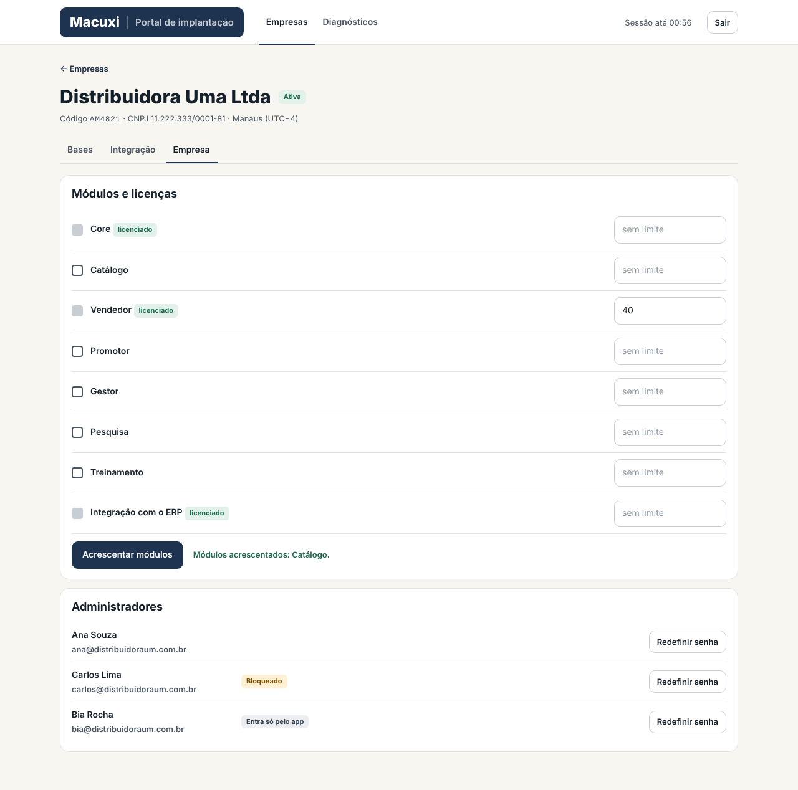 |

## 9. Diagnósticos
Sai o subtítulo "Enviados pelos aparelhos. Ficam 90 dias." inteiro (o RD-0295 propõe manter "Ficam 90 dias."; fica a saída inteira: o prazo é o que o sistema faz por trás e o time não age por ele). A contagem ("12 diagnósticos") só aparece com 1 ou mais; no vazio fica só **"Nenhum diagnóstico com estes filtros."**/**"Nenhum diagnóstico recebido."** (ajustado pelo RD-0294). Resto igual. Sai: 2 + a contagem "0 diagnósticos".

| Antes | Depois |
|---|---|
| 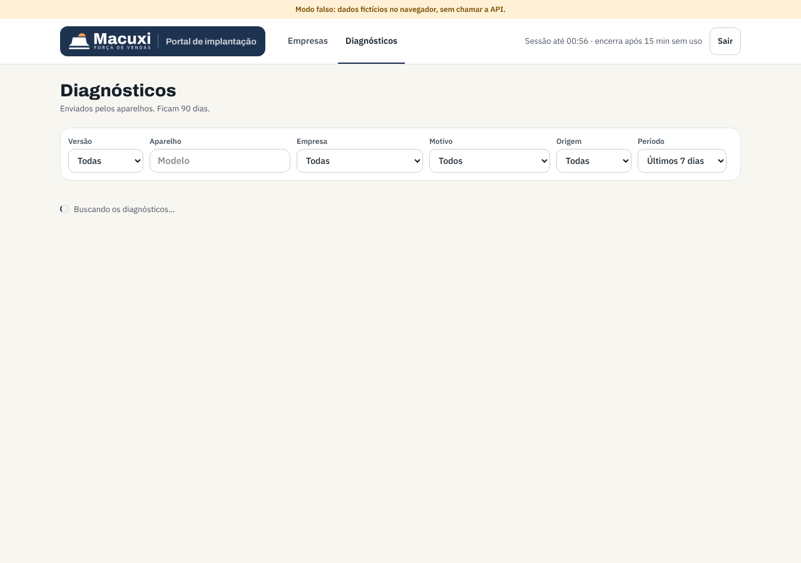 |  |

## Placar
> Substituído pelo placar final do §13.3. Linhas "Aba Bases", "Aba Integração" e "Total" revogadas pelo §10 (placar novo lá). Ver §11.6: "Nova empresa" e "Aba Empresa" mudam de novo.

| Tela | Frases que saem | Além disso |
|---|---|---|
| Moldura | 7 | — |
| Entrar | 1 | — |
| Escolha a empresa | 1 | — |
| Empresas | 3 | 1 botão repetido |
| Nova empresa | 18 | campo Código, cartão Parâmetros (5 campos), "Passo 1", "Conferir sem gravar"; entra UF |
| Aba Bases | até 59 | 16 "Arquivo CSV", 16 "Modo", input em inglês |
| Aba Integração | 6 | — |
| Aba Empresa | 17 | 3 cartões repetidos, "Conferir sem gravar" |
| Diagnósticos | 2 | — |
| **Total** | **até 114** | |

## Achados RD (corretor) e MC (marca)
~~Os recados do corretor-redundancias e do design-de-marca não chegaram a esta sessão (…). Achados MC (cor/layout) idem; o layout novo do cartão de base em uma linha precisa da validação do design-de-marca antes do lote.~~ **Respondidos no §13** (RD-0260 a RD-0295, RD-0089/RD-0090, MC-0021 a MC-0024 e os itens fora de catálogo dos dois pareceres).

## Para o engenheiro-apps
- testIDs ficam; mudam os asserts de texto (`TEXTOS_*`, `CARTAO_DA_ENTIDADE`, `ROTULO_MODO`, `TEXTOS_ADMINS`, `TEXTOS_PORTAL_DIAGNOSTICOS`). Saem `empresa.codigo`, `empresa.alcada-*`, `empresa.validade-orcamento`, `empresa.aplicacao-orcamento`, `empresa.conferir`, `empresa.admin-existente`; entra `empresa.uf`.
- `CARTAO_DA_ENTIDADE[*].descricao` e `ROTULO_MODULO[*].ajuda` saem do código.
- Código UF+4 depende da API (`CriarEmpresaSchema` com `uf` e sem `codigo`; resposta com `codigo`) — dono: engenheiro-software/modulo-core. O modo falso (`lib/portal-falso.ts`) gera `AM4821` igual.

## 10. Adendo — Integração via Conector e via API; CSV fora do portal
> 2026-11-14 · designer-ux · pedido do dono do produto R-20261114-132000-alexandre (chegou pela ponte; não lido no repositório de recados nesta sessão — confirmar). Onde conflitar, o §10 vale sobre §5 (abas), §6, §7 e o Placar.

**Regra:** ou é Conector, ou é API. O CSV sai do portal: a aba Bases (com a Equipe por CSV), o Conector de arquivo e todo texto sobre CSV. (Confirmado pelo §12: nenhum CSV fica no `config.`.)

### 10.1 Abas
Abas da página da empresa: **"Integração" · "Empresa"**; **Integração abre por padrão**. O resto do cabeçalho do §5 fica igual. O §6 (aba Bases) está revogado inteiro.

### 10.2 Aba Integração em dois lados
Dois lados lado a lado, com a mesma largura (≥ 768 px). Abaixo de ~768 px, empilhados: **Conector primeiro**, API depois. Cada lado tem título de seção e, embaixo, só a lista do que já existe.

**Esquerda — "Integração via Conector"** (passos numerados na ordem em que a pessoa age; o círculo do número em Azul noite `bg-accent`, texto branco, ajustado pelo MC-0024):
1. **"Baixar o Conector"**: botão "Gerar o link do Conector"/"Gerando o link…" (texto atual de `TEXTOS_DOWNLOAD_CONECTOR`) → link **"Baixar {arquivo}"**, embaixo **"Versão 1.4.0 · 38 MB"** (sai o nome do arquivo dessa linha: já está no link), **"O link vale até 01:30. Depois disso, gere outro."** e **"SHA-256 {hash}"**. Estados de erro do download sem mudança.
2. **"Gerar a credencial"**: **Identificador** · **Nome** · caixa **"Envia os pedidos aprovados ao ERP"** · **"Gerar credencial"** (principal). Chave gerada: **"Copie a chave agora: ela não aparece de novo."** + chave + **"Copiar"**. Saem o título interno "Credencial do Conector "erp"" e o rodapé "Identificador: erp · escopo integracao.v1 · prefixo mx_…" (ajustado pelo RD-0286; o "cole na configuração" já está no passo 3).
3. **"Instalar e colar a credencial"**: lista numerada, três linhas:
   1. **"Instale o Conector no servidor do ERP."**
   2. **"Cole o identificador e a chave na configuração."**
   3. **"Inicie o serviço."**

Embaixo: **"Conectores"** — tabela **Identificador · Pedidos · Situação**; vazio **"Nenhum Conector."**

**Direita — "Integração via API":**
1. **"Gerar a credencial da API"**: os mesmos campos e textos do passo 2 da esquerda — **Identificador** · **Nome** · **"Envia os pedidos aprovados ao ERP"** · **"Gerar credencial"** (neutro) · chave gerada com o mesmo aviso e "Copiar".
   - Decisão (caixa de pedidos fica): pela API o ERP também busca os pedidos aprovados; a caixa diz se esta credencial pode buscá-los, igual ao Conector.
   - Decisão (botão neutro): um só principal por tela; o principal fica no Conector, que é o primeiro caminho.
2. **"Guia da API"**: botão **"Baixar o guia (PDF)"** + link **"Documentação da API (OpenAPI 3.1)"** (o link sai do lado do Conector: uma informação, um lugar).
   - Decisão: enquanto o PDF não existir, o botão **não aparece** e o cartão fica só com o link do OpenAPI. Sem "O guia chega em breve.": a pessoa não age com esse texto.

Embaixo: **"Credenciais da API"** — tabela **Identificador · Pedidos · Situação** (a coluna Pedidos fica, porque a caixa ficou); vazio **"Nenhuma credencial."**

**Sai:** o diálogo "Passar as bases ao Conector do ERP?" inteiro (título, 3 frases, botões "Gerar só para as bases livres" e "Desativar o de arquivo e passar todas"), o tipo "Carga por arquivo" (`ROTULO_TIPO.arquivo`), "Nenhum Conector ainda. A primeira importação de CSV cria o Conector de arquivo do portal.", "O guia da API (…) chega em breve neste servidor.", "Gera a chave que o Conector…" e "Vai no arquivo de configuração do Conector."

| Antes | Depois, 1280 px (com o link gerado e a chave recém-gerada) | Depois, celular 390 px |
|---|---|---|
|  |  | 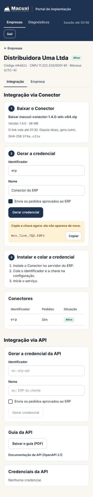 |

A simulação do §7 (`depois-05-integracao.*`) e a do §6 (`depois-04-bases.*`) ficam só como registro.

### 10.3 Nova empresa (§4)
Fica como está: selo **"sempre"** em Core e em Integração com o ERP. **Pergunta ao dono do produto:** sem CSV, toda empresa precisa de Conector ou API; a Integração com o ERP continua "sempre"?

> Ver §11: com os planos, a Nova empresa não lista mais módulos; a pergunta acima passa a ser se todo plano inclui a Integração com o ERP.

### 10.4 Placar novo
> Substituído pelo placar final do §13.3. Linhas "Nova empresa" e "Aba Empresa" atualizadas no §11.6.

| Tela | Frases que saem | Além disso |
|---|---|---|
| Moldura | 7 | — |
| Entrar | 1 | — |
| Escolha a empresa | 1 | — |
| Empresas | 3 | 1 botão repetido |
| Nova empresa | 18 | campo Código, cartão Parâmetros (5 campos), "Passo 1", "Conferir sem gravar"; entra UF |
| Aba Bases | **aba inteira, 17 cartões** (antes: até 59 frases enxugadas; agora sai tudo) | a aba some |
| Aba Integração | 8 | diálogo inteiro (3 botões), tipo "Carga por arquivo"; entram 2 títulos de lado, 3 passos com 3 linhas, 3 cartões da API |
| Aba Empresa | 17 | 3 cartões repetidos, "Conferir sem gravar" |
| Diagnósticos | 2 | — |
| **Total** | **57 frases + a aba Bases inteira (17 cartões)** | |

### 10.5 Para o engenheiro-apps
- **Saem do portal:** `components/portal/cartao-base.tsx`, `components/portal/cartao-equipe.tsx`, `lib/portal-carga.ts`, `lib/portal-carga-rede.ts` (e `portal-carga.test.ts`), `lib/equipe-csv.ts` (e o teste), o Conector de arquivo em `lib/portal-rotas.ts` ("Carga por arquivo (implantação)"), a Equipe por CSV de `lib/portal-falso.ts` e os testIDs `base-*`, `equipe-*` e `integracao.confirmar-*`. Confirmar com o corretor-redundancias se algum deles é usado fora do portal antes de apagar.
- `tela-empresa.tsx`: abas Integração e Empresa; Integração abre por padrão.
- `aba-integracao.tsx`: dois lados (grid de 2 colunas ≥ 768 px; 1 coluna abaixo, Conector primeiro); o botão do Conector passa para dentro do passo 1; `textoDoPacote` sem o nome do arquivo quando o link já o mostra; o link do OpenAPI vai para o cartão "Guia da API"; `integracao.guia` vira o botão do PDF, só quando ele existir.
- **A Equipe passa a vir só pelo ERP (Conector/API) ou pelo BKO.** ~~Pendência — pergunta ao dono do produto: a Equipe por CSV sai mesmo do portal?~~ **Respondida: sim** (§12).
- **Pendência para engenheiro-software / modulo-integracao:** credencial de API separada da do Conector (tipo próprio, ex. o `nuvem` que já existe em `ROTULO_TIPO`, rota que lista só as de API) e o guia da API em PDF (modulo-integracao faz e manda ao designer-ux para revisão de layout). Se a rota não existir, o lado direito mostra só o guia e o link do OpenAPI.

## 11. Adendo — Planos (Light, PME, Enterprise, Corporate) e CNPJ pela Receita
> 2026-11-14 · designer-ux · pedido do dono do produto R-20261114-132600-alexandre (chegou pela ponte; não lido no repositório de recados nesta sessão — confirmar). Onde conflitar, o §11 vale sobre §3 (coluna Módulos), §4 (cartões Empresa e Módulos e licenças), §8 (cartão Módulos e licenças), §10.3 e os placares. Contratos novos (planos e CNPJ) vêm do engenheiro-software.
>
> ~~**A tabela dos planos (preço e licenças) não chegou a esta sessão.** Nenhum preço nem limite foi inventado: a spec e as simulações usam os marcadores `{preço}` e `{licenças}`, **a confirmar pela tabela do recado**.~~
> **Fechamento (14/11):** a tabela chegou pela ponte (recado do dono do produto R-20261114-132600, a tabela que faltava) e foi conferida contra o contrato `packages/platform-sdk/src/planos.ts` e a ADR 0046 (branch `nuvem/planos-engenheiro-software`). Os valores batem com o contrato (preço mensal e anual = 10 × o mensal); as diferenças de forma e o que a spec segue estão no §11.9. A tela mostra reais; o contrato guarda centavos (`preco_mensal_centavos`, `preco_unitario_centavos`, `valor.*_centavos`).

**Premissa:** os módulos da empresa passam a vir do **plano + adicionais**. O cartão "Módulos e licenças" sai do Criar empresa e da aba Empresa; o portal não marca mais módulo por módulo.

### 11.1 Ordem do Criar empresa
**CNPJ → dados preenchidos → Plano → Adicionais → Ciclo e teste → Administrador → "Criar empresa" com o "Total" ao lado.** Um só botão principal (52 px), no fim.

### 11.2 Cartão "Empresa" com o CNPJ pela Receita
- **CNPJ** no topo, sozinho na primeira linha (máscara `00.000.000/0000-00`, placeholder igual). A busca dispara **ao sair do campo** com 14 dígitos válidos.
- Embaixo, sempre visíveis (vazios até a busca, para quem preenche à mão): **Razão social · Nome fantasia** / **Endereço** (linha inteira) / **Município · UF · Fuso** / **Telefone · E-mail** / **Situação · CNAE**.
- A busca preenche **razão social, nome fantasia, endereço, município, UF, situação, CNAE, telefone e e-mail**. A UF gera o código UF+4 (§4, §5), como antes. O **Fuso** vem pré-escolhido pela UF/município e continua editável (ex.: AM → Manaus (UTC−4)).
- **Decisão (edição):** todos os campos preenchidos continuam **editáveis**, exceto **Situação** e **CNAE**, que são **só leitura** (fundo cinza, sem borda) porque vêm da Receita e não mudam no portal. Se a Receita estiver fora, Situação e CNAE ficam vazios e a empresa pode ser criada sem eles.
- Editar o CNPJ de novo limpa o estado e busca outra vez ao sair; os campos que a pessoa editou à mão **não são sobrescritos** sem ela apagar (decisão: não perder digitação).
- Nenhum texto explicando a consulta (sem "Os dados vêm da Receita Federal").

**Estados do campo CNPJ** (uma frase, embaixo do campo, `aria-live="polite"`; somem quando a pessoa edita o CNPJ):

| Estado | Campo | Texto final |
|---|---|---|
| Vazio | placeholder `00.000.000/0000-00` | — |
| Buscando | indicador girando à direita, campo travado | **"Buscando na Receita…"** |
| Encontrado | ✓ à direita | — (decisão: sem texto; os campos preenchidos já mostram o resultado) |
| CNPJ inválido (dígito verificador ou menos de 14 dígitos) | borda de erro | **"CNPJ inválido. Confira os 14 dígitos."** |
| Não encontrado | borda de erro | **"CNPJ não encontrado na Receita."** |
| Receita fora (tempo esgotado, 5xx, limite de consultas) | borda de alerta + link **"Tentar de novo"** à direita | **"Não deu para buscar na Receita. Preencha os campos ou tente de novo."** |
| Situação não ativa (baixada, suspensa, inapta, nula) | borda de alerta; os campos se preenchem | **"CNPJ {situação} na Receita."** (ex.: "CNPJ baixado na Receita.", "CNPJ suspenso na Receita.", "CNPJ inapto na Receita."; `{situação}` no masculino, minúsculo) |

- **Decisão (situação não ativa):** alerta, **não bloqueia** o "Criar empresa". Pergunta ao dono do produto no §11.7.
- CNPJ que já tem empresa no Macuxi: segue o erro da API que já existe ao criar (sem mudança).

### 11.3 Cartões "Plano", "Adicionais" e "Ciclo"
1. **"Plano"**: 4 cartões de **escolha única** (rádio), em uma linha (2 × 2 abaixo de 768 px), só os planos `ativo`, na `ordem` do catálogo (`GET ROTA_PORTAL_PLANOS`, `ListaPlanosSchema`). Cada cartão tem 3 linhas e nada mais: **nome** · **preço** · **licenças**. Sem descrição e sem o desconto por licença (já está no preço). Sem pré-seleção; sem plano, erro no cartão **"Escolha o plano."** Selecionado: borda de destaque de 2 px + rádio cheio.

   | Plano (`codigo`) | Mensal | Anual | Licenças |
   |---|---|---|---|
   | **Light** (`light`) | **R$ 610,00/mês** | **R$ 6.100,00/ano** | **10 vendedores · 1 gestor · 1 BKO** |
   | **PME** (`pme`) | **R$ 1.197,00/mês** | **R$ 11.970,00/ano** | **20 vendedores · 2 gestores · 3 BKO** |
   | **Enterprise** (`enterprise`) | **R$ 1.719,00/mês** | **R$ 17.190,00/ano** | **30 vendedores · 3 gestores · 5 BKO** |
   | **Corporate** (`corporate`) | **R$ 2.592,50/mês** | **R$ 25.925,00/ano** | **50 vendedores · 5 gestores · 5 BKO** |

   - Preço: `preco_mensal_centavos` formatado em reais; no Anual, `valorDaAssinatura(plano, [], 'anual').por_ciclo_centavos` (= mensal × (12 − `meses_gratis_anual`)). Os números vêm do catálogo, nunca de constante na tela.
   - Licenças: de `licencas` (vendedor, gestor, bko), singular com 1 ("1 gestor"), "BKO" invariável; tipo com 0 não aparece (o `promotor` é 0 em todos os planos); `null` = "{tipo} sem limite".
   - **Decisão (selo "2 meses grátis"):** fica **só no alternador "Anual"** do cartão Ciclo, visível nos dois ciclos; no Anual, o cartão do plano mostra só **"R$ 6.100,00/ano"**. O pedido previa o selo também no cartão; com o do alternador seriam 5 selos iguais na mesma tela (uma informação, um lugar).
2. **"Adicionais"**: três caixas, cada uma com nome + preço, **o mesmo em todos os planos**:
   - **"Promotor avulso · R$ 80,00 por licença/mês"**;
   - **"Pesquisa · R$ 10,00 por usuário/mês"**;
   - **"Treinamento · R$ 10,00 por usuário/mês"**.
   - Marcada, a caixa mostra o campo **"Quantidade"** (inteiro, mínimo 1, padrão 1, máximo 100.000): no Promotor avulso são as licenças; na Pesquisa e no Treinamento, os usuários com o módulo liberado (o contrato pede `quantidade` nos três: `AdicionalContratadoSchema`, RN-PLA-03; ver §11.9). Vazio ou 0: **"Informe a quantidade."** `aria-label` **"Quantidade de {adicional}"**.
   - Preço: `plano.adicionais[].preco_unitario_centavos`. Nenhum plano inclui adicional (`incluidos` = 0), então os três aparecem em todos; adicional que o plano não vende (fora de `plano.adicionais`) não aparece.
3. **"Ciclo"**: alternador **Mensal / Anual** (padrão **Mensal**); no Anual, selo curto **"2 meses grátis"** (de `meses_gratis_anual`). Ao lado, a caixa **"Começar com 14 dias de teste"** (de `dias_teste`; vai em `com_teste`), **marcada por padrão**.
   - **Decisão (teste):** caixa marcada por padrão. No caso comum (começar em teste) é **zero ação**; quem já fecha contrato desmarca com um toque. O "estado padrão sem caixa" exigiria outra tela para começar sem teste. Decisão padrão, aguardando o dono do produto (§11.7, 1).
4. **Total do pedido (decisão: aparece)**: uma linha ao lado do "Criar empresa": **"Total: R$ 1.537,00/mês"** (Mensal) ou **"Total: R$ 15.370,00/ano"** (Anual). A tela calcula com `valorDaAssinatura(plano, adicionais, ciclo).por_ciclo_centavos` e confere com `valor.por_ciclo_centavos` da resposta (`CriarEmpresaComPlanoRespostaSchema.valor`). Some sem plano escolhido. Motivo: cada parcela já está no seu cartão, a soma não está em lugar nenhum, e é o número que o time confere com o cliente antes de criar. Sem texto sobre cobrança ou teste.
   - Exemplo da simulação: PME R$ 1.197,00 + 3 × R$ 80,00 + 10 × R$ 10,00 = **R$ 1.537,00/mês** (153.700 centavos).

Envio: `POST ROTA_PORTAL_EMPRESA_COM_PLANO` (`CriarEmpresaComPlanoSchema`) com `assinatura: { plano: codigo, ciclo, adicionais: [{ adicional, quantidade }], com_teste, pedido_id }` (`pedido_id` gerado no portal).

Sucesso, como no §4: **"Empresa criada. Código da empresa: AM4821."** Erro geral: **"Confira os campos marcados."**

| Depois — Nova empresa (CNPJ preenchido, PME, Promotor avulso 3 e Pesquisa 10, total) | Depois — estados do campo CNPJ |
|---|---|
| 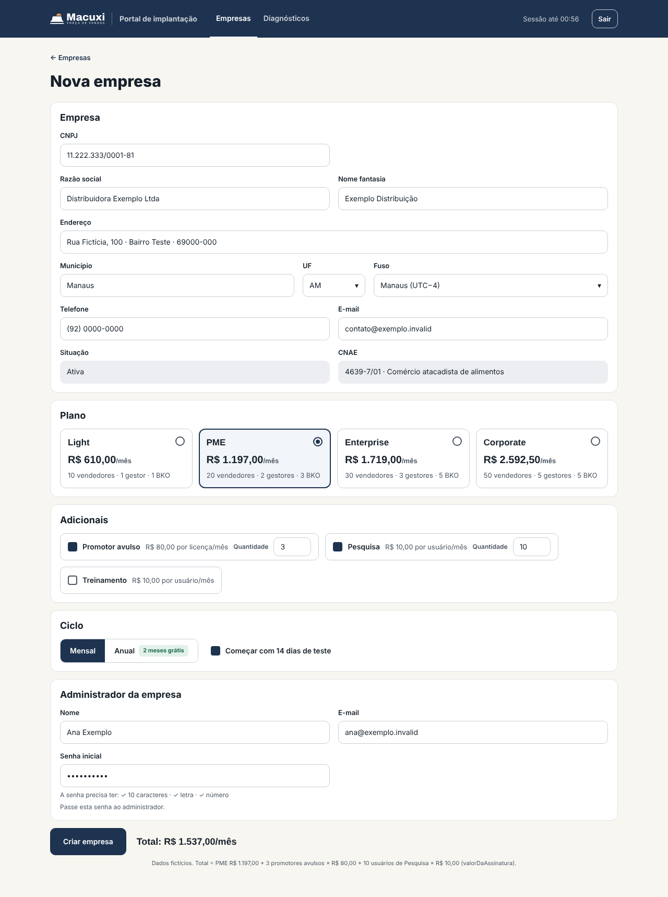 | 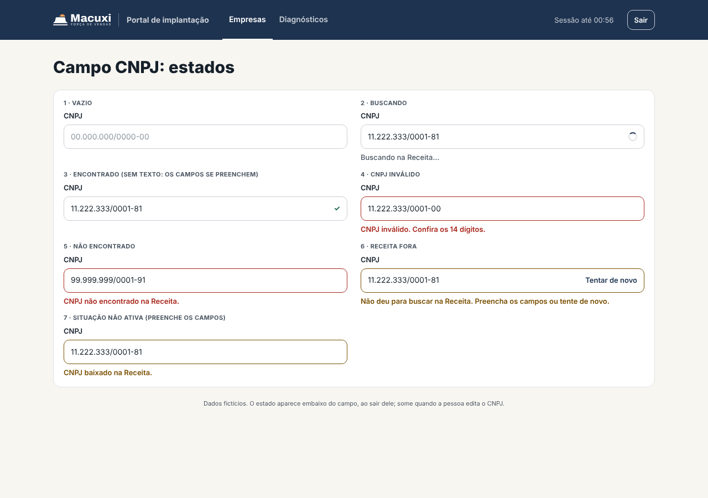 |

### 11.4 Aba Empresa: cartão "Plano"
Ordem dos cartões: **"Plano"** → **"Administradores"** (§8). Dados da ficha: `GET rotaPortalAssinatura(tenantId)` (`FichaAssinaturaSchema`).
- Linha de cima: **nome do plano** (ex.: **PME**) · selo **"Mensal"**/**"Anual"** (`ciclo`) · se `teste_ate` e não `paga`, selo de alerta **"Teste até 27/11/2026"** (data no fuso do tenant; 14 dias a partir de 14/11 terminam em 27/11, `fimDoTeste`) · valor **"R$ 1.537,00/mês"** (ou **"R$ 15.370,00/ano"**; `valor.por_ciclo_centavos`) · à direita **"Trocar de plano"** (principal: é a única ação da aba).
- Tabela **Licenças · Em uso · Contratadas** (`licencas[]`, `em_uso` e `contratadas`): **Vendedor**, **Gestor** e **BKO** sempre; **Promotor avulso**, **Pesquisa** e **Treinamento** só quando contratados (`contratadas` ≠ 0). `contratadas` = `null`: **"sem limite"**. Em uso = contratadas: número em cor de alerta **com o texto "no limite"** (ex.: **"2 · no limite"**; cor nunca sozinha).
- ~~Embaixo, uma linha: "Adicionais: Promotor avulso · Pesquisa" (some se não houver).~~ **Sai:** repetia as linhas Promotor avulso e Pesquisa da tabela (uma informação, um lugar).
- **"Trocar de plano"**: o cartão dá lugar ao **mesmo seletor do Criar empresa** (Plano + Adicionais + Ciclo, sem a caixa de teste), com o plano atual marcado **"Atual"** e já selecionado, os adicionais e as quantidades atuais marcados; ao mudar, o botão vira **"Trocar para {plano}"** (principal) + **"Cancelar"**, com a linha **"Total: R$ 20.590,00/ano"** ao lado. Sem mudança, o botão fica desabilitado como **"Trocar de plano"**. Envio: `PUT rotaPortalAssinatura(tenantId)` (`TrocarPlanoSchema`, com `pedido_id`).
  - Sucesso: aviso success fechável **"Plano trocado: Enterprise."**
  - Plano abaixo do uso (`conferirTrocaDePlano` na tela; 422 `PLANO_ABAIXO_DO_USO` na API, `detalhes.problemas[].mensagem`): erro no cartão do plano, uma linha por item, botão desabilitado. Texto do contrato: **"O plano Light tem 10 licenças de vendedor e a empresa usa 14."** ~~"{Plano} tem {n} licenças de {tipo}; {m} em uso. Desative {m−n} antes de trocar."~~ A frase do contrato não diz a ação: pedido ao engenheiro-software para acrescentar **"Inative 4 antes de trocar."** (recados-pendentes.md); até lá, vale a do contrato.
  - Plano atual fora de venda (`PLANO_INATIVO`): **"O plano {nome} não está mais à venda."** (do contrato), no cartão dele.
  - Quando a troca vale e como cobra: a tela não explica cobrança.
- **Decisão (admin do cliente):** vê o cartão **só leitura** (plano, selos, valor, tabela), **sem "Trocar de plano"** (o `PUT` é só do super-admin). Decisão padrão, aguardando o dono do produto (§11.7, 2).
- Saem do §8: "Módulos e licenças" (8 linhas com caixa e campo Licenças, selos "licenciado"), "Acrescentar módulos" e os resultados "Módulos acrescentados: …"/"Nada mudou.".

| Depois — aba Empresa (cartão Plano + Administradores; embaixo, o seletor aberto pelo "Trocar de plano", no Anual) |
|---|
| 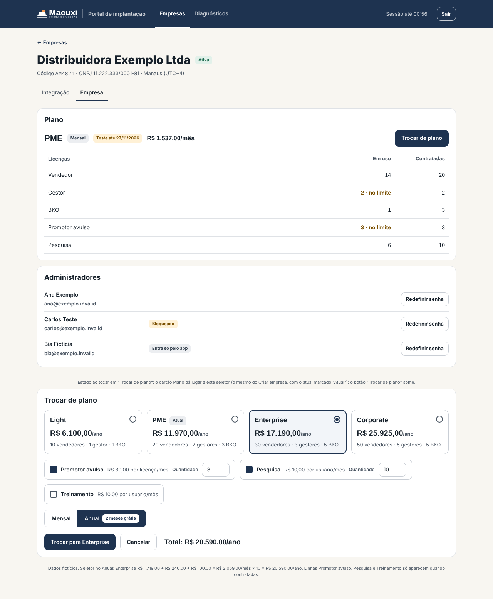 |

### 11.5 Lista de Empresas (§3)
Tabela **Empresa · Código · CNPJ · Plano · Situação · Criada em**. A coluna Plano mostra o nome (ex.: "PME"); em teste, o selo **"teste"** ao lado. Sem simulação nova (só troca o cabeçalho e o conteúdo da coluna).

### 11.6 Placar (substitui as linhas "Nova empresa" e "Aba Empresa" do §10.4)
> Substituído pelo placar final do §13.3.
| Tela | Sai | Entra |
|---|---|---|
| Empresas | coluna "Módulos" | coluna "Plano" (+ selo "teste") |
| Nova empresa | 18 frases, campo Código, cartão Parâmetros (5 campos), "Passo 1", "Conferir sem gravar" (§4) **+ cartão "Módulos e licenças" (8 linhas, 8 campos Licenças, 2 selos "sempre")** | CNPJ no topo com 5 textos de estado; 7 campos novos preenchidos pela Receita (nome fantasia, endereço, município, telefone, e-mail, situação e CNAE — os 2 últimos só leitura); UF e Fuso pré-preenchidos; cartões **Plano** (4 opções), **Adicionais** (3 caixas), **Ciclo** (Mensal/Anual + "2 meses grátis" + caixa do teste) |
| Aba Empresa | 17 frases, 3 cartões repetidos, "Conferir sem gravar" (§8) **+ cartão "Módulos e licenças", botão "Acrescentar módulos", 2 resultados** | cartão **Plano** (nome, ciclo, fim do teste, tabela em uso/contratadas por tipo, adicionais, "Trocar de plano" com o seletor) |

Total de frases que saem: 57 (§10.4) + 2 ("Módulos acrescentados…", "Nada mudou.") = **59 frases + a aba Bases inteira**. Entram 9 textos de estado/erro, todos de ação: 5 do CNPJ, "Escolha o plano.", "Plano trocado: {plano}.", o de licenças em uso e "no limite".

### 11.7 Perguntas ao dono do produto
1. **Teste de 14 dias:** caixa "Começar com 14 dias de teste" marcada por padrão — ou toda empresa começa em teste, sem caixa? **Decisão padrão, aguardando o dono do produto.**
2. **Admin do cliente:** vê o plano só leitura, sem "Trocar de plano" — ou ele mesmo pode trocar? **Decisão padrão, aguardando o dono do produto.**
3. **CNPJ não ativo** (baixado, suspenso, inapto): só alerta — ou bloqueia o "Criar empresa"? **Decisão padrão, aguardando o dono do produto.**
4. ~~**Integração com o ERP** (§10.3): todo plano inclui?~~ **Respondida: sim.** Todos os planos incluem Core, Catálogo, Vendedor, Gestor e Integração com o ERP (pela ponte, 14/11; no contrato, `core` e `integracao` entram sempre, `modulosDaAssinatura`).
5. ~~**Tabela dos planos** (preço por ciclo, licenças por tipo, preço dos adicionais, se Promotor avulso é por licença): não chegou a esta sessão.~~ **Respondida:** tabela no §11.3; Promotor avulso é por licença; tipos de licença: vendedor, gestor, BKO e promotor avulso.
6. ~~**Equipe por CSV** (§10.5): sai mesmo do portal?~~ **Respondida: sim** (§12).

### 11.8 Para o engenheiro-apps
- **testIDs (alinhados ao `planos.ts`):** `empresa.cnpj` (com `data-estado` = `vazio|buscando|encontrado|invalido|nao-encontrado|receita-fora|nao-ativa`), `empresa.cnpj-tentar`, `empresa.nome-fantasia`, `empresa.endereco`, `empresa.municipio`, `empresa.telefone`, `empresa.email`, `empresa.situacao`, `empresa.cnae`, `empresa.plano-<codigo>` (`light|pme|enterprise|corporate`, o `codigo` do catálogo), `empresa.adicional-<adicional>` (`promotor|pesquisa|treinamento`, os valores de `ADICIONAIS`; antes `promotor-avulso`), `empresa.adicional-<adicional>-qtd` (antes só `empresa.adicional-promotor-avulso-qtd`), `empresa.ciclo-<mensal|anual>` (`CICLOS`), `empresa.teste` (`com_teste`), `empresa.total`; na aba Empresa `empresa-plano.cartao`, `empresa-plano.nome`, `empresa-plano.ciclo`, `empresa-plano.teste-ate`, `empresa-plano.valor`, `empresa-plano.uso-<item>` (`vendedor|gestor|bko|promotor|pesquisa|treinamento`, os valores de `ITENS_CONTADOS`), `empresa-plano.trocar`, `empresa-plano.confirmar`, `empresa-plano.cancelar`, `empresa-plano.erro`, `empresa-plano.total`.
- **Rótulos na tela por item:** `vendedor` = "Vendedor", `gestor` = "Gestor", `bko` = "BKO", `promotor` = "Promotor avulso", `pesquisa` = "Pesquisa", `treinamento` = "Treinamento".
- **Saem:** os testIDs e o código do cartão "Módulos e licenças" no Criar empresa e na aba Empresa (`empresa.modulo-*`, `empresa.licencas-*`, `empresa.acrescentar-modulos` ou equivalentes) e `ROTULO_MODULO` no portal, se não for usado em outro lugar (confirmar com o corretor-redundancias).
- O seletor de planos é **um componente só**, usado no Criar empresa e no "Trocar de plano" (prop `atual`).
- **Contratos:** planos entregues pelo engenheiro-software em `packages/platform-sdk/src/planos.ts` (ADR 0046): `ListaPlanosSchema`, `CriarEmpresaComPlanoSchema`/`CriarEmpresaComPlanoRespostaSchema`, `FichaAssinaturaSchema`, `TrocarPlanoSchema`, `valorDaAssinatura`, `conferirTrocaDePlano`, `fimDoTeste`; rotas atrás de `MACUXI_PLANOS` (404 com a flag desligada = passo Empresa atual). Falta o contrato de **CNPJ** (consulta → campos e códigos `invalido`, `nao_encontrado`, `indisponivel`; situação). Dinheiro formatado de centavos (`R$ 1.234,00`). O modo falso (`lib/portal-falso.ts`) usa os valores do §11.3.

### 11.9 Tabela da ponte × contrato (`planos.ts`, ADR 0046)
Os números batem: Light 10 × 50 + 1 × 70 + 1 × 40 = R$ 610,00; PME (1.000 + 140 + 120) × 0,95 = R$ 1.197,00; Enterprise (1.500 + 210 + 200) × 0,90 = R$ 1.719,00; Corporate (2.500 + 350 + 200) × 0,85 = R$ 2.592,50; anual = 10 × mensal nos quatro. A spec segue o contrato nas diferenças de forma:

| Ponto | Tabela da ponte | Contrato | A spec segue |
|---|---|---|---|
| Quantidade dos adicionais | só o Promotor avulso tem "Quantidade" | `AdicionalContratadoSchema.quantidade` (≥ 1) nos três; Pesquisa e Treinamento contam usuários liberados (RN-PLA-03) e a trava usa esse número | campo **Quantidade** nos três (§11.3, 2) |
| Desconto por licença (−5%, −10%, −15%) | coluna própria | não existe campo: só `preco_mensal_centavos`, já com o desconto | a tela não mostra o desconto |
| Preço anual | coluna própria | calculado: mensal × (12 − `meses_gratis_anual`), `valorDaAssinatura` | a tela calcula; não há campo |
| Código do adicional | "Promotor avulso" | `promotor` | rótulo "Promotor avulso", id `promotor` |
| Código dos planos | só o nome | `codigo` do catálogo (seed do banco-dados) | `light`, `pme`, `enterprise`, `corporate` (premissa; confirmar no seed) |
| Ficha | vendedor, gestor, BKO, promotor avulso | 6 itens (`ITENS_CONTADOS`), com Pesquisa e Treinamento | 3 linhas sempre + as dos adicionais contratados (§11.4) |
| Teste | — | `dias_teste` (14) e `com_teste`; fim = hoje + 14 − 1 | "Teste até 27/11/2026" (antes 28/11 na simulação) |
| Licença de promotor no plano / adicional incluso | "nenhum plano inclui" | `licencas.promotor` e `adicionais[].incluidos` existem | seed com 0 nos dois (banco-dados) |

## 12. Adendo — o `config.` cadastra só o admin da conta do cliente
> 2026-11-14 · designer-ux · pedido do dono do produto R-20261114-133000-alexandre (chegou pela ponte; não lido no repositório de recados nesta sessão — confirmar). Responde a pergunta do §10.5 e do §11.7 item 6 ("a Equipe por CSV sai mesmo do portal?"): **sim**.

- O `config.` cadastra **só o administrador da conta do cliente** (cartão "Administrador da empresa" do Criar empresa, §4 item 3, e cartão "Administradores" da aba Empresa, §8 e §11.4).
- **Sai o cartão Equipe inteiro**: modelo, CSV e importação (já fora com a aba Bases no §10). Os demais usuários o admin cadastra **no BKO**.
- Dos cartões de usuários, **fica só "Administradores"**. **Nenhum CSV fica no `config.`**: todo trecho anterior que cite CSV (§6, o diálogo "Passar as bases ao Conector do ERP?" do §7, a linha "Aba Bases" do Placar) está **revogado pelo §12** (e já pelo §10).
- **Simulações:** nenhuma nova. As do §10 e do §11 (`depois-03b-*`, `depois-03c-*`, `depois-05b-*`, `depois-06b-*`) não mostram a Equipe nem CSV; só `depois-04-bases.*` mostra (cartão Equipe = 1), e ela fica só como registro.
- **Placar:** não muda; a aba Bases, com a Equipe dentro, já sai inteira no §10.4.
- **Para o engenheiro-apps:** nada além do §10.5 (saem `cartao-equipe.tsx`, `lib/equipe-csv.ts`, a Equipe de `lib/portal-falso.ts` e os testIDs `equipe-*`).
